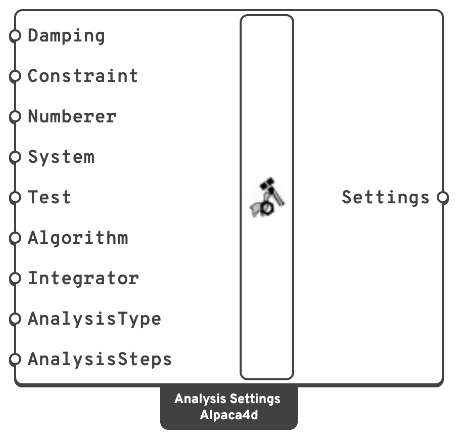

# Analysis Settings

Collects every object OpenSees needs to define an analysis into one bundle, which
[Run Analysis](run-analysis.md) then executes.

## 🔧 Grasshopper component

`Analysis Settings (Alpaca4d)` — **Alpaca4d ▸ 07_Analysis**

<figure><figcaption></figcaption></figure>

### Inputs

| Name | Nick | Type | Default | Description |
| --- | --- | --- | --- | --- |
| Damping | `Damping` | Damping | *(none)* | Rayleigh damping, from [Damping](damping.md). Leave empty for an undamped run. |
| Constraint | `Constraint` | Text | `Transformation` | Constraint handler: `Plain`, `Transformation`. |
| Numberer | `Numberer` | Text | `RCM` | DOF numbering: `RCM`, `AMD`, `Plain`. |
| System | `System` | Text | `SparseSPD` | Linear system solver: `BandGen`, `BandSPD`, `ProfileSPD`, `SuperLU`, `UmfPack`, `SparseSYM`, `SparseSPD`, `SparseGeneral`, `FullGeneral`. |
| Test | `Test` | Test | — | Convergence test, from [Test](test.md). |
| Algorithm | `Algorithm` | Text | `Newton` | Solution algorithm: `Linear`, `Newton`, `NewtonLineSearch`, `ModifiedNewton`, `KrylovNewton`, `SecantNewton`, `BFGS`, `Broyden`. |
| Integrator | `Integrator` | Integrator | — | From [Integrator](integrator.md). |
| AnalysisType | `AnalysisType` | Text | `Static` | `Static` or `Transient`. |
| AnalysisSteps | `AnalysisSteps` | AnalysisStep | — | From [Analysis Step](analysis-step.md). |

Attach a **Value List** to any of the text inputs and Alpaca4d fills it with the valid
options.

### Outputs

| Name | Nick | Type | Description |
| --- | --- | --- | --- |
| Settings | `Settings` | Settings | The analysis definition, for [Run Analysis](run-analysis.md). |

## 💡 Choosing the values

**Constraint handler.** Leave it at `Transformation`. `Plain` cannot handle
[rigid diaphragms](../constraints/diaphragm.md) or
[rigid links](../constraints/rigid-link.md), and gives a wrong answer rather than an error
when it meets one.

**Algorithm.** `Newton`, the default, re-forms the tangent every iteration. On an elastic model
it is about 20 % slower than `Linear`, and on a yielding one it is what lets the step converge at
all. `Linear` does one solve with no iteration. On a non-linear model it still reports success,
and returns the unconverged first guess. `ModifiedNewton` re-forms the tangent less often, and
`KrylovNewton` often converges where Newton does not.

**System.** `SparseSPD` suits most structural models, which are symmetric and positive
definite. `UmfPack` or `SparseGeneral` handle a non-symmetric system — which is what you get
from a corotational transformation, among other things. `FullGeneral` is for small models
and debugging only.

**Analysis type.** `Static` for anything where inertia does not matter, including a pushover.
`Transient` whenever time is real: a ground motion, an impact, a machine.

## 📈 When to use it

**Use it when** you are running anything through [Run Analysis](run-analysis.md).

**Do not use it when** you only want modes → [Natural Vibration](natural-vibration.md) needs
no settings.

## 🔗 Relation to OpenSees

The component writes the standard analysis block:

```tcl
rayleigh    $alphaM $betaKcurr $betaKinit $betaKcomm
constraints $constraintType
numberer    $numbererType
system      $systemType
test        $testType $tol $iter $flag $norm $maxIncr
algorithm   $algorithmType
integrator  $integratorType ...
analysis    $analysisType
set alpacaAnalyzeOk [analyze $numIncr $dt $dtMin $dtMax $jd]
```
