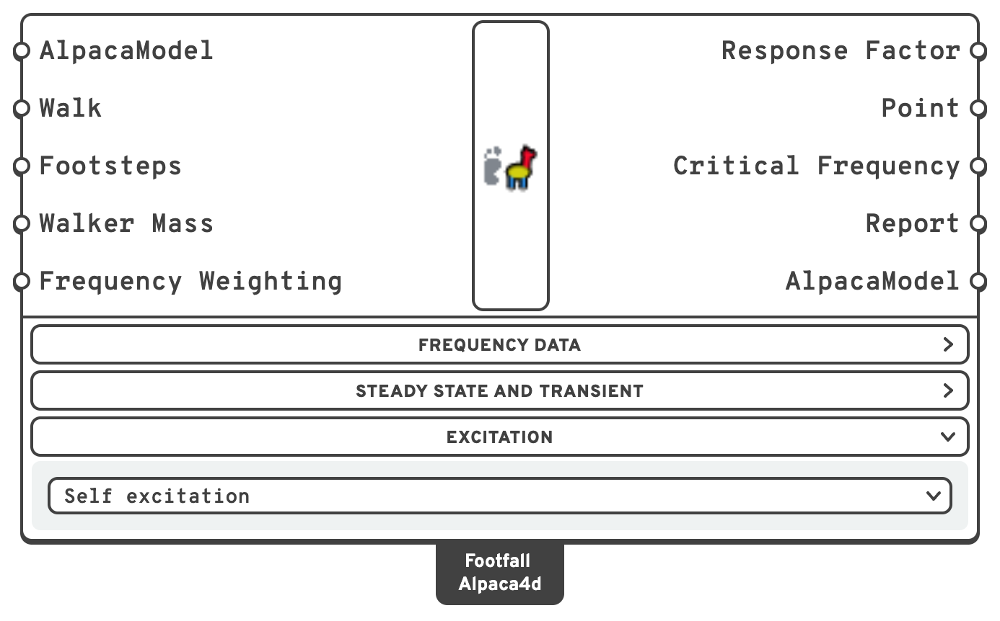
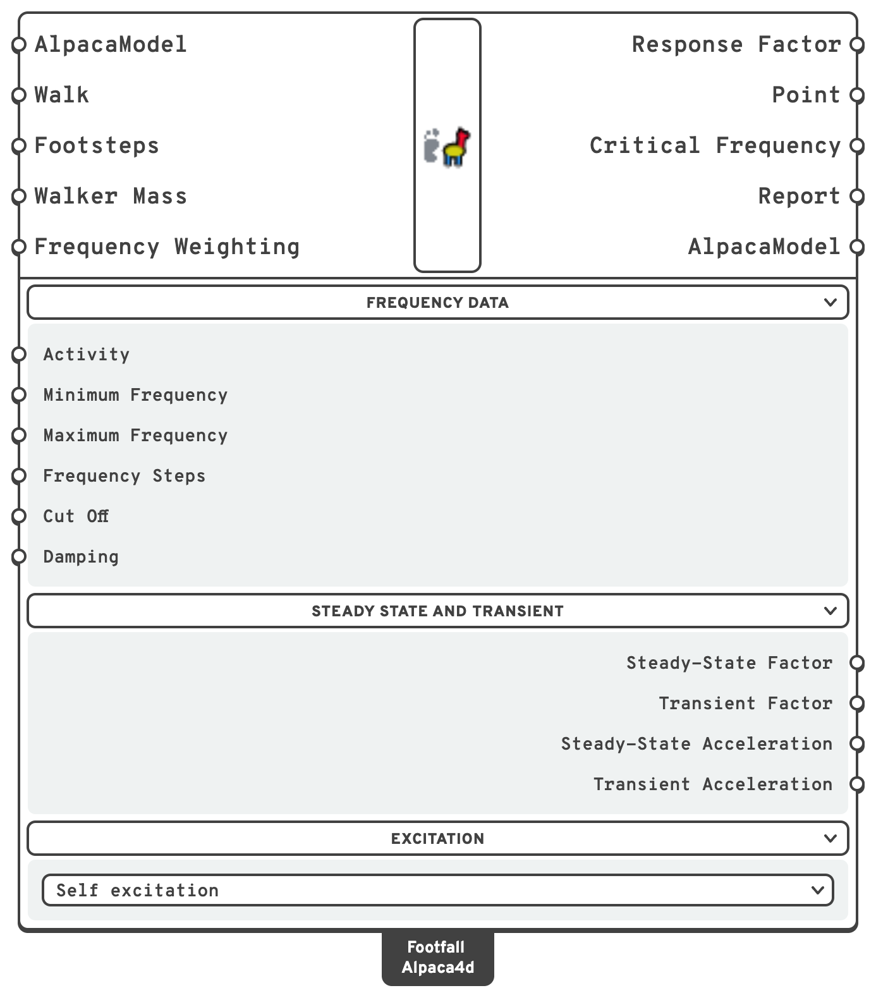

# Footfall Analysis

How much a floor or a stair shakes when someone walks on it, as a **response factor** R: the
weighted acceleration over the threshold of perception, where R = 1 is just felt. Read where the
walker stands (self excitation), or anywhere else for a walker anywhere (full excitation): walking in
a corridor can shake an office next to it. It follows SCI P354, *Design of Floors for Vibration: A
New Approach* (Smith, Hicks and Devine, revised 2009), with its Fourier coefficients for walking
(Table 3.1) and for stairs (Table 3.2).

## 🔧 Grasshopper component

`Footfall Analysis (Alpaca4d)` — **Alpaca4d ▸ 07_Analysis**, nickname `Footfall`

<figure><figcaption></figcaption></figure>

<figure><figcaption>
With every menu open
</figcaption></figure>

A switcher component: pick **Self excitation** or **Full excitation** in the **Excitation**
drop-down under it, or right-click it ▸ **Units**. The body holds what changes from one check to the
next: the model, where people walk and, in full excitation, where it is felt, the footsteps, the
walker and the weighting, and the response factor. The activity, the paces, the cut-off and the
damping are in the **Frequency data** menu below it, and the steady-state and transient responses
apart in the **Steady state and transient** menu. Both stay folded until you open them.

It works from the modes of [Natural Vibration](natural-vibration.md) and runs nothing in OpenSees
itself. It reads them from the recorder file exactly as OpenSees wrote them, scaled to unit
modal mass (mass-normalised), rather than with the largest translation of 1 that Model View shows:
the modal masses are in them.

### Inputs — Self excitation

The walker shakes the point it stands on, which P354 takes as the worst place in most cases.

| Name | Nick | Type | Default | Description |
| --- | --- | --- | --- | --- |
| AlpacaModel | `AlpacaModel` | Model | — | The model from [Natural Vibration](natural-vibration.md): its modes and their frequencies. Solve for modes up to 2 Hz past **Cut Off**, or twice the fundamental frequency if that is higher. |
| Walk | `Walk` | Point (list) | *(empty)* | Where people walk, and where the response is read. Each point takes the model's nearest node: the vertices of the meshes the shells were made from are the nodes themselves. Leave empty for the nodes of every shell element - slabs, treads, landings - or every node of a model with no shells. See [Where the walker goes](#where-the-walker-goes). |
| Footsteps | `Footsteps` | Integer | *(empty)* | How many steps the walker takes along the path: its length over the stride, about 0.75 m at 2 Hz. The steady-state response builds up step by step, so a short path gives less: the resonance build-up factor ρ = 1 − e^(−2π ζ N). Leave empty for a path long enough to reach the steady state, ρ = 1. |
| Walker Mass | `Walker Mass` | Number | `76` | The walker's mass, in `kg`. P354 takes 76 kg, a weight Q of 746 N. |
| Frequency Weighting | `Frequency Weighting` | Text | `Wb` | How much of each frequency a person feels, P354 Table 5.1. `Wb`: offices, homes, wards, general laboratories, workshops, circulation and stairs. `Wg`: critical areas such as operating theatres and precision laboratories. `None`: every frequency in full, which is conservative. |
| Activity | `Activity` | Text | `Walking` | Which of P354's Fourier coefficients load the structure. `Walking`: on a floor, Table 3.1, four harmonics. `Stairs`: up or down a stair, Table 3.2 from ISO 10137, two harmonics; for a welded steel stair, use it with a **Cut Off** of 12 Hz and 0.5% damping. Connect a **Value List** to pick it. In the **Frequency data** menu. |
| Minimum Frequency | `Minimum Frequency` | Number | `1.8` | The slowest pace tried, in footfalls per second, `Hz`. P354: 1.8 Hz walking, and 1.8 Hz alone in homes and operating theatres; stairs from 1.2 Hz. In the **Frequency data** menu. |
| Maximum Frequency | `Maximum Frequency` | Number | `2.2` | The fastest pace tried, `Hz`. P354: 2.2 Hz walking; up to 4.5 Hz on a fast stair descent. In the **Frequency data** menu. |
| Frequency Steps | `Frequency Steps` | Integer | `41` | How many paces are tried, evenly spaced from **Minimum** to **Maximum Frequency**, both included. A lightly damped structure resonates over a narrow band of paces, so try them closely: 41 over 1.8 to 2.2 Hz is one every 0.01 Hz. In the **Frequency data** menu. |
| Cut Off | `Cut Off` | Number | `10` | P354's low to high frequency cut-off, `Hz`, from Table 6.1: 10 for general floors and offices, 8 for enclosed spaces such as operating theatres and homes, 12 for stairs. See [Which response counts](#which-response-counts). In the **Frequency data** menu. |
| Damping | `Damping` | Number | `0.03` | The damping ratio of every mode: 0.03 is 3%. P354 Table 4.1: 0.5% for fully welded steel such as a stair, 1.1% for a bare floor, 3% for a floor fitted out and furnished, 4.5% with partitions across the modes. In the **Frequency data** menu. |

### Inputs — Full excitation

For each point where it is felt, the walker is tried at every point where people walk, and the worst
is kept. The other inputs are Self excitation's.

| Name | Nick | Type | Default | Description |
| --- | --- | --- | --- | --- |
| AlpacaModel | `AlpacaModel` | Model | — | The model from [Natural Vibration](natural-vibration.md), as in self excitation. |
| Walk | `Walk` | Point (list) | *(empty)* | Where people walk: corridors, circulation, a gym floor. The walker is tried at each, for every **Feel** point. Each point takes the model's nearest node. Leave empty for the nodes of every shell element, or every node of a model with no shells. |
| Feel | `Feel` | Point (list) | *(empty)* | Where the vibration is felt, and the response is read: offices, a laboratory, a ward. Each point takes the model's nearest node. Leave empty to read it at the **Walk** points. |
| Footsteps | `Footsteps` | Integer | *(empty)* | The walker's steps along the path, for the build-up factor ρ, as in self excitation. |
| Walker Mass | `Walker Mass` | Number | `76` | The walker's mass, in `kg`. |
| Frequency Weighting | `Frequency Weighting` | Text | `Wb` | How much of each frequency a person where it is felt feels, P354 Table 5.1: `Wb`, `Wg` or `None`, as in self excitation. Use `Wg` for a laboratory or an operating theatre. |
| Activity | `Activity` | Text | `Walking` | `Walking` or `Stairs`, as in self excitation. In the **Frequency data** menu. |
| Minimum Frequency | `Minimum Frequency` | Number | `1.8` | The slowest pace tried, `Hz`. In the **Frequency data** menu. |
| Maximum Frequency | `Maximum Frequency` | Number | `2.2` | The fastest pace tried, `Hz`. In the **Frequency data** menu. |
| Frequency Steps | `Frequency Steps` | Integer | `41` | How many paces are tried. In the **Frequency data** menu. |
| Cut Off | `Cut Off` | Number | `10` | P354's low to high frequency cut-off, `Hz`. In the **Frequency data** menu. |
| Damping | `Damping` | Number | `0.03` | The damping ratio of every mode. In the **Frequency data** menu. |

### Outputs — Self excitation

| Name | Nick | Type | Description |
| --- | --- | --- | --- |
| Response Factor | `Response Factor` | Number (list) | The response factor R at each Walk point, at its worst pace. 1 is the threshold of perception. See [Is it acceptable?](#is-it-acceptable) |
| Point | `Point` | Point (list) | The node each Walk point took, where its response is read, in the same order as the results, in `m`. |
| Critical Frequency | `Critical Frequency` | Number (list) | The pace that gives each Walk point its response factor, `Hz`. |
| Report | `Report` | Text | Where the walker went, the fundamental frequency, the modes taken, the worst point, its pace, and which response governs there. |
| Steady-State Factor | `Steady-State Factor` | Number (list) | The response factor of the steady-state response alone, at its worst pace: the harmonics of the walking force driving the modes. Counted below the cut-off and on stairs. In the **Steady state and transient** menu. |
| Transient Factor | `Transient Factor` | Number (list) | The response factor of the transient response alone, at its worst pace: each footfall setting the modes ringing. Not worked out on stairs. In the **Steady state and transient** menu. |
| Steady-State Acceleration | `Steady-State Acceleration` | Number (list) | The weighted rms acceleration of the steady-state response at each Walk point, in `m/s²`. 0.005 m/s² is R = 1. In the **Steady state and transient** menu. |
| Transient Acceleration | `Transient Acceleration` | Number (list) | The weighted rms acceleration of the transient response over one pace at each Walk point, in `m/s²`. In the **Steady state and transient** menu. |
| AlpacaModel | `AlpacaModel` | Generic | The model it was given, with what was found at each node on it — R, the steady-state and transient factors and accelerations, the critical frequency: for the **AlpacaModel** input of the [Report](../report/report.md), whose [Report View](../report/report-view.md) Footfall topic draws the model coloured by any of them and whose [Report Result Table](../report/report-result-table.md) lists the worst. |

### Outputs — Full excitation

| Name | Nick | Type | Description |
| --- | --- | --- | --- |
| Response Factor | `Response Factor` | Number (list) | The response factor R at each Feel point, with the walker where and at the pace that make it worst. |
| Point | `Point` | Point (list) | The node each Feel point took, where its response is read, in the same order as the results, in `m`. |
| Critical Frequency | `Critical Frequency` | Number (list) | The pace that gives each Feel point its response factor, `Hz`. |
| Walker Point | `Walker Point` | Point (list) | Where the walker is when each Feel point shakes the most: the Walk node that gives it its response factor, in `m`. |
| Report | `Report` | Text | Where the walker went and where the response was read, how many pairs of nodes and how long they took, the fundamental frequency, the modes taken, the worst point, the walker that shakes it, its pace, and which response governs there. |
| Steady-State Factor | `Steady-State Factor` | Number (list) | The response factor of the steady-state response alone, at its worst pace and walker. In the **Steady state and transient** menu. |
| Transient Factor | `Transient Factor` | Number (list) | The response factor of the transient response alone, at its worst pace and walker. In the **Steady state and transient** menu. |
| Steady-State Acceleration | `Steady-State Acceleration` | Number (list) | The weighted rms acceleration of the steady-state response at each Feel point, in `m/s²`. In the **Steady state and transient** menu. |
| Transient Acceleration | `Transient Acceleration` | Number (list) | The weighted rms acceleration of the transient response over one pace at each Feel point, in `m/s²`. In the **Steady state and transient** menu. |
| AlpacaModel | `AlpacaModel` | Generic | The model it was given, with what was found at each node on it — R, the steady-state and transient factors and accelerations, the critical frequency: for the **AlpacaModel** input of the [Report](../report/report.md), whose [Report View](../report/report-view.md) Footfall topic draws the model coloured by any of them and whose [Report Result Table](../report/report-result-table.md) lists the worst. |

The outputs follow the points given, one value each, in their order - the **Walk** points, or the
**Feel** points in full excitation - or with none given the nodes walked on. So **Response Factor**
and **Point** go straight into a coloured point cloud or a [Legend](../visualisation/legend.md), and
the results of a mesh's vertices line up with them.

## 🧮 What it solves

The walker is a force of weight Q, broken into the harmonics of the pace fp. Each
harmonic h is a sinusoid of amplitude Fh = αh Q at h·fp:

| Activity | h | h·fp | αh |
| --- | --- | --- | --- |
| Walking, Table 3.1 | 1 | 1.8 to 2.2 Hz | 0.436 (h·fp − 0.95) |
| | 2 | 3.6 to 4.4 Hz | 0.006 (h·fp + 12.3) |
| | 3 | 5.4 to 6.6 Hz | 0.007 (h·fp + 5.2) |
| | 4 | 7.2 to 8.8 Hz | 0.007 (h·fp + 2.0) |
| Stairs, Table 3.2 | 1 | 1.2 to 4.5 Hz | 1.1 |
| | 2 | 2.4 to 9 Hz | 0.22 |

Every pace from **Minimum** to **Maximum Frequency** is tried, and each point keeps the worst.
μe μr / Mn of P354, a mode's amplitude where the walker is and
where the response is read over its modal mass, is φe φr of the
mass-normalised mode. With self excitation the two are the same node, φ². With full excitation they
are not, and φe φr is negative for a mode that moves the two nodes opposite
ways: that mode takes away from the others.

**Steady state** (P354 6.3.2). Each harmonic drives each mode with the dynamic magnification D and
the phase φ

D = h²β² / √((1 − h²β²)² + (2hζβ)²), β = fp / fn  (Equation 30)

tan φ = −2hζβ / (1 − h²β²), −π ≤ φ ≤ 0  (Equation 32)

A mode below the harmonic answers it out of phase, one above it in phase. Within a harmonic the
modes are added with their phases, as P354's full time history does (6.4.1, Equation 31); the
harmonics, at their own frequencies, as the root of the sum of their squares (Equation 36), which is
that time history's rms over a pace:

aw,rms = ρ · (1/√2) · √( Σh | Σn φe,n φr,n Fh Dn,h eiφn,h W(h·fp) |² )

P354's Equation 36 adds the modes without their phases. Where the walker is the response point that
gives the same or more. Where it is not, it can make two modes cancel that in fact add: two modes
either side of a harmonic, φe φr positive for one and negative for the other.
CCIP-016 adds them with their phases too.

The modes taken are those up to 2 Hz past **Cut Off**. ρ is the resonance build-up factor from
**Footsteps**, 1 when it is empty.

**Transient** (P354 6.3.3). Each footfall is an impulse FI = 60 fp1.43 / fn1.3 · Q / 700 N s
(Equation 18) that sets every mode ringing from a peak of
2π fn √(1 − ζ²) φe,n φr,n FI W(fn), dying away with its damping
(Equations 33 and 34). The modes are added in time, and the rms is taken over one pace,
T = 1 / fp (Equation 12), exactly rather than sampled. The modes taken are those up to
twice the fundamental frequency.

R = aw,rms / 0.005 m/s² (Equation 38).

### Where the walker goes

**Self excitation** reads each Walk point's response to a walker standing there. For most floors
that is the worst place, and it costs one pass per point.

**Full excitation** takes two sets of points: where people walk (**Walk**) and where it is felt
(**Feel**). For each Feel point the walker is tried at every Walk point and every pace, and the worst
is kept, with **Walker Point** saying where the walker was: walking here shakes there. Give the
corridors and circulation as Walk and the rooms that matter as Feel - an office, a laboratory, a
ward - each with its own component and **Frequency Weighting** when their limits differ. With Feel
empty, the response is read at the Walk points, so each is shaken by a walker anywhere on them; no
point then shakes less than in self excitation.

Each point takes the nearest node of the model, so the vertices of the meshes the shells were made
from, or points on them, are the easiest to give. The report says how far the farthest point is from
its node, and the component warns when a point is far from every node. With no points given, the
walker goes on the nodes of the shell elements - the slabs, treads and landings people walk on, not
the columns and beams under them - or on every node of a model with no shells.

Full excitation costs as much as self excitation at as many points as there are pairs: Walk points
times Feel points. A laptop works out about a million pairs a second, so 2,000 by 2,000 points take
a few seconds; the report gives the time.

### Which response counts

P354 calls a floor whose fundamental frequency is below **Cut Off** a low-frequency floor. It is
checked for both responses, and the greater counts: its higher modes can make the transient
larger. A floor at or above the cut-off is a high-frequency floor, checked for the transient
alone. Both factors come out either way, in **Steady-State Factor** and **Transient Factor**.

A stair is checked for the steady state alone, whatever its frequency. SCI's Advisory Desk note
AD 406 finds that the transient prediction does not apply to stairs. A stair above the cut-off
takes the modes the transient would have taken, up to twice the fundamental frequency, so that its
first vertical modes are in the response.

The fundamental frequency is that of the lowest mode that moves mostly vertically. A building's
sway, or a stair's sideways mode below the floor's first vertical mode, is not taken for it; the
component says so when it skips mode 1.

### Is it acceptable?

Compare **Response Factor** with the limits of P354 Table 5.3:

| Place | R |
| --- | --- |
| Office | 8 |
| Shopping mall, busy office, dealing floor | 4 |
| Stairs, light use (offices) | 32 |
| Stairs, heavy use (public buildings, stadia) | 24 |

BS 6472 (P354 Table 5.2) and HTM 08-01 for hospitals (Table 8.1) are stricter in some places:
1 for operating theatres and precision laboratories, 2 to 4 by day and 1.4 at night in homes,
2 for wards. HTM 08-01's limits are meant for use with `Wg`.

## 📈 When to use it

Three examples check stairs:
[Footfall on a Double Landing Stair](https://alpaca4d.github.io/examples/footfall-stair/), a U-shaped
steel stair of beams and shells, and how the stringers' depth moves its response factor;
[Footfall on a Helical Stair of Shells](https://alpaca4d.github.io/examples/footfall-helical-stair/),
a ribbon carried by curved parapets; and
[Footfall on a Long Straight Stair](https://alpaca4d.github.io/examples/footfall-straight-stair/), 36
steps held only at their ends, in resonance until its bounce clears 9 Hz.

**Use it when** a floor is long-spanning or light, or a stair is slender: steel and composite
floors, timber floors, precast planks, footbridges inside a building, stairs and landings.

**Give it the mass the floor has in use.** P354 takes the self-weight, the superimposed dead load
(screed, ceiling, services, raised floor) and about 10% of the imposed load, not the full imposed
load of the ultimate design. The self-weight is mass already, from the material density. Put the
rest in with [Mass from Loads](../loads/mass-from-loads.md) before Assemble: put the superimposed
dead loads and the imposed load in [Load Patterns](../loads/load-pattern.md) named, say, "Finishes"
and "Imposed", and name them in two Mass from Loads, "Finishes" at Factor 1 and "Imposed" at 0.1.
The [footfall stair examples](https://alpaca4d.github.io/examples/footfall-stair/) do just that. A [Gravity Load](../loads/gravity.md) does not create
mass, and neither do the load patterns or the [load combinations](../loads/load-combination.md):
Natural Vibration solves the modes without them. Without Mass from Loads or Mass Points, Footfall
says in a remark that the modes come from the self-weight alone.

**Give it the stiffness the floor has in use.** P354 uses a dynamic modulus of 38 kN/mm² for
normal-weight concrete and 22 kN/mm² for lightweight, and treats composite beams as fully
composite.

**Ask Natural Vibration for enough modes.** The steady state needs the modes up to
**Cut Off** + 2 Hz, the transient those up to twice the fundamental frequency. The component warns
when the highest mode solved falls short, and when some came back at 0 Hz: Natural Vibration's
default solver gives up on a model with many modes at nearly the same frequency - the two dozen
treads of a stair - and `-fullGenLapack` solves every mode of a model that size.

## 🔗 Relation to OpenSees

None of its own. Natural Vibration runs `eigen`, and its MPCO recorder writes the modes
mass-normalised, φᵀMφ = 1; the footfall response is worked out from them in Alpaca4d.
