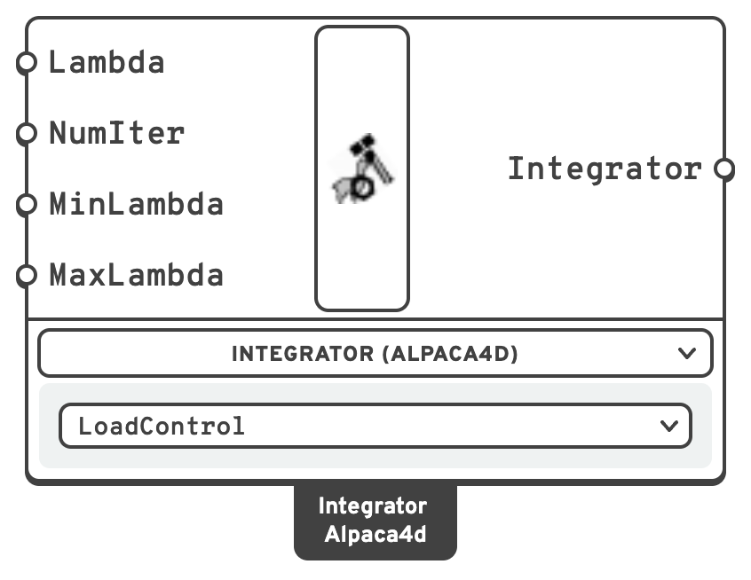

# Integrator

The **integrator** decides how the solution advances from one step to the next — how much
load to add in a static analysis, or how to march through time in a transient one.

## 🔧 Grasshopper component

`Integrator (Alpaca4d)` — **Alpaca4d ▸ 07_Analysis**

<figure><figcaption></figcaption></figure>

A switcher component: pick the unit in the drop-down under it, or right-click it ▸ **Units**. The drop-down shows **CentralDifference** as `CentralDiff`.

### Inputs — LoadControl

For **static** analysis. Adds a fixed increment of load factor at each step.

| Name | Nick | Type | Default | Description |
| --- | --- | --- | --- | --- |
| Lambda | `Lambda` | Number | `1` | Load factor increment per step. |
| NumIter | `NumIter` | Integer | *(empty)* | Iterations per step to aim for. Left empty, every step adds **Lambda**. Given, together with **MinLambda** and **MaxLambda**, it turns on adaptive stepping — see below. |
| MinLambda | `MinLambda` | Number | *(empty)* | Smallest increment adaptive stepping may take. |
| MaxLambda | `MaxLambda` | Number | *(empty)* | Largest increment adaptive stepping may take. |

**NumIter**, **MinLambda** and **MaxLambda** have no defaults on purpose: they are one switch, not three
settings. Given, OpenSees stops stepping by **Lambda** and adapts each step to take about **NumIter**
iterations, anywhere between **MinLambda** and **MaxLambda**. The load factor the model ends up under is
then not **Lambda** times the number of steps, and nothing reports that it changed. Leave them empty for
a model under exactly **Lambda** × the [Analysis Step](analysis-step.md)'s steps.

### Inputs — Newmark

For **transient** analysis. The standard implicit time-stepping scheme.

| Name | Nick | Type | Default | Description |
| --- | --- | --- | --- | --- |
| Gamma | `Gamma` | Number | `0.5` | Newmark γ. |
| Beta | `Beta` | Number | `0.25` | Newmark β. |

`γ = 0.5, β = 0.25` is the average acceleration method: unconditionally stable and free of
numerical damping. `γ > 0.5` introduces numerical damping, which can help a noisy non-linear
run at the cost of some accuracy.

### Inputs — CentralDifference

For **transient** analysis. Explicit, no inputs.

Conditionally stable: the time step must be below the critical step of the smallest, stiffest
element in the model, or the solution diverges. Suits short, sharp events on models where a
small step is wanted anyway.

### Outputs

| Name | Nick | Type | Description |
| --- | --- | --- | --- |
| Integrator | `Integrator` | Integrator | For [Analysis Settings](analysis-settings.md). |

## 📈 When to use it

| Analysis | Integrator |
| --- | --- |
| Linear static | **LoadControl**, `Lambda = 1`, one step |
| Pushover / non-linear static | **LoadControl** with a small `Lambda` and many steps |
| Seismic or general dynamic | **Newmark** |
| Impact, blast, wave propagation | **CentralDifference**, with a small `Dt` |


The integrator and the [analysis type](analysis-settings.md) have to agree. `LoadControl`
with `Transient`, or `Newmark` with `Static`, will not do what you want.


## 🔗 Relation to OpenSees

```tcl
integrator LoadControl       $lambda $numIter $minLambda $maxLambda   ;# the last three only when given
integrator Newmark           $gamma $beta
integrator CentralDifference
```
