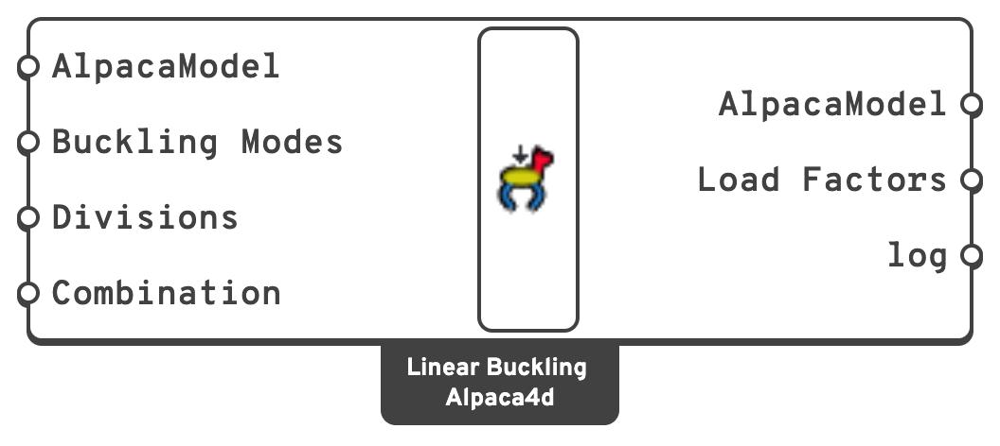

# Linear Buckling Analysis

Finds the **load factors** at which the structure buckles under its loads, lowest first, and the
**shapes** it buckles into. The first factor is the critical load factor $$\alpha_{cr}$$: the
loads times $$\alpha_{cr}$$ are the loads at which the structure first becomes unstable.

## 🔧 Grasshopper component

`Linear Buckling Analysis (Alpaca4d)` — **Alpaca4d ▸ 07_Analysis**

<figure><figcaption></figcaption></figure>

Like [Natural Vibration](natural-vibration.md), it needs no
[Analysis Settings](analysis-settings.md): it sets up and runs its own analysis.

### Inputs

| Name | Nick | Type | Default | Description |
| --- | --- | --- | --- | --- |
| AlpacaModel | `AlpacaModel` | Model | — | The assembled model, from [Assemble](../assemble.md), with the loads to buckle it under, or an analysed one, from [Run Analysis](run-analysis.md), Section Optimiser or [Natural Vibration](natural-vibration.md), buckled as it was assembled. An analysed model is buckled as it was before it was analysed: from Section Optimiser, its last design, with no need to assemble its **Section** output again. Its loads are those it was assembled with; the forces the analysis found are not used. |
| Buckling Modes | `Buckling Modes` | Integer | `1` | How many of the lowest buckling modes to find. |
| Divisions | `Divisions` | Integer | `1` | How many elements every beam is split into for the analysis; `1` leaves them whole. A member that buckles on its own, between its ends, needs 4 or more: 4 come out about 5 % too high. The split model is the one handed on; the one connected is not changed. See [Divisions](#divisions). |
| Combination | `Combination` | Text | — | The [load combination](../loads/load-combination.md) to buckle the model under, for a model that has them: its name, `ULS 2`, or its place from 0. A model with combinations needs one named here: left empty, it is an error that lists them. A model without combinations is buckled under all its load patterns together, each at its own Factor, and the load factors multiply their sum; a remark names the patterns when there is more than one. A list of names buckles the model once for each. |

### Outputs

| Name | Nick | Type | Description |
| --- | --- | --- | --- |
| AlpacaModel | `AlpacaModel` | Model | The buckled model. Its steps are the buckling modes, step 0 the first, each scaled to a largest translation of 1. Feed it to [Model View](../visualisation/model-view.md), which draws a mode at **Deformation scale** 1 with its largest movement 8 % of the model's diagonal, on a slider from −2 to 2, or to [Nodal Displacements](../results/nodal-displacements.md). Its beams are split as **Divisions** asks. |
| Load Factors | `Load Factors` | Number (list) | One per mode, lowest first: what the loads are multiplied by for the model to buckle. The first is $$\alpha_{cr}$$. Below 1, the model buckles before its loads are reached. |
| log | `log` | Text | What OpenSees printed. Read it when the analysis fails. |

## 🧮 What it solves

The loads are those of the assembled model at load factor 1, as one step of
[Run Analysis](run-analysis.md) applies them: every [load pattern](../loads/load-pattern.md),
with its factor. Ground motion patterns are left out, since they load nothing in a static step.

The analysis is **linear**: elastic, about the undeformed shape, with the axial and membrane
forces of a first-order analysis under those loads. The load factors $$\lambda$$ and the mode
shapes $$\boldsymbol{\phi}$$ solve

$$
\left(\mathbf{K} - \lambda\,\mathbf{K}_G\right)\boldsymbol{\phi} = \mathbf{0}
$$

where $$\mathbf{K}$$ is the elastic stiffness of the structure and $$\mathbf{K}_G$$ the
geometric stiffness its loads give it: compression softens it, tension stiffens it.

OpenSees has no buckling analysis, but it can print its stiffness matrix. With no load the
matrix is $$\mathbf{K}$$, and under the loads $$\mathbf{K} - \mathbf{K}_G$$. The component has
OpenSees print both, then solves the eigenvalue problem in Alpaca4d itself. This is Luigi
Caglio's method, as Michael Scott shows it on OpenSees Digital ("Right under your nose", 2021).

For the analysis, and only for it (the model connected is not changed):

- Every beam gets a **PDelta** transformation, which is what gives a beam its geometric
  stiffness.
- [Shells](../elements/shell.md) keep their type but run linear, and Alpaca4d adds their
  geometric stiffness from the membrane forces OpenSees finds under the loads, for buckling out
  of their plane and in it. No shell of OpenSees has all of it: the corotational ASD shells leave
  it out, and ShellNLDKGQ / ShellNLDKGT keep only the part out of their plane, so the web of a
  box column, swaying in its own plane, would never soften.
- Beams are split as **Divisions** asks.
- Solids, [SSP Brick](../elements/brick.md) and
  [Ten Node Tetrahedron](../elements/ten-node-tetrahedron.md), run as they are, and Alpaca4d adds
  their geometric stiffness from the stresses OpenSees finds in them under the loads,
  $$\int \nabla N_a \cdot \boldsymbol{\sigma} \cdot \nabla N_b \, dV$$ for each pair of nodes. No
  solid of OpenSees has one: they are small-strain elements. It is taken where the element takes
  its own stiffness: at the centre of an SSP Brick, which is stiffened against hourglassing
  rather than integrated at eight points, and at the four points of a ten node tetrahedron. A
  column of bricks buckles within 0.3 % of Euler's load, and under its own weight within 0.3 %
  of Greenhill's.
- A joint band - a thin band of solids standing in for springs spread over a horizontal joint,
  its material an Elastic Orthotropic marked as a surface connection, as the printed cylinder
  example's joints are - gets the geometric stiffness of a joint, not of a band. A band *t* thick
  under a pressure $$\sigma$$ would also soften against slip by $$\sigma / t$$, which springs of
  no thickness never do, and buckle in shear at $$\sigma = k_s t$$; so the slip across it is left
  out, and a stack of layers on slipping joints buckles at Haringx's load, as a laminated rubber
  bearing does.

Two solid examples, fresh concrete stiffening with age, checked for buckling as it is printed: the
[3D printed cylinder](https://alpaca4d.github.io/examples/printed-cylinder/) and a
[3D printed structure](https://alpaca4d.github.io/examples/3d-printed-structure/), a branching shell
printed along its own sections.

## ✂️ Divisions

A PDelta beam only feels the sway of its chord, the line between its ends. That is all the sway
of a frame needs, so a frame can be left as it is. A member that buckles on its own, bowing
between its ends, needs to be split into several elements.

With n elements to a half wave of the buckled shape, the load factor comes out about
85 % / n² too high:

| Divisions | Load factor of a member buckling on its own |
| --- | --- |
| `1` | None: a member pinned at both ends has no node in between to buckle at. |
| `4` | About 5 % too high |
| `8` | About 1.3 % too high |
| `16` | About 0.3 % too high |

Twice the elements give a quarter of the error. A member fixed at both ends buckles in one
half wave over half its length, so it needs twice as many elements as a pinned one for the same
accuracy.

## ⚠️ Limits

- **Beams buckle in bending only.** Lateral-torsional and torsional buckling need warping,
  which the beam elements do not have. Check lateral-torsional buckling of members with
  [Utilisation](../results/utilisation.md).
- **It is linear.** It leaves out imperfections, plasticity and the deformation before
  buckling, so $$\alpha_{cr}$$ is the elastic critical load factor, not the load the structure
  can carry.
- **Model size.** OpenSees 3.8.0 can only hand the stiffness matrices over as full tables, which
  limits the model to 4000 equations, about 650 beam or shell nodes. A build of OpenSees newer than 3.8.0 hands
  them over sparse, with no such limit: a plate of 39 000 equations takes a little over a minute, a
  printed cylinder of 15 000 equations in bricks about 15 seconds. Choose
  the OpenSees that runs in **Alpaca4d → Settings → Set OpenSees Executable...** (see
  [Setup](../../setup.md)).

## 📋 What it reports

| Message | Means |
| --- | --- |
| *The first load factor is …: the model buckles before its loads are reached.* | $$\alpha_{cr} < 1$$. |
| *Nothing buckles under these loads* | No member is compressed by the loads. |
| *The beams are not split* | **Divisions** is `1`: right for the sway of a frame, not for a member buckling on its own. |
| *… beam transformations were made PDelta* | What was changed for the analysis. |
| *OpenSees could not solve the model with no load* | The model is a mechanism, or a support is missing. |
| *The model has … equations* | Too many for this OpenSees; see [Limits](#limits). |
| *This AlpacaModel has been analysed, and does not carry the model it was analysed from* | It was analysed by something other than Run Analysis, Natural Vibration, Linear Buckling or Section Optimiser. Connect the output of [Assemble](../assemble.md). |

## 📈 When to use it

**Use it when**

- You check whether a frame needs a second-order analysis. EN 1993-1-1 5.2.1 lets a
  first-order analysis stand when $$\alpha_{cr} \geq 10$$ for an elastic analysis (15 for a
  plastic one). Below that, the second-order effects of sway have to be accounted for.
- You need the buckling length of a member for a design check. With $$N_{Ed}$$ its axial force
  under the loads, it buckles at $$N_{cr} = \alpha_{cr}\,N_{Ed}$$, so
  $$L_{cr} = \pi\sqrt{EI/N_{cr}}$$. Give it to [Utilisation](../results/utilisation.md)'s
  **LengthY** or **LengthZ**.
- You want to see how a structure, a compressed plate or a shell, will lose stability, and
  which of its parts goes first.

**Do not use it when**

- You want the load a real, imperfect structure collapses at → a non-linear static analysis
  with [Run Analysis](run-analysis.md), with imperfections modelled.
- You want the lateral-torsional buckling of beams → [Utilisation](../results/utilisation.md).


The licence works as for [Run Analysis](run-analysis.md): models up to 50 elements run without
one, and the design a topology optimisation finds up to 500.


## 🔗 Relation to OpenSees

The component writes one deck and runs it in OpenSees. The model comes first, with its beams
made PDelta and its shells linear, then:

```tcl
system FullGeneral          ;# OpenSees 3.8.0; a newer one prints sparse, see below
constraints Transformation
numberer AMD
test FixedNumIter 1 0
algorithm Newton
integrator LoadControl 0.0
analysis Static
analyze 1                   ;# no load
printA ...                  ;# K
pattern Plain ...           ;# the model's load patterns
integrator LoadControl 1.0
analyze 1                   ;# the loads, at factor 1
printA ...                  ;# K - K_G of the beams
eleResponse $shell stresses ;# the membrane forces of each shell
wipe
```

An OpenSees newer than 3.8.0 prints the matrices sparse. It solves the two steps with Mumps, on
every core, when it has it (see [Setup](../../setup.md#solving-on-several-cores)), and with
SuperLU when it has not, or when Mumps fails. Mumps keeps its matrix to itself, so for each
`printA` the deck puts SuperLU's system in its place, which only assembles the matrix, and Mumps
back after:

```tcl
if {[catch {system Mumps -matrixType 1 -numThreads 0}]} { system SparseGeneral }
...
system SparseGeneral; initialize       ;# when Mumps solves
if {[catch {printA -file K.mtx -sparse 1 -precision 16 -binary}]} {
    printA -file K.mtx -sparse 1 -precision 16
}
system Mumps -matrixType 1 -numThreads 0
```

An OpenSees built from 13 November 2026 on writes the matrix binary with `-binary`: exact, and
printed in well under a second where the text of a plate of 87 000 equations takes 22 seconds. An
older one ignores the flag and writes the text, and the component reads either.

`numberer AMD` numbers the equations to keep the factor small. SuperLU factorises them in the
order they are numbered, so with `numberer Plain` the time depended on the order of the nodes: an
arch of bricks of 20 000 equations took 3 minutes numbered along its length, 10 numbered at
random, and half a second with AMD.

A model with no beams or trusses, of solids and shells alone, needs one print. OpenSees gives
neither a geometric stiffness, so `K - K_G` under the loads would be `K` again: the deck prints
`K` before the loads, without a step, as `printA` forms it itself, and solves only the step to
the loads, for the stresses.

```tcl
initialize                  ;# no step: printA forms K
printA ...                  ;# K
pattern Plain ...           ;# the model's load patterns
integrator LoadControl 1.0
analyze 1                   ;# the loads, at factor 1
eleResponse $solid stresses ;# the stresses of each solid
```

Alpaca4d adds the geometric stiffness of the shells, built from their membrane forces, and
solves the eigenvalue problem. The buckled shapes are written to
`recorder_buckling_<id>_0.mpco`, in the `AlpacaResults` folder next to the Grasshopper file, where
`<id>` is the start of the component's InstanceGuid: each Linear Buckling keeps a file of its own. A model
whose ties are chained, such as a rigid link from a node of a rigid diaphragm, runs on the
`Penalty` constraint handler, since `Transformation` gets chains wrong; so does a model with a
shell on a tied node.
