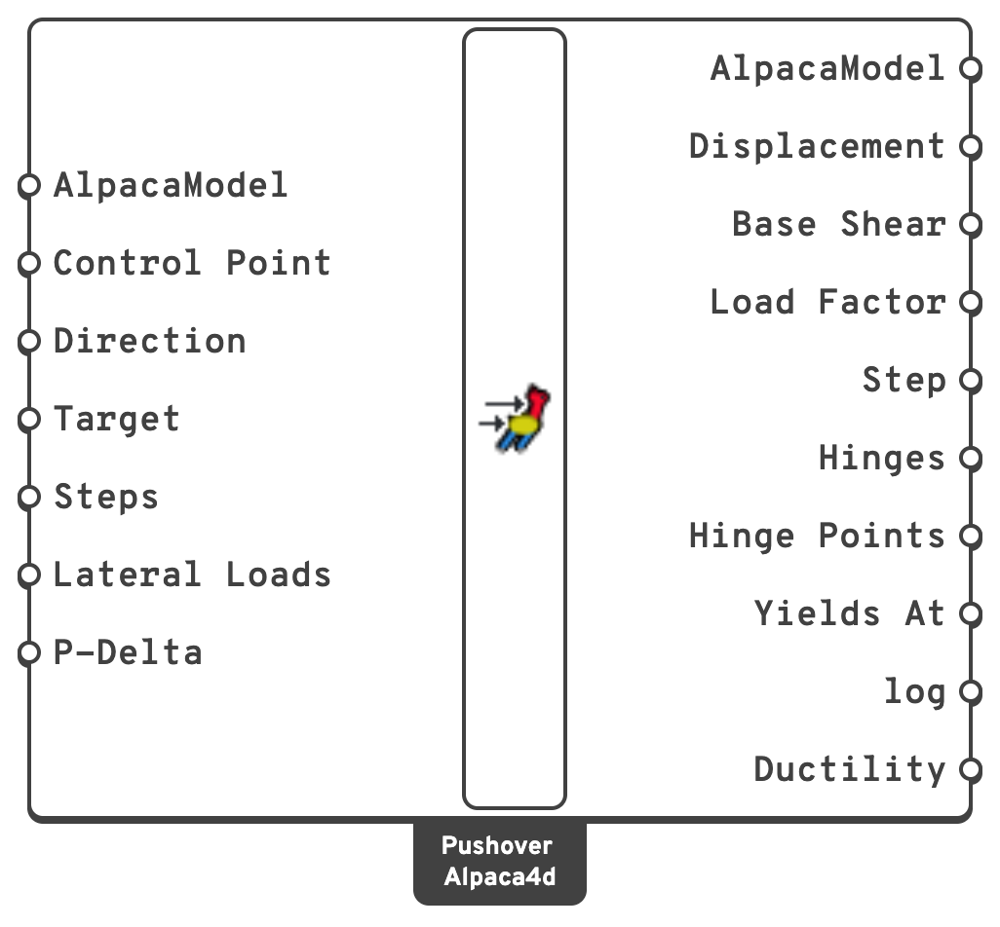

# Pushover Analysis

Pushes the structure sideways until it gives way, and returns its **capacity curve**: the base
shear against the displacement of a control point. The loads the structure carries are applied
first and held; then a lateral load pattern is scaled up, step by step, until the control point
has moved as far as asked.

## 🔧 Grasshopper component

`Pushover Analysis (Alpaca4d)` — **Alpaca4d ▸ 07_Analysis**, nickname `Pushover`

<figure><figcaption></figcaption></figure>

Like [Linear Buckling](linear-buckling.md), it needs no [Analysis Settings](analysis-settings.md):
it sets up and runs its own analysis.

### Inputs

| Name | Nick | Type | Default | Description |
| --- | --- | --- | --- | --- |
| AlpacaModel | `AlpacaModel` | Model | — | The model, from [Assemble](../assemble.md), with the loads to hold while it is pushed: its self-weight and its floors. They are applied first, in 10 steps, at load factor 1. An analysed model is pushed as it was before it was analysed. |
| Control Point | `Control Point` | Point | — | The point whose displacement drives the push and makes the curve's x: a node of the model, usually on the roof, in `m`. |
| Direction | `Direction` | Text | `X` | The direction of the push: `X`, `Y` or `Z`, global. Connect a **Value List** to pick from them. |
| Target | `Target` | Number | — | How far to push the control point along **Direction**, from where the model's own loads left it, in `m`. Negative pushes the other way. |
| Steps | `Steps` | Integer | `100` | How many steps to reach **Target** in. A step that does not converge is tried with other algorithms, then in halves. See [When a step does not converge](#when-a-step-does-not-converge). |
| Lateral Loads | `Lateral Loads` | Point Load (list) | *(empty)* | [Point Loads](../loads/point-load.md) giving the shape of the push: their forces at load factor 1, all scaled together — one per floor, in proportion to its mass or its height, say. Leave empty to push the control point alone, with 1 kN along **Direction**. They are not put in a load pattern. |
| P-Delta | `P-Delta` | Boolean | `True` | Gives every beam with a **Linear** transformation a **PDelta** one for the push, so the loads held on the columns push them further as the frame sways, and the curve comes down past its peak. Corotational beams are left as they are. |

### Outputs

| Name | Nick | Type | Description |
| --- | --- | --- | --- |
| AlpacaModel | `AlpacaModel` | Model | The pushed model, every converged step recorded: the model's own loads first, then the push. Feed it to [Model View](../visualisation/model-view.md) or to the [result components](../results/README.md) with a step from **Step**. |
| Displacement | `Displacement` | Number (list) | The control point's displacement along **Direction** at each point of the curve, from where the model's own loads left it, in `m`. The first point is 0. |
| Base Shear | `Base Shear` | Number (list) | The base shear at each point of the curve, in `kN`: the reactions along **Direction**, added up and turned to resist the push. |
| Load Factor | `Load Factor` | Number (list) | The factor on the **Lateral Loads** at each point of the curve. |
| Step | `Step` | Integer (list) | The recorded step of each point of the curve. The first is the model under its own loads, before the push. |
| Hinges | `Hinges` | Text (list) | Every point of a beam on a fibre section that yields during the push, in the order it does: which beam, where along it, the point of the curve it yields at — roof displacement and base shear — the ductility it reaches by the end, and when its concrete crushes or a bar reaches its ultimate strain. See [Plastic hinges](#plastic-hinges). |
| Hinge Points | `Hinge Points` | Point (list) | Where each of the **Hinges** is, on the model as it was built, in `m`. |
| Yields At | `Yields At` | Integer (list) | The point of the curve each of the **Hinges** yields at: its place in **Displacement**, **Base Shear** and **Step**. |
| log | `log` | Text | What OpenSees printed, a line repeated written once with its count. Read it when the push stops short. |
| Ductility | `Ductility` | Number (tree) | The ductility each of the **Hinges** has reached at each point of the curve: its most strained fibre's largest strain so far over its yield strain. A branch a hinge, in the order of **Hinges**, a value a point of the curve, 0 before it yields. It never comes down. See [Plastic hinges](#plastic-hinges). |

Plot **Base Shear** against **Displacement** for the capacity curve. To see one point of it, pick
its **Step** with a **List Item** and feed it to Model View, Beam Forces or Reaction Forces with
the pushed model.

## 🧮 What it solves

1. **The model's own loads**, every [load pattern](../loads/load-pattern.md) of the assembled
   model, in 10 steps of `LoadControl` to load factor 1, then held with `loadConst`. A model with
   no loads takes a single step of nothing.
2. **The push.** The **Lateral Loads** go in a pattern of their own, on a linear time series, and
   a `DisplacementControl` integrator scales them so that the control point moves
   **Target** / **Steps** along **Direction** each step, until it has moved **Target**.

Displacement control, not load control, so the push goes on **past the peak**. A load that can
no longer grow — a mechanism has formed, or P-Delta has taken the frame over the top — is a point
of the curve, where under load control it would be a step that cannot converge.

The base shear is the sum of every node's reaction along **Direction**, turned round. Under one
lateral load it equals the load factor times that load.

The model's beams yield only if their sections can: give them a
[Fiber Section](../moment-curvature/fiber-section.md) on a
[ForceBeamColumn](../elements/force-beam-column.md). An elastic section stays elastic, and its
curve is a straight line.

### Plastic hinges

The pushed model records every beam's section deformations as well: the strain at each section's
centroid and its two curvatures, at each of the five integration points along it. A fibre section
stays plane, so they give the strain of every fibre, and that against its material's yield strain
says where the beam has yielded. **Hinges** lists every point that does, in the order it does, with
the point of the curve it yields at; **Yields At** gives that point alone, to mark the curve with.

How far a hinge has gone is its **ductility**: the largest strain its most strained fibre has
reached so far, over that fibre's yield strain. It is 1 when the point first yields and only grows,
for a fibre that has yielded keeps the strain it took, even when it unloads. **Hinges** gives the
ductility each reaches by the end; **Ductility** gives it at every point of the curve.

[Model View](../visualisation/model-view.md) draws the hinges at any step with **Plastic hinges**
ticked in its Results menu. A ball comes at a point once it yields and stays, coloured by the
ductility reached: yellow from 1, orange from 2, red from 4, dark red from 8, purple once concrete
has crushed or a bar reached its ultimate strain. It is solid while the point is past its yield
strain at that step and faded once it has unloaded. Step through **Step** to watch them form and
grow. Like SeismoStruct's performance criteria, these are strains, read from the fibres, rather
than a hinge's rotation against the tables of ASCE 41.

The fibres' stresses are not recorded: for a frame of 28 beams pushed in 200 steps they came to
23 MB of a 24 MB file. A model with shells still records them, which Shell Stresses reads.

### When a step does not converge

A step that does not converge with `Newton` is tried again with `ModifiedNewton -initial`,
`KrylovNewton`, `NewtonLineSearch` and `Newton -initial`. If none converges, the step is halved
and tried again, down to 1/1024 of its size, and grows back after each step that converges. Past
that the push stops, with the curve as far as it got and a warning.

### When a section has no stiffness left

A force-based beam inverts the stiffness of its sections. A fibre section whose every fibre has
yielded with nothing to harden — [Steel01](../moment-curvature/steel01.md) with `b = 0` — or
broken, has none to invert. OpenSees says so (`could not invert flexibility`) and goes on, and
the step can converge on forces that are not the materials'. The push stops at the first step
that does this, and the curve is cut before it, with a warning.

Steel01 with `b = 0` can go wrong earlier, without OpenSees saying anything: on a section whose
fibres yield together, the base shear climbs past the plastic capacity. The component warns of
it before it runs. Give `b` a small value, `0.001` to `0.01` (its default is `0.01`).

## 📈 When to use it

**Use it when**

- You want the strength and the ductility of a frame, a wall or a column under lateral load: the
  peak base shear, where it yields, how far it goes before it softens.
- You want a capacity curve for a seismic assessment by the N2 or a similar method.

**Do not use it when**

- The structure stays elastic: a [Run Analysis](run-analysis.md) gives the same in one step.
- The load comes and goes, or inertia matters → a time history, with Run Analysis.
- You want the behaviour of one cross-section → [Moment Curvature](../moment-curvature/moment-curvature.md).

## 💡 Good to know

- **Gravity first.** Put the self-weight ([Gravity Load](../loads/gravity.md)) and the
  floor loads in the assembled model. They are what P-Delta acts on, and they set the axial force
  in the columns, which changes the moment they carry: less in a steel column, more in a concrete
  one squeezed less than about its balance point, less again past it.
- **The lateral pattern.** One Point Load per floor, at the floor's control node, in proportion
  to the floor's mass is a "uniform" pattern; in proportion to mass times height, a "modal"
  (triangular) one. EN 1998-1 4.3.3.4.2.2 asks for both.
- **A rigid diaphragm.** Push the master node of the floor, not one of the nodes it ties: a
  displacement cannot be imposed on a degree of freedom that a constraint holds.
- **Steps.** 50 to 200 is usual. More steps give a smoother curve, and a step that is too long
  is halved anyway.
- **The fibre section's axes.** On a beam its *y* and *z* are the beam's local *y* and *z*, as
  [Fiber Section](../moment-curvature/fiber-section.md#on-a-beam) draws them, and the beam's axis
  runs through the section's area centroid.

### Messages

| Message | Level | What to do |
| --- | --- | --- |
| *Peak base shear … at …; n points to …* | Remark | The curve, in one line. |
| *n hinges; the first at point …* | Remark | Where the structure yielded first. **Hinges** has them all. |
| *No beam has a fibre section* | Remark | Give the beams a Fiber Section, or the curve is a straight line. |
| *P-Delta is off and every beam has a Linear transformation* | Remark | Turn **P-Delta** on for the second-order effects of the loads. |
| *Steel01 with b = 0 has nothing to harden* | Warning | Give `b` a small value. See [above](#when-a-section-has-no-stiffness-left). |
| *The push stopped at … a step would not converge* | Warning | The structure may have run out of strength, or it needs more **Steps**. |
| *The push stopped at … a beam's fibre section had no stiffness left* | Warning | See [above](#when-a-section-has-no-stiffness-left). |
| *The model's own loads did not converge* | Error | Run them with Run Analysis to see why. |
| *Control Point … is not on a node of the model* | Error | Put it on a beam end or a mesh vertex. |
| *The model has a ground motion* | Error | A pushover is static: leave the Uniform Excitation out. |

## 🔗 Relation to OpenSees

The model's deck, with every Linear `geomTransf` made PDelta when **P-Delta** is on, then:

```tcl
logFile pushover.log -noEcho        ;# at the start: what OpenSees prints goes to a file
...                                 ;# the model, its load patterns, the recorder
constraints Transformation
numberer RCM
system BandGeneral
test NormDispIncr 1e-8 50 0
algorithm Newton
integrator LoadControl 0.1
analysis Static
analyze 10                          ;# the model's own loads
loadConst -time 0.0
timeSeries Linear $tag
pattern Plain $tag $tag {
    load $node $Fx $Fy $Fz $Mx $My $Mz   ;# the Lateral Loads
}
# then, step by step until the control node has moved Target:
integrator DisplacementControl $controlNode $dof $dU
analyze 1
```

`BandGeneral` solves, because a structure past its peak has a stiffness that is no longer
positive definite, which `BandSPD` cannot factor. The deck writes the curve itself, a line per
step: the control node's displacement, the sum of the reactions after `reactions`, and
`getLoadFactor`. Use [Serialize](../utility/serialize.md) on the pushed model to see the whole
deck.

## Example

[Irregular Building Pushover](https://alpaca4d.github.io/examples/irregular-building-pushover/): a small
concrete building on fibre sections — an L in plan, a tall ground storey, a top storey set back — its
own weight and its floors held, pushed to 3% drift. Its plastic hinges show the ground storey giving
way, a soft storey, and the L twisting.

## See also

- [Fiber Section](../moment-curvature/fiber-section.md) — the section that yields
- [Force Beam Column](../elements/force-beam-column.md) — the beam it goes on
- [Linear Buckling](linear-buckling.md) — the elastic critical load factor
- [Which analysis](../../concepts/which-analysis.md)
