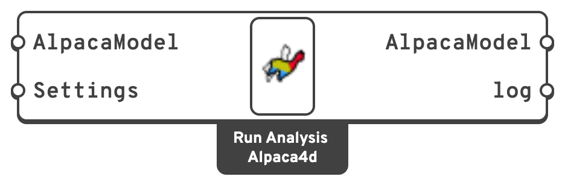

# Run Analysis

Writes the model out as an OpenSees `.tcl` deck, launches the solver, and hands back the
model with the results attached.

## 🔧 Grasshopper component

`Run Analysis (Alpaca4d)` — **Alpaca4d ▸ 07_Analysis**

<figure><figcaption></figcaption></figure>

### Inputs

| Name | Nick | Type | Default | Description |
| --- | --- | --- | --- | --- |
| AlpacaModel | `AlpacaModel` | Model | — | The assembled model, from [Assemble](../assemble.md). |
| Settings | `Settings` | Settings | — | From [Analysis Settings](analysis-settings.md). |

### Outputs

| Name | Nick | Type | Description |
| --- | --- | --- | --- |
| AlpacaModel | `AlpacaModel` | Model | The same model, now carrying results. Feed it to the [Results](../results/README.md) and [Visualisation](../visualisation/README.md) components. `null` if the analysis failed. |
| log | `log` | Text | Everything OpenSees printed — the console output and any error stream. **Read this first when something goes wrong.** |


**The log used to be the first output.** Definitions made before the model was put first open
with the previous Run Analysis component, which still works. Grasshopper's **Solution ▸ Upgrade
Components** swaps it for the current one and keeps every wire — each output's wires follow it
by name, and the **Do not use settings** choice is kept.


## 💡 Where the files go

The deck and the results go into a folder called **`AlpacaResults`, next to the Grasshopper
file**, a set of files for each run:

| File | Contents |
| --- | --- |
| `AlpacaModel_<id>_<run>.tcl` | The input deck. |
| `recorder_<id>_<run>.mpco` | The MPCO result database. |

`<id>` is the first 8 characters of the component's InstanceGuid, so two Run Analysis components
in one document keep their results apart; `<run>` counts from 0, as a component given a tree of
models solves once per branch. The names stay the same from one solution to the next, so the
files are overwritten rather than piling up.

A **FileName** that an [MPCO Recorder](../mpco-recorder.md) gives is taken from the Grasshopper
file's folder instead, with `_<run>` before its extension when the component solves more than
once.

If the Grasshopper document has never been saved, the folder is `Alpaca4d/AlpacaResults` in the
system's temporary folder. Save the file first — it makes the output findable, and it is required
by [Natural Vibration](natural-vibration.md).

The recorder that is attached depends on the analysis type: a static recorder for `Static`,
a transient one for `Transient`. An [MPCO Recorder](../mpco-recorder.md) on the
**Recorders** input of [Assemble](../assemble.md) replaces it with the results you tick.

## 💡 Errors and how they surface

| What you see | What happened |
| --- | --- |
| *"OpenSees executable path is not configured"* | Set it — **Alpaca4d ▸ Settings ▸ Set OpenSees Executable…**. See [Setup](../../setup.md). |
| *"Analysis Failed: OpenSees exited with an error"* | The deck itself failed — a bad command, an undefined material. The **log** names the line. |
| *"This OpenSees does not know the Ten Node Tetrahedron"* | The model has [Ten Node Tetrahedra](../elements/ten-node-tetrahedron.md) and the OpenSees is 3.8.0 or older, whose element is six times too soft. Use an OpenSees built from master since 16 October 2026. |
| *"Analysis Failed: OpenSees 'analyze' did not converge"* | The deck was valid but the solution did not converge. Loosen the [Test](test.md) tolerance, raise its iteration count, take smaller steps in [Analysis Step](analysis-step.md), or change the algorithm. |
| *"Warning! Double check the log!"* | OpenSees printed a warning and carried on. The results exist but deserve a look. |

On any failure the `AlpacaModel` output is `null`, so the downstream result components go
quiet rather than showing stale numbers.

## 📈 When to use it

**Use it when** you want a static or transient solution.

**Do not use it when** you want modes and periods → [Natural Vibration](natural-vibration.md)
sets up its own eigenvalue run and needs no settings.

## 🔗 Relation to OpenSees

The component assembles and runs a complete deck: the model, then the recorder, then the
analysis block from [Analysis Settings](analysis-settings.md), then `wipe`. To see exactly
what was sent, use [Serialize](../utility/serialize.md), or open the `AlpacaModel_<id>_<run>.tcl` it
leaves in `AlpacaResults`.
