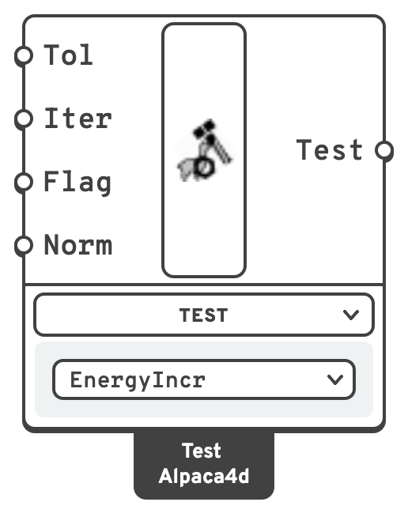

# Test

The **convergence test** decides when an iteration within a step is close enough to stop.

## 🔧 Grasshopper component

`Test (Alpaca4d)` — **Alpaca4d ▸ 07_Analysis**

<figure><figcaption></figcaption></figure>

A switcher component with ten units, one per OpenSees test: pick the unit in the drop-down under
it, or right-click it ▸ **Units**. It starts on `EnergyIncr`.

### Inputs — tests on one tolerance

`EnergyIncr`, `NormUnbalance`, `NormDispIncr`, `RelativeNormUnbalance`, `RelativeNormDispIncr`,
`RelativeTotalNormDispIncr` and `RelativeEnergyIncr`.

| Name | Nick | Type | Default | Description |
| --- | --- | --- | --- | --- |
| Tolerance | `Tol` | Number | `1e-8` | Convergence tolerance. |
| Iteration | `Iter` | Integer | `10` | Maximum iterations before the step is declared failed. |
| Flag | `Flag` | Integer | `0` | How much the test prints: `0` nothing, `1` each time, `2` on success, `4` each step, `5` error message. |
| Norm | `Norm` | Integer | `2` | Which norm: `0` max, `1` one-norm, `2` two-norm. |

There is no `maxIncr` input: OpenSees reads a fifth number as a divergence guard, `maxTol`, rather
than as `maxIncr`, so any value given there would cut analyses short.

### Inputs — NormDispAndUnbalance

Converged when **both** the displacement increment and the residual are within their tolerances.

| Name | Nick | Type | Default | Description |
| --- | --- | --- | --- | --- |
| TolIncr | `TolIncr` | Number | `1e-8` | Tolerance on the displacement increment. |
| TolR | `TolR` | Number | `1e-8` | Tolerance on the residual force. |
| Iteration | `Iter` | Integer | `10` | Maximum iterations. |
| Flag | `Flag` | Integer | `0` | Print level, as above. |

No **Norm** here: OpenSees reads this test's trailing numbers back over the iteration limit and
the print flag, so a norm would overwrite them. To choose the norm, use `NormDispOrUnbalance`.

### Inputs — NormDispOrUnbalance

Converged when **either** the displacement increment or the residual is within its tolerance.

| Name | Nick | Type | Default | Description |
| --- | --- | --- | --- | --- |
| TolIncr | `TolIncr` | Number | `1e-8` | Tolerance on the displacement increment. |
| TolR | `TolR` | Number | `1e-8` | Tolerance on the residual force. |
| Iteration | `Iter` | Integer | `10` | Maximum iterations. |
| Flag | `Flag` | Integer | `0` | Print level, as above. |
| Norm | `Norm` | Integer | `2` | Norm, as above. |

### Inputs — FixedNumIter

Runs exactly **Iteration** iterations at every step, without checking convergence.

| Name | Nick | Type | Default | Description |
| --- | --- | --- | --- | --- |
| Iteration | `Iter` | Integer | `10` | How many iterations every step takes. |
| Flag | `Flag` | Integer | `0` | Print level, as above. |
| Norm | `Norm` | Integer | `2` | Norm, as above. |

### Outputs

| Name | Nick | Type | Description |
| --- | --- | --- | --- |
| Test | `Test` | Test | For [Analysis Settings](analysis-settings.md). |

## 📈 When to use it

**Use it when** you are running anything through [Run Analysis](run-analysis.md). Every
analysis needs a convergence test, even a linear one.

**Do not use it when** you only want modes → [Natural Vibration](natural-vibration.md) has
nothing to converge.

## 💡 Which test

| Unit | Measures | Use for |
| --- | --- | --- |
| **NormDispIncr** | The size of the displacement increment. | The general default. |
| **NormUnbalance** | The size of the residual force. | When equilibrium is what matters — you care that forces balance, not that the model stopped moving. |
| **EnergyIncr** | The product of the two. | Well-conditioned for problems mixing very stiff and very flexible parts. |
| **NormDispAndUnbalance** | Both displacement and residual. | Strict, when you do not trust either alone. |
| **NormDispOrUnbalance** | Displacement or residual, whichever converges first. | Lenient: a run that stalls on one criterion while the other is met. |
| **RelativeNormUnbalance**, **RelativeNormDispIncr**, **RelativeEnergyIncr** | The same as the plain tests, as a fraction of their value at the first iteration of the step. | A model whose absolute numbers are hard to set a tolerance for, such as one with very different load levels. |
| **RelativeTotalNormDispIncr** | The displacement increment as a fraction of the sum of all increments of the step. | As above, when the first increment is a poor yardstick. |
| **FixedNumIter** | Nothing: it stops after **Iteration** iterations. | A set number of iterations, converged or not. |


`1e-8` is tight. A model in kN and metres with a displacement test will usually converge, but
a stiff model, or one with a badly scaled unit system, may need `1e-6` or looser. Raising
**Iteration** to 100 costs little and rescues many runs.

If a run fails to converge, turn **Flag** to `1` and read the [log](run-analysis.md) — it
will show whether the residual is falling slowly or diverging outright, which are different
problems.


## 🔗 Relation to OpenSees

```tcl
test $type $tol $iter $flag $norm                       ;# the tests on one tolerance
test NormDispAndUnbalance $tolIncr $tolR $iter $flag
test NormDispOrUnbalance  $tolIncr $tolR $iter $flag $norm
test FixedNumIter         $iter $flag $norm
```
