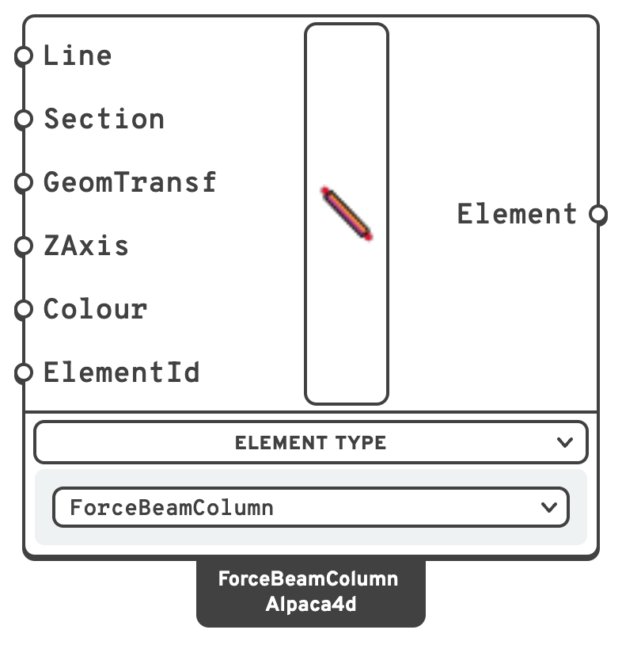

# Force Beam Column

A **force beam column** is a frame element with a force-based (flexibility) formulation.
The section response is integrated along the member, so the element captures the real
distribution of curvature along the span rather than assuming a shape function for it.

## 🔧 Grasshopper component

`ForceBeamColumn (Alpaca4d)` — **Alpaca4d ▸ 02_Element**

<figure><figcaption></figcaption></figure>

A switcher component. The **Element Type** menu selects the unit:

- **ForceBeamColumn** — a plain force-based beam, described here.
- **WithHinges** — the same element with plastic hinge zones at the ends, described in
  [Beam With Hinges](beam-with-hinges.md).
- **Truss** — a bar that carries axial force only: in tension and compression, or in one of the
  two. Its inputs are below.

### Inputs — ForceBeamColumn

| Name | Nick | Type | Default | Description |
| --- | --- | --- | --- | --- |
| Line | `Line` | Curve | — | Centreline of the element, in `m`. |
| Section | `Section` | Section | — | Cross-section, from any of the [Sections](../sections/README.md) components. Carries the material, and with it the mass density. |
| GeometricTransformation | `GeomTransf` | Generic | Linear | Geometric transformation. If left empty a **Linear** transformation is built from the line and `ZAxis`. |
| ZAxis | `ZAxis` | Vector | horizontal | Local *z* axis of the element. If left empty it is horizontal, so local *y* — the depth of an I-section, the height of a rectangle — points as near straight up as the beam allows, and gravity bends a floor beam about its strong axis (`Vy`, `Mz`). A vertical member gets local *y* along global X. |
| Colour | `Colour` | Colour | Alpaca4d beam colour | Display colour in the Rhino viewport. |
| ElementId | `ElementId` | Text | *(empty)* | Optional name for the element, used to pull its results out later. Free text, and yours to repeat: one name over twenty curves labels all twenty, and asking for it returns all twenty. Give a list to name them apart. |

### Inputs — Truss

| Name | Nick | Type | Default | Description |
| --- | --- | --- | --- | --- |
| Line | `Line` | Curve | — | One bar per line, in `m`. Its two ends become nodes. It must be straight: anything but a line is an error. |
| Section | `Section` | Section | — | The bar's area and material: any beam section, a tube from Section Library included. Its shape only draws the bar. |
| WorksIn | `WorksIn` | Text | `Both` | `Both`, `Tension` or `Compression`: which way the bar carries load. A tension-only bar goes slack when pushed, a compression-only one lets go when pulled. Connect a **Value List** to pick from them. |
| Prestress | `Prestress` | Number | `0` | The axial force the bar starts with, in `kN`, tension positive. A cable needs it: straight and slack, it has no stiffness across its length. A tension-only bar takes zero or more, a compression-only one zero or less. |
| ZAxis | `ZAxis` | Vector | horizontal | Local *z* axis, squared off the bar. It only turns the section, for drawing and for the steel check; left empty it is horizontal, as on a beam. |
| Colour | `Colour` | Colour | Alpaca4d beam colour | Display colour in the Rhino viewport. |
| ElementId | `ElementId` | Text | *(empty)* | Optional name for the element, used to pull its results out later. Free text, and yours to repeat: one name over twenty curves labels all twenty, and asking for it returns all twenty. Give a list to name them apart. |

A truss is always corotational, so it holds for large displacements too. A line load on it goes
to its two end nodes, half each. A tension-only or compression-only bar needs a non-linear
analysis to let go: the **Newton** algorithm, in several steps.

### Outputs

| Name | Nick | Type | Description |
| --- | --- | --- | --- |
| Element | `Element` | Element | Beam element, to be connected to [Assemble](../assemble.md). |

## 📈 When to use it

**Use it when**

- You are modelling any line-like member: beams, columns, braces, truss bars.
- You want the spread of yielding along the member length to be captured.
- You need realistic curvature and rotation demands for pushover or seismic work.

**Do not use it when**

- Inelasticity is confined to the member ends and you would rather control the hinge length
  explicitly → switch the unit to **WithHinges**.
- The member is really a surface or a solid → use [Shell](shell.md) or [Brick](brick.md).

## 🔗 Relation to OpenSees

The component writes a `geomTransf` and a `forceBeamColumn`:

```tcl
geomTransf Linear $transfTag $zx $zy $zz
element forceBeamColumn $eleTag $iNode $jNode $transfTag NewtonCotes $secTag 5 -mass $massDens
```

- The integration is **Newton–Cotes with 5 points**, created automatically.
- `$secTag` comes from the **Section** input.
- `$massDens` is mass per unit length, from the section area times the material density.
- Transformation and integration tags are numbered automatically per element.
