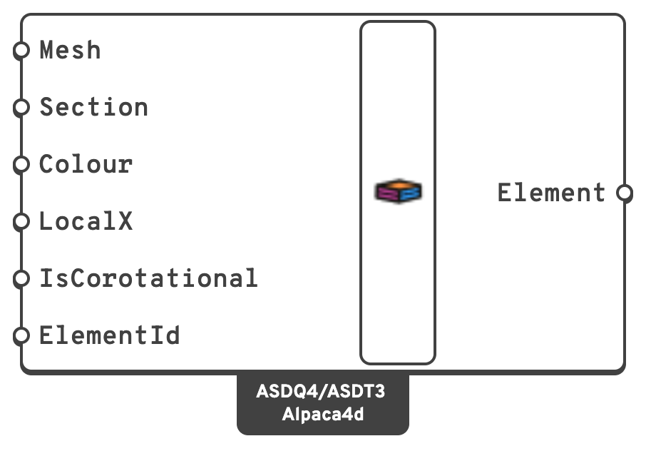

# Shell

**Shell elements** carry both in-plane (membrane) and out-of-plane (bending, shear) actions,
and are the right choice for anything thin relative to its other two dimensions — slabs,
walls, plates, folded plates, roofs, tanks.

Alpaca4d uses the ASDShell family from ASDEA:

- `ASDShellQ4` — 4-node quadrilateral.
- `ASDShellT3` — 3-node triangle.

## 🔧 Grasshopper component

`ASD Shell (Alpaca4d)` — **Alpaca4d ▸ 02_Element**

<figure><figcaption></figcaption></figure>

One component covers both element types. The mesh is exploded into single faces, and each
face becomes one element: 4 vertices → `ASDShellQ4`, 3 vertices → `ASDShellT3`.

### Inputs

| Name | Nick | Type | Default | Description |
| --- | --- | --- | --- | --- |
| Mesh | `Mesh` | Mesh | — | Surface mesh, in `m`. Quads and triangles may be mixed. |
| Section | `Section` | Section | — | Shell section — a [Plate Fiber Section](../sections/plate-fiber.md), which carries the thickness and an [nD material](../materials/ND.md). |
| Colour | `Colour` | Colour | Alpaca4d shell colour | Display colour in the Rhino viewport. |
| Local X Axis | `LocalX` | Vector | element default | Direction the element's local *x* axis is aligned to. Sets the axes that [Shell Forces](../results/shell-forces.md) are reported in. It is flattened onto each face, so it only has to point roughly the right way, but not along the shell's normal: within 1° of the normal of any face is an error that names those faces. Leave empty to let OpenSees pick per face. |
| Is Corotational | `IsCorotational` | Boolean | `false` | Use the corotational formulation, for large displacements and rotations. |


Set **Local X Axis** on any model where you intend to read `pxx`, `myy` and the rest. Without
it each face orients itself independently, and the per-face results are no longer comparable
across the mesh.



**The Local X Axis cannot stand square to the shell.** It is flattened onto each face, and along a
face's normal nothing is left to flatten: OpenSees stops at Run Analysis with only *Analysis
Failed* to show for it, and a vector a hair off the normal gives an axis that turns with every tilt
of the face. So ASD Shell turns away a Local X within 1° of the normal of any face and lists the
faces, counting from 0. On a horizontal slab give a horizontal vector, not Z. On a curved shell,
pick one that no face stands square to: a cylinder's own axis, or a horizontal vector on a dome
that stops short of vertical. A shell whose faces turn to face every way has no such vector, so
split it and give each part its own.


### Outputs

| Name | Nick | Type | Description |
| --- | --- | --- | --- |
| Element | `Element` | Element | List of shell elements, one per mesh face, to be connected to [Assemble](../assemble.md). |

## 📈 When to use it

**Use it when**

- You are modelling slabs, walls, plates, shells or other thin surfaces.
- Membrane and bending actions both matter — floor diaphragms, shear walls, tanks.
- A solid model would be unnecessarily heavy but a beam model is too coarse.

**Do not use it when**

- The body is genuinely volumetric → use [Brick](brick.md) or
  [Ten Node Tetrahedron](ten-node-tetrahedron.md).
- The behaviour is member-like → use [ForceBeamColumn](force-beam-column.md).

## 🔗 Relation to OpenSees

```tcl
element ASDShellQ4 $eleTag $n1 $n2 $n3 $n4 $secTag <-corotational> <-local $x $y $z>
element ASDShellT3 $eleTag $n1 $n2 $n3      $secTag <-corotational> <-local $x $y $z>
```

- Node tags come from the mesh face vertices, matched to model nodes by the
  [Assemble](../assemble.md) tolerance.
- `$secTag` is the **Section** input.
- `-corotational` is emitted when **Is Corotational** is `true`.
- `-local` is emitted only when **Local X Axis** is supplied.
