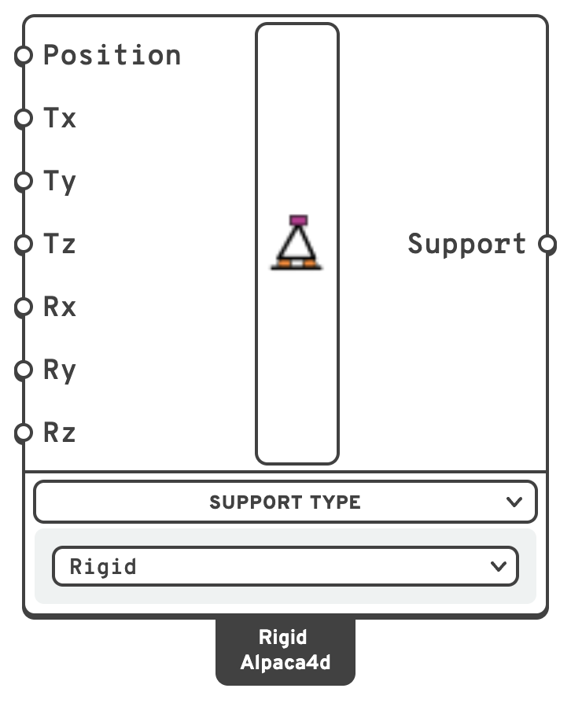

# Support

A **support** holds a node. The **Rigid** type fixes the directions you choose; the **Elastic**
and **Compression Only** types hold it through springs. Every type works along the axes of a
plane, so a support can be axis-aligned or **skewed** — turned to an arbitrary plane, for an
inclined roller or a support on a sloping face.

## 🔧 Grasshopper component

`Support (Alpaca4d)` — **Alpaca4d ▸ 02_Element**

<figure><figcaption></figcaption></figure>

A switcher component. The **Support Type** menu selects the type:

- **Rigid** — the default. Fixes the node along and about the axes you choose.
- **Elastic** — a spring along or about each axis of the plane.
- **Compression Only** — holds the node along the plane's *Z* only while it pushes into the
  support, and lets it lift; after a gap, if there is one.


Definitions saved before 0.12.0 have the older Support component, marked OLD on the canvas. It
still works. Grasshopper's **Upgrade Components…** swaps it for this one on its Rigid type, with
its wires and the values set on its inputs.


### Inputs — Rigid

| Name | Nick | Type | Default | Description |
| --- | --- | --- | --- | --- |
| Position | `Position` | Plane | — | Where the support acts, in `m`. A **Point** restrains the global axes; a **Plane** restrains its own axes instead, which is how you get a skewed support. |
| Tx | `Tx` | Boolean | `true` | Translation along the support plane's *X* axis. `true` = restrained. |
| Ty | `Ty` | Boolean | `true` | Translation along the support plane's *Y* axis. |
| Tz | `Tz` | Boolean | `true` | Translation along the support plane's *Z* axis. |
| Rx | `Rx` | Boolean | `true` | Rotation about the support plane's *X* axis. |
| Ry | `Ry` | Boolean | `true` | Rotation about the support plane's *Y* axis. |
| Rz | `Rz` | Boolean | `true` | Rotation about the support plane's *Z* axis. |

A point arriving on **Position** is cast to a world-aligned plane at that point, so a model
built before planes were an option behaves exactly as it did.

### Inputs — Elastic

| Name | Nick | Type | Default | Description |
| --- | --- | --- | --- | --- |
| Position | `Position` | Plane | — | Where the support acts, in `m`. The springs act along and about the plane's own axes; a **Point** uses the global ones. |
| Kx | `Kx` | Number | *(empty)* | Stiffness along the plane's *X* axis, in `kN/m`. Left empty, or zero, the node is free that way. |
| Ky | `Ky` | Number | *(empty)* | Stiffness along the plane's *Y* axis, in `kN/m`. |
| Kz | `Kz` | Number | *(empty)* | Stiffness along the plane's *Z* axis, in `kN/m`. |
| Krx | `Krx` | Number | *(empty)* | Stiffness about the plane's *X* axis, in `kNm/rad`. |
| Kry | `Kry` | Number | *(empty)* | Stiffness about the plane's *Y* axis, in `kNm/rad`. |
| Krz | `Krz` | Number | *(empty)* | Stiffness about the plane's *Z* axis, in `kNm/rad`. |

Give at least one stiffness: with none the support holds nothing, and the component warns. A
negative stiffness is an error.

### Inputs — Compression Only

| Name | Nick | Type | Default | Description |
| --- | --- | --- | --- | --- |
| Position | `Position` | Plane | — | Where the support acts, in `m`. It holds along the plane's *Z* only, while the node moves against *Z*: down, for a **Point**. Turn the plane over for a support that holds only in tension. |
| Stiffness | `Stiffness` | Number | *(empty)* = rigid | In `kN/m`. Left empty it is rigid: as stiff as the penalty Alpaca4d gives skewed supports. |
| Gap | `Gap` | Number | `0` | How far the node moves into the support before it takes hold, in `m`. Until then the structure has to hold the node by itself. |

A Compression Only support needs a non-linear analysis to let go: the **Newton** algorithm, in
several steps. The component says so in a remark, and
[Run Analysis](../analysis/run-analysis.md) warns when the algorithm is Linear.

### Outputs

| Name | Nick | Type | Description |
| --- | --- | --- | --- |
| Support | `Support` | Support | Support object, to be connected to [Assemble](../assemble.md). |

### The seven presets

Seven common Rigid DOF patterns are recognised by name and drawn with their own symbol in
[Model View](../visualisation/model-view.md). Anything else, spring supports included, is drawn
as a short text tag listing what the support holds.

| Preset | Tx | Ty | Tz | Rx | Ry | Rz |
| --- | --- | --- | --- | --- | --- | --- |
| Rigid / Fixed | ✓ | ✓ | ✓ | ✓ | ✓ | ✓ |
| Hinged / Pinned | ✓ | ✓ | ✓ | | | |
| Sliding in X and Y + Rz restraint | | | ✓ | | | ✓ |
| Sliding in X + Rz restraint | | ✓ | ✓ | | | ✓ |
| Sliding in Y + Rz restraint | ✓ | | ✓ | | | ✓ |
| Sliding in Z and Y + Rz restraint | ✓ | | | | | ✓ |
| Free | | | | | | |

## 💡 Springs beside a rigid support

Elastic and Compression Only never fix the node themselves: a direction without a spring is
free. A Rigid support on the same point can hold what they leave free. A pinned bearing that can
lift is a Compression Only support with a Rigid one holding **Tx** and **Ty** only.

Do not let the two act along the same direction. The rigid one would take the whole load there
and the spring nothing, so [Assemble](../assemble.md) warns when it happens.

Axis-aligned Rigid supports on one node are merged; skewed and spring supports never are. Each
spring support gets a row of its own in [Reaction Forces](../results/reaction-forces.md), with the
spring's force. See
[Two supports on one node](../assemble.md#two-supports-on-one-node).

## 📈 When to use it

**Use it when**

- Anywhere the structure meets the ground or a stiffer neighbouring system.
- You need a roller on an incline, or a bearing on a sloping face — feed a rotated **Plane**
  rather than trying to fake it with constraints.
- The ground or the bearing gives way under load: a pile head, an elastomeric bearing → Elastic.
- The structure may lift off its bearing → Compression Only, with a Newton analysis.

**Do not use it when**

- You want two nodes of the model to move together rather than to be held still → use
  [Rigid Link](../constraints/rigid-link.md), [Equal DOF](../constraints/equal-dof.md) or
  [Rigid Diaphragm](../constraints/diaphragm.md).
- The spring joins two parts of the model rather than one part and the ground → use a
  [Spring Link](spring-link.md).

## 🔗 Relation to OpenSees

**Axis-aligned** Rigid supports are a single point constraint, exact and free of any penalty:

```tcl
fix $nodeTag  $tx $ty $tz $rx $ry $rz
```

**Skewed** Rigid supports are different. OpenSees has no notion of a nodal coordinate system —
`fix` only ever speaks global DOFs — so the restraint is carried by a `zeroLength` element
between the support node and a coincident node that is fixed outright:

```tcl
uniaxialMaterial Elastic $springTag $k $eta $kNeg
node $auxTag $x $y $z
fix  $auxTag 1 1 1 1 1 1
element zeroLength $eleTag $auxTag $nodeTag -mat $springTag ... \
        -dir $d1 $d2 ... -orient $xx $xy $xz  $yx $yy $yz
```

- `-orient` hands the element the support plane, after which the `-dir` indices count along
  the plane's own axes: **1–3 translation, 4–6 rotation**.
- Directions left out of `-dir` carry no stiffness at all, so a release along a local axis is
  exact. Only the restrained directions are a penalty.
- The penalty stiffness is **10⁶ × the stiffest term in the model** — recomputed per model
  from the element diagonals, so it is unit-independent and leaves the solver about ten
  digits of conditioning.

**Spring** supports are built the same way, skewed or not, with one material per spring:

| Type | Material |
| --- | --- |
| Elastic | `uniaxialMaterial Elastic $tag $k 0 $k` |
| Compression Only, no gap | `uniaxialMaterial ENT $tag $k` |
| Compression Only, with a gap | `uniaxialMaterial ElasticPPGap $tag $k -1e30 -$gap` |

The spring runs from the fixed node to the support's node, so its deformation is the node's
movement along the plane's axis, and a node moving against *Z* compresses it. A Compression Only
support left without a stiffness gets the penalty stiffness.


For a skewed or spring support the reaction lands on the auxiliary node, because that is where
the point constraint lives. [Reaction Forces](../results/reaction-forces.md) reads it back from
there and reports it in the support's own axes, so this is invisible from Grasshopper.

