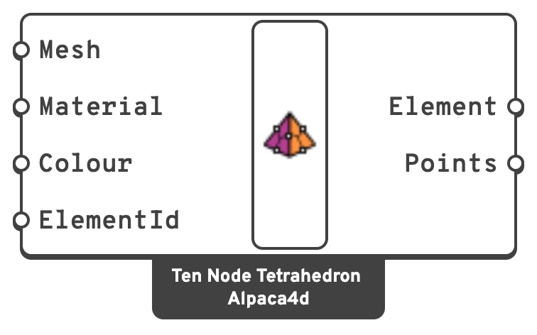

# Ten Node Tetrahedron

The **ten node tetrahedron** is the quadratic 3D solid element: the four corners of a
tetrahedron plus a node at the middle of each of its six edges. Its strain varies linearly
through it, so it can bend, where the linear four node tetrahedron, with one constant strain,
locks up. It is the element to use for volumes that only mesh into tetrahedra.

It is made from a 4-vertex mesh per tetrahedron. The six edge nodes are added for you at the edge
midpoints.

It replaces the Four Node Tetrahedron component.


**It needs an OpenSees newer than 3.8.0.** In OpenSees 3.8.0 and earlier the element
integrates over a sixth of its volume, so it comes out **six times too soft** (and six times too
light), and reading its stresses corrupts memory. The fixes are in OpenSees pull request
#1833, merged into the master branch on 16 October 2026. Use an OpenSees built from master
since then, or a release after 3.8.0. On an older one, Run Analysis stops with a message
saying so; it does not hand back wrong numbers.


## 🔧 Grasshopper component

`TenNodeTetrahedron (Alpaca4d)` — **Alpaca4d ▸ 02_Element**

<figure><figcaption></figcaption></figure>

Constructs one quadratic tetrahedral element from one 4-vertex mesh.

### Inputs

| Name | Nick | Type | Default | Description |
| --- | --- | --- | --- | --- |
| Mesh | `Mesh` | Mesh | — | Tetrahedral mesh with **4 vertices**, its corners, in `m`. The corners are put in OpenSees order and checked for a positive Jacobian; the edge nodes are added at the midpoints. |
| Material | `Material` | Material | — | An [nD material](../materials/ND.md). |
| Colour | `Colour` | Colour | Alpaca4d brick colour | Display colour in the Rhino viewport. |
| ElementId | `ElementId` | Text | *(empty)* | Optional name for the element, used to pull its results out later. Free text, and yours to repeat: one name over twenty meshes labels all twenty, and asking for it returns all twenty. Give a list to name them apart. |

### Outputs

| Name | Nick | Type | Description |
| --- | --- | --- | --- |
| Element | `Element` | Element | Tetrahedral element, to be connected to [Assemble](../assemble.md). |
| Points | `Points` | Point (list) | The element's ten nodes: the four corners, then the middles of edges 1-2, 2-3, 3-1, 1-4, 2-4 and 3-4. |

### Supports and point loads go on nodes

A [Support](support.md) holds the one node at its point. A face supported only at its mesh
vertices is held at its corners and **free at the edge nodes between them**, and bulges there.
Support the edge nodes too: take the points from **Points**, keep the ones on the supported
face, and remove duplicates. [Assemble](../assemble.md) warns when it finds an edge node
between two supported corners with no support of its own.

## 📈 When to use it

**Use it when**

- The volume cannot be meshed into hexahedra, which is most geometry not drawn with bricking
  in mind.
- The solid bends: a cantilever 10 × 1 × 1 cut into 60 tetrahedra deflects 0.4018 against
  beam theory's 0.4024 with ten node elements, and 0.098 with four node ones, a quarter of it.

**Do not use it when**

- A hexahedral mesh is available and coarse is good enough → [SSP Brick](brick.md) is cheaper.
- The body is thin → use [Shell](shell.md).

**Examples:** [Spot the Cow](#spot-the-cow), [Femur](#femur) and
[Inigo the Dragon](#inigo-the-dragon), at the end of this page, bring tetrahedral meshes from a
mesher into Grasshopper, under their own weight, a point force and in vibration.

## 📊 Results

[Brick Stresses](../results/brick-stresses.md) gives one value per element: the mean of its four
integration points, which is the stress at its centre. [View Results](../visualisation/view-results.md)
draws how the stress varies across each element, from the four points read back to its nodes.

Its own weight ([Gravity Load](../loads/gravity.md)) is shared among the nodes the way the
element itself shares a body force: −1/20 of the element's weight on each corner and 1/5 on
each edge node. The total is the weight.

## 🔗 Relation to OpenSees

```tcl
element TenNodeTetrahedronStd $eleTag $n1 $n2 $n3 $n4 $n5 $n6 $n7 $n8 $n9 $n10 $matTag $bx $by $bz
```

- `$n1 … $n4` are the corners, `$n5 … $n10` the edge nodes on 1-2, 2-3, 3-1, 1-4, 2-4, 3-4.
  `TenNodeTetrahedronStd` takes them in that standard order; plain `TenNodeTetrahedron` has
  `$n9` and `$n10` the other way round.
- `$matTag` is the **Material** input.
- Body forces are not exposed by the component; use [Gravity Load](../loads/gravity.md) for
  self-weight.

Tetrahedron nodes have **3 DOF**.

## Examples

Three tetrahedral meshes from a mesher, brought into Grasshopper. Download a definition from the
link under its picture. Each needs an OpenSees newer than 3.8.0, as the warning at the top of this
page explains; with 3.8.0 the analysis stops and says so.

### Spot the Cow

<figure><figcaption></figcaption></figure>

[spot-the-cow](https://raw.githubusercontent.com/Alpaca4d/alpaca4d.github.io/main/doc/basics/elements/ten-node-tetrahedron/spot-the-cow/spot-the-cow.gh)

A solid concrete cow, 2.4 m long, standing on its four hooves under its own weight, in 5 030 Ten
Node Tetrahedra. It shows how to bring a tetrahedral mesh into Grasshopper, how to hold a solid on
the ground, and how to read the stress inside it. Spot is Keenan Crane's cow, a mesh used
throughout geometry processing.

#### The model

| Group | What it does |
| --- | --- |
| 1 - Spot the cow in tetrahedra | The tetrahedra as a mesher writes them: **Nodes**, the 1 431 corner points, and **Tetrahedra**, four node numbers per tetrahedron, one branch each. **List Item** picks each tetrahedron's corners and **Construct Mesh** makes them into a four vertex mesh. |
| 2 - Concrete, and Ten Node Tetrahedra | An [nD](../materials/ND.md) Elastic Isotropic material, C30/37, with its density, and a Ten Node Tetrahedron for each mesh. |
| 3 - Pinned at every node on the ground | Every element's ten nodes from its **Points** output, in one list; those below 1 mm, once each, held in X, Y and Z by a [Support](support.md). |
| 4 - Its own weight | [Gravity](../loads/gravity.md), in a [Load Pattern](../loads/load-pattern.md). |
| 5 - Assemble Model | [Assemble](../assemble.md), and [Model View](../visualisation/model-view.md) to see the elements and the supports. |
| 6 - Solve, and the vertical stress | [Run Analysis](../analysis/run-analysis.md), and [View Results](../visualisation/view-results.md) on Brick stresses, σ33, over a **Range** of -0.15 to 0.15 MPa, with its [Legend](../visualisation/legend.md). |

#### Tetrahedra from a mesher

Grasshopper has no tetrahedral mesher, so the tetrahedra come in as one hands them out: a list of
points, and four point numbers per tetrahedron, counted from 0. Ten Node Tetrahedron takes a four
vertex mesh, puts the corners in the order OpenSees wants, and adds a node in the middle of each
edge. The four mesh faces do not matter: any four that close the mesh will do.

The same two lists come out of any tetrahedral mesher: a TetGen `.node` and `.ele`, the nodes and
the tetrahedra of a gmsh `.msh`. Paste or read yours into **Nodes** and **Tetrahedra**, and the rest
of the definition runs as it is. This cow was meshed with [gmsh](https://gmsh.info), by
`Tools/Examples/SpotTheCowMesh.py` in the Alpaca4d repository.

#### Holding a solid

As [Supports and point loads go on nodes](#supports-and-point-loads-go-on-nodes) explains, a
support holds only the node at its point. So the hooves are held at every node on the ground, taken
from **Points**, which gives each element's ten nodes, edge nodes included. **Cull Duplicates**
keeps each node once: a node is shared by the elements around it.

A solid node has no rotations, so a support on it holds translations only. The cow stands on
pinned points.

#### What it shows

The cow weighs 47.4 kN: 1.93 m³ of concrete at 2 500 kg/m³. The reactions add up to that.

| Where | Vertical stress |
| --- | --- |
| Legs, 20 cm up | -0.094 MPa |
| Body, 60 cm up | -0.024 MPa |
| Top of the neck, where the head hangs out past the front legs | +0.11 MPa |
| At the pinned nodes under the hooves | down to -1.4 MPa |

The legs check by hand. At 20 cm up their cross-section is 0.52 m² and carries the 45.7 kN of cow
above it: 45.7 / 0.52 = -0.089 MPa, against -0.094 MPa in the model.

The stress under the hooves is not real. Holding a solid at its nodes makes a point support, and
the stress at a point support grows every time the mesh is refined. That is why **Range** is set to
±0.15 MPa: fitted to everything drawn, the scale would stretch from -1.4 to +0.3 MPa and leave the
rest of the cow one colour. Clear Range to see all of it.

Pick another result in View Results' **Result** menu: Von Mises, or Displacement, at most 0.02 mm.

Spot by Keenan Crane, from his [3D model repository](https://www.cs.cmu.edu/~kmcrane/Projects/ModelRepository/),
dedicated to the public domain (CC0).

### Femur

<figure><figcaption></figcaption></figure>

[femur](https://raw.githubusercontent.com/Alpaca4d/alpaca4d.github.io/main/doc/basics/elements/ten-node-tetrahedron/femur/femur.gh)

A thigh bone, held at the knee, with the force of the hip on its head, in 3 813 Ten Node
Tetrahedra. The bone is the Standardised Femur, the reference geometry for finite element studies
of the femur. The example shows how to hold one end of a solid and load the other through a patch
of nodes.

#### The model

| Group | What it does |
| --- | --- |
| 1 - The femur in tetrahedra | The tetrahedra as a mesher writes them: **Nodes**, the 1 297 corner points, and **Tetrahedra**, four node numbers per tetrahedron, one branch each. **List Item** and **Construct Mesh** make each into a four vertex mesh. See [Tetrahedra from a mesher](#tetrahedra-from-a-mesher). |
| 2 - Bone, and Ten Node Tetrahedra | An [nD](../materials/ND.md) Elastic Isotropic material: cortical bone, E = 17 GPa, ν = 0.3. |
| 3 - Held at the knee | Every element's ten nodes from its **Points** output; those in the bottom 2 cm, once each, held in X, Y and Z, as a bone potted in cement for a test. |
| 4 - The hip's force | The highest node is the top of the head. The force is shared equally among the nodes within 15 mm of it: **List Length** counts them and **Division** gives each its share of the 2 kN, as [Point Loads](../loads/point-load.md). |
| 5 - Assemble Model | [Assemble](../assemble.md), and [Model View](../visualisation/model-view.md) to see the supports and the loads. |
| 6 - Solve, and the displacement | [Run Analysis](../analysis/run-analysis.md), and [View Results](../visualisation/view-results.md) on Displacement, drawn 20 times larger, with its [Legend](../visualisation/legend.md). |

#### The load

When you walk, the hip pushes on the head of the femur with about two and a half times your weight.
For an 80 kg person that is 2 kN. Here it leans 13° from the shaft, pushing the head down and out:
(0.45, 0, -1.95) kN. Spread over the 90 nodes on the top of the head, it does not punch through a
single node.

#### What it shows

The head moves 3.4 mm, mostly sideways. The shaft bends over the knee, as it does under the
eccentric load of the neck. The reactions at the knee balance the 2 kN exactly.

Treat the numbers as an illustration, not as biomechanics. The bone is solid cortical bone all
through: the canal and the softer bone inside the ends are filled in, so this femur is stiffer than
a real one. Change **E** and the load in groups 2 and 4 to try your own.

#### The geometry

The Standardised Femur comes as IGES surfaces that do not close into a solid: its faces stand up
to a millimetre apart, and CAD will not sew them. `Tools/Examples/FemurMesh.py`, in the Alpaca4d
repository, rebuilds a closed surface from the outer faces with a signed distance and marching
cubes. It then fills that surface with tetrahedra with [gmsh](https://gmsh.info).

The [Standardised Femur](https://doi.org/10.15131/shef.data.3839766.v1) by Marco Viceconti,
University of Sheffield, licensed under [CC BY 4.0](https://creativecommons.org/licenses/by/4.0/);
see Viceconti et al., *Journal of Biomechanics* 29 (1996), 1241. Here its outer surface was rebuilt
as a closed solid and meshed with tetrahedra.

### Inigo the Dragon

<figure><figcaption></figcaption></figure>

<figure><figcaption></figcaption></figure>

[inigo-the-dragon](https://raw.githubusercontent.com/Alpaca4d/alpaca4d.github.io/main/doc/basics/elements/ten-node-tetrahedron/inigo-the-dragon/inigo-the-dragon.gh)

A concrete dragon 5.5 m tall, standing on its two feet, in 10 903 Ten Node Tetrahedra, and the ways
it vibrates: it sways, wags its tail and flaps its wings. The example runs a
[Natural Vibration](../analysis/natural-vibration.md) analysis on a solid and steps through its
modes in View Results. Inigo is Keenan Crane's dragon, built from signed distance functions.

#### The model

| Group | What it does |
| --- | --- |
| 1 - Inigo the dragon in tetrahedra | The tetrahedra as a mesher writes them: **Nodes**, the 3 511 corner points, and **Tetrahedra**, four node numbers per tetrahedron, one branch each. **List Item** and **Construct Mesh** make each into a four vertex mesh. See [Tetrahedra from a mesher](#tetrahedra-from-a-mesher). |
| 2 - Concrete, and Ten Node Tetrahedra | An [nD](../materials/ND.md) Elastic Isotropic material, C30/37, with a density of 2 500 kg/m³. |
| 3 - Held at every node on the soles | Every element's ten nodes from its **Points** output; those below 1 mm, once each, held in X, Y and Z by a [Support](support.md). |
| 4 - Assemble Model | [Assemble](../assemble.md), with no load at all. |
| 5 - The first 12 modes | [Natural Vibration](../analysis/natural-vibration.md) with **Vibration Modes** set to 12, and a **Mode** slider into the **Step** of [View Results](../visualisation/view-results.md), which draws the mode deformed. **Frequencies** lists them, in Hz. |

#### No load, only mass

A natural vibration analysis needs mass, not load. It takes the mass from the material's density:
11.4 m³ of concrete, 28.5 t. Natural Vibration connects to Assemble Model, not to Run Analysis:
there is nothing to run first.

#### The modes

**Mode** picks the mode View Results draws, counting from 0 as **Step** does: 0 is the first mode.

| Mode | Step | Frequency | Shape |
| --- | --- | --- | --- |
| 1 | 0 | 7.7 Hz | sways forward and back |
| 2 | 1 | 21.8 Hz | sways side to side |
| 3 | 2 | 41.5 Hz | wags its tail, and the wings rock |
| 4 | 3 | 59.1 Hz | both wings flap together |
| 5 | 4 | 60.1 Hz | the wings flap against each other, and the tail swings |

The definition opens on mode 4. Tick **Animate** in View Results' **Display** menu to watch it
move.


**A mode has no size of its own.** Each mode is read with its largest translation 1, and View
Results draws it at **Deformation scale** 1 with its largest movement 8 % of the model's diagonal:
0.68 m on the dragon. The numbers on the legend show where the dragon moves most, not by how much.
Here 0.4 moves the wing tip by a quarter of a metre, and **Animate** sweeps the scale from 0 to 0.8
and back.


#### The geometry

Inigo's wings are membranes a few centimetres thick, and its fingers and smile leave gaps narrower
than an element. Meshed as they are, they give a surface that passes through itself. So
`Tools/Examples/InigoTheDragonMesh.py`, in the Alpaca4d repository, rebuilds the dragon on a grid
before meshing it with [gmsh](https://gmsh.info): grown by 4.5 cm all over, which makes the wings
9 cm thicker, with every gap narrower than 18 cm filled and the soles cut flat. The scales, the
teeth and the finer details are gone; the dragon is all there.

Inigo the Dragon by Keenan Crane, 2026, from his
[3D model repository](https://www.cs.cmu.edu/~kmcrane/Projects/ModelRepository/), dedicated to the
public domain (CC0).
