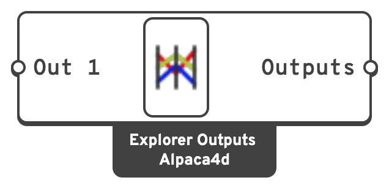

# Explorer Outputs

Names the results a design is judged by, for [Explorer Record](explorer-record.md) to save
and the explorer to show as the axes to the right of the inputs.

## 🔧 Grasshopper component

`Explorer Outputs (Alpaca4d)` — **Alpaca4d ▸ 12_Explorer**

<figure><figcaption></figcaption></figure>

### Inputs

| Name | Nick | Type | Default | Description |
| --- | --- | --- | --- | --- |
| Result | `Out 1`, `Out 2`… | Any | – | One result per input: a number, or a text for a category. A new input appears when the last one is used. |

An input takes the name of what is wired into it. **Rename it** to name the column, units
included: `Mass [t]`, `Max displacement [mm]`. The unit in brackets is shown under the axis.

### Outputs

| Name | Nick | Type | Description |
| --- | --- | --- | --- |
| Outputs | `Outputs` | Generic (list) | The results by name. For **Outputs** on [Explorer Record](explorer-record.md). |

## 📈 When to use it

**Use it** for the handful of numbers a design is chosen on: the total mass, the largest
displacement, the highest [Utilisation](../results/utilisation.md), the first period from the
[Modal Analysis Report](../results/modal-analysis-report.md).

**Do not** wire in whole result lists. An input given a list writes one column per item,
`Name_1`, `Name_2`…, and keeps at most ten. Reduce a list to the value that matters first -
*Bounds*, *Mass Addition* - then wire that in.


An input with no value writes an empty cell, which the explorer shows as *no data* below the
axis, rather than a number that would stretch it. Numbers are written with a decimal point
whatever Rhino's language, so a study opens the same anywhere.


Explorer Outputs can also go into the **Inputs** of Explorer Record, to save a computed value
as an input - useful when something other than Explorer Inputs drives the definition, such as
Galapagos.
