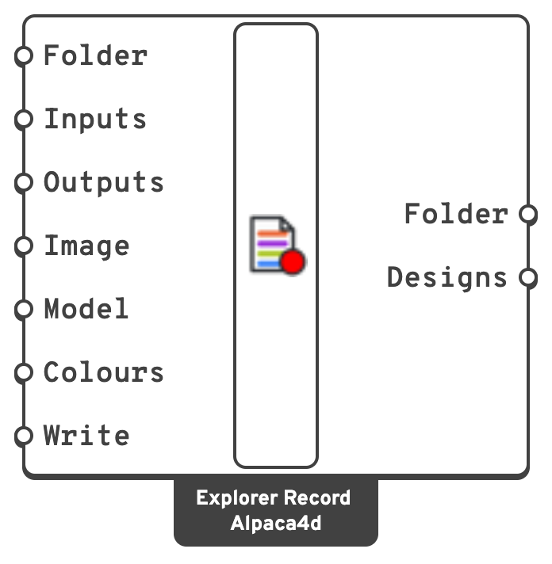

# Explorer Record

Saves each design of a study into a folder the
[Alpaca4d Explorer](https://alpaca4d.github.io/explorer/) opens: `data.csv` with its inputs and
results, and a picture and a 3D model of each design.

## 🔧 Grasshopper component

`Explorer Record (Alpaca4d)` — **Alpaca4d ▸ 12_Explorer**

<figure><figcaption></figcaption></figure>

### Inputs

| Name | Nick | Type | Default | Description |
| --- | --- | --- | --- | --- |
| Folder | `Folder` | Text | `AlpacaExplorer\<file name>` next to the .gh file | Where to save the study. A relative path starts at the .gh file's folder. A definition not saved yet records under `Documents\Alpaca4d`. |
| Inputs | `Inputs` | Generic (list) | – | From **Inputs** of [Explorer Inputs](explorer-inputs.md). A design is known by its inputs. |
| Outputs | `Outputs` | Generic (list) | – | From [Explorer Outputs](explorer-outputs.md). |
| Image | `Image` | Generic | active viewport, 800 × 600 | From [Explorer Image](explorer-image.md). |
| Model | `Model` | AlpacaModel, mesh, Brep, curve, point, text dot, text (list) | – | The design's 3D model. Left empty, there is none. |
| Colours | `Colours` | Colour (list) | – | A colour per **Model** item, or one for all: a text dot's background, a text's colour. Left empty, anything picked from Rhino keeps the colour Rhino draws it in. |
| Write | `Write` | Boolean | `false` | `true` to save designs. |

### Outputs

| Name | Nick | Type | Description |
| --- | --- | --- | --- |
| Folder | `Folder` | Text | The study folder. |
| Designs | `Designs` | Integer | How many designs it holds. |

### Right-click

| Item | Does |
| --- | --- |
| Open the study folder | Opens it in Finder or Explorer. |
| Open the Alpaca4d Explorer | Opens the explorer in the browser, and the folder, ready to drop on it. |
| Start a new study… | Deletes `data.csv` and the pictures and models it lists, after asking. Other files in the folder are left alone. |

## 📈 What it saves

```
AlpacaExplorer/bridge/
  data.csv
  20_1.5_6_HEA200.png
  20_1.5_6_HEA200.glb
```

Files are named after the design's input values. `data.csv` has a column per input
(`in:Span [m]`), per result (`out:Mass [t]`), the picture (`img`, or `img:Top` and so on for
several views) and the model (`threeD`).

**The 3D model.** Plug the **AlpacaModel** into **Model** and it is saved as
[Model View](../visualisation/model-view.md) draws it: beams as their sections carried along
them, shells and solids as meshes, in the elements' colours. Meshes keep their vertex colours,
so a coloured result mesh comes out coloured. Breps and SubDs are meshed, curves become lines,
points and point clouds become dots.

**Labels.** Text dots and text become labels: the explorer draws them over the model, facing
you and the same size however far you zoom, as Rhino draws a text dot, and a button in the 3D
view shows or hides them. A dot keeps its colour as its background, a text as its colour: the
one given in **Colours**, or else, for a dot picked from Rhino, its own object or layer colour, as
Rhino draws it. A thin light ring keeps a black dot visible on a dark view. They
are kept as labels in the .glb rather than turned into geometry, so other glTF viewers show the
model without them.

## 💡 Notes


**A study only grows.** A design whose inputs are already in `data.csv` is not saved again. Fly
again after a stop and only the missing designs are run. To start over, right-click ▸
*Start a new study…*



**One study per folder.** If the folder holds a study with other inputs, results or views,
Explorer Record refuses to add to it rather than write rows that do not line up. Record into
another folder, or start a new study.


- If a design cannot be saved - data.csv open in Excel, a full disk, a result whose list changed
  length and with it the columns - the flight stops and says why, rather than solving designs that
  are not kept.
- A design is written once its solution is over and Rhino has redrawn, so its picture shows it
  and not the design before. With **Write** on, moving a slider by hand records the design too.
- Pictures leave out the grid and the axes. Pick a display mode and a view before flying; the
  picture is the viewport as it is drawn.
- Something that solves designs back to back without letting Rhino redraw, such as Galapagos,
  still has every design saved, but a picture may show the design after its own.
