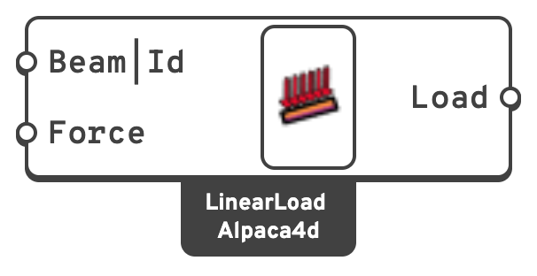

# 📏 Beam

A uniform **line load** along the length of a beam element.

## 🔧 Grasshopper component

`Linear Load (Alpaca4d)` — **Alpaca4d ▸ 05_Load**, nickname `LinearLoad`

<figure><figcaption></figcaption></figure>

### Inputs

| Name | Nick | Type | Default | Description |
| --- | --- | --- | --- | --- |
| Beam\|Id | `Beam\|Id` | Element or text | *all beams* | The beam to load, or text naming the beams by ElementId: `Beam_3`, a wildcard `Beam*`, an element tag `47`, or `regex:^Col`. **If left empty the load is applied to every beam element in the model.** |
| Force | `Force` | Vector | — | Load intensity `qx, qy, qz` in **global** axes, in `kN/m`. |

### Outputs

| Name | Nick | Type | Description |
| --- | --- | --- | --- |
| Load | `Load` | Load | Line load, for a [Load Pattern](load-pattern.md). |

The global vector is resolved into the element's **local** axes before it is written, so a
vertical load on an inclined member is decomposed into its local transverse and axial parts
automatically.

## 📈 When to use it

**Use it when**

- The action is genuinely distributed along a member: façade weight, finishes not modelled
  as elements, an imposed line load on a beam.
- A slab is not modelled and you are transferring its load onto the supporting beams by hand.

**Do not use it when**

- The load varies along the member. This is a **uniform** load only. Approximate a varying
  load by splitting the beam and giving each piece its own intensity.
- The action is a surface pressure on a shell → [Shell Load](shell-load.md).


Leaving **Beam|Id** empty loads *all* beams, which is convenient but easy to forget. If
different members need different intensities, use one component per group. Plug the elements
in, or give the group one ElementId on the beam component and type that name here, so the load
follows the name instead of a wire.

Each item makes one load, so two names that match the same beam (`Beam*` and `Beam_3`) load it
twice. A name that matches no beam loads nothing, and Assemble Model warns about it.


## 🔗 Relation to OpenSees

Inside the enclosing pattern:

```tcl
eleLoad -ele $eleTag -type -beamUniform $Wy $Wz $Wx
```

`Wy`, `Wz` and `Wx` are the **local** components, obtained from the global **Force** vector
through the element's geometric transformation.
