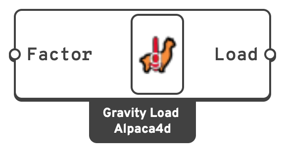
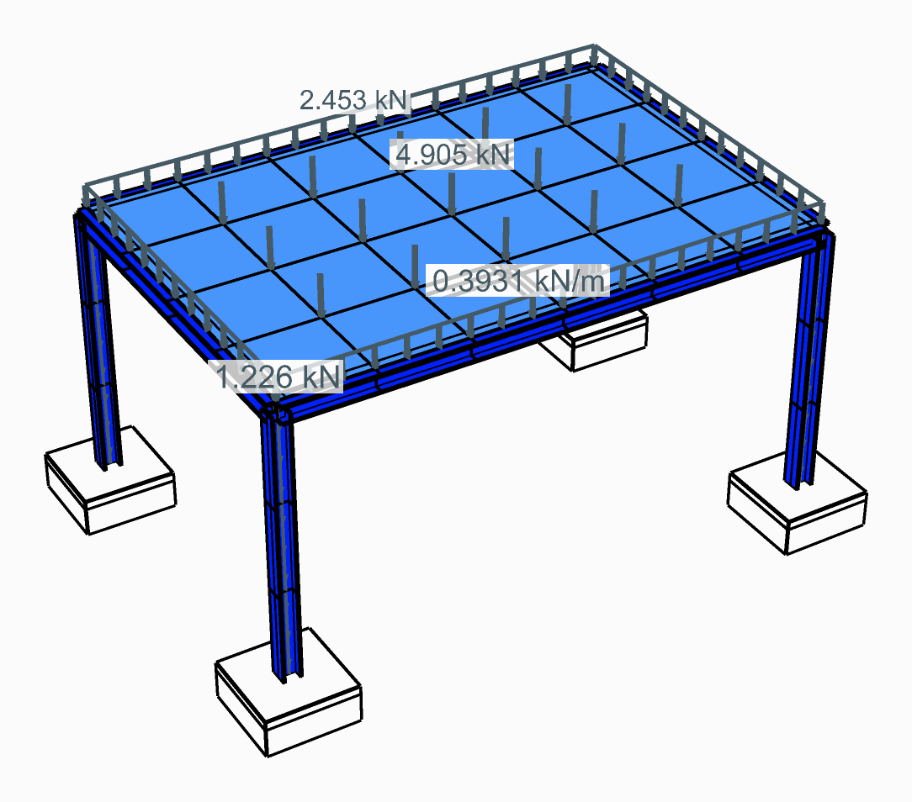

# Gravity

Applies the **self-weight** of every element in the model, derived from the material density
and the section or thickness.

## 🔧 Grasshopper component

`Gravity Load (Alpaca4d)` — **Alpaca4d ▸ 05_Load**

<figure><figcaption></figcaption></figure>

### Inputs

| Name | Nick | Type | Default | Description |
| --- | --- | --- | --- | --- |
| Factor | `Factor` | Number | `1.0` | Multiplier on gravity. `1.0` is plain self-weight; `0.0` disables it; `1.35` gives a factored permanent load; values above 1 are also a quick way to include finishes not modelled explicitly. |

### Outputs

| Name | Nick | Type | Description |
| --- | --- | --- | --- |
| Load | `Load` | Load | Gravity load, for a [Load Pattern](load-pattern.md). |

There is no geometry input. Gravity applies to the whole model, and its direction is −Z.
[Model View](../visualisation/model-view.md#how-the-loads-are-drawn), with **Show Loads** on, draws
it as OpenSees is given it, in the Gravity colour: a line load along each beam, and a point load
down on each node of the rest.

<figure><figcaption><p>A steel frame's own weight along its members, 0.393 kN/m, and the slab's on its nodes: 4.905 kN inside, half on an edge, a quarter at a corner</p></figcaption></figure>

## 📈 When to use it

**Use it when**

- Any model where self-weight matters. Put it in its own permanent pattern (a "G" case) and
  combine it with the others.

**Do not use it when**

- You are modelling weight that is *not* in the elements — plant, finishes, a stored
  material → use [Point Load](point-load.md), [Beam Load](beam-load.md) or
  [Shell Load](shell-load.md), and [Mass Point](mass-point.md) for the dynamic side.


**A beam carries its weight along it**, as a uniform load, so a beam of one element bends
under it: `w L² / 8` at the middle of a simply supported span. A
[truss](../elements/force-beam-column.md) has no bending to carry a load along it with, so half its
weight goes on each end, as a [Linear Load](beam-load.md) on it does.


## 🔗 Relation to OpenSees

Gravity is resolved by Alpaca4d during assembly rather than written as its own command. Each
element's weight becomes loads inside the enclosing pattern: an element load along each beam, and
`load` entries on the nodes of everything else.

```tcl
pattern Plain $tag $tsTag -fact $factor {
    eleLoad -ele $beamTag -type -beamUniform $Wy $Wz $Wx
    load $nodeTag 0.0 0.0 -$w 0.0 0.0 0.0
    ...
}
```

A beam's load is `A × ρ × g` per metre, straight down, written in the beam's local axes as a
[Linear Load](beam-load.md) is. A truss's weight, `A × ρ × L`, goes half on each end. A shell's,
`t × ρ × area`, is split between its nodes. A solid's, `ρ × volume`, is shared equally among its nodes, except a
[Ten Node Tetrahedron](../elements/ten-node-tetrahedron.md)'s: −1/20 of it on each corner and
1/5 on each edge node, the way the element shares a body force.
