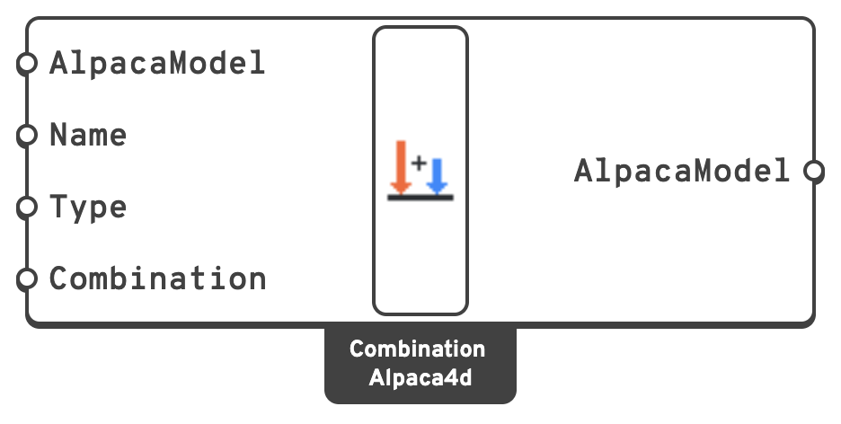

# Load Combination

A **load combination** is a set of [Load Patterns](load-pattern.md) acting together, each times a
factor: `1.35 G + 1.5 Q` for the ultimate limit state, `G + Q` for the characteristic one.

Load Combination adds combinations to the assembled model. [Run Analysis](../analysis/run-analysis.md)
then solves each one, with only the patterns it names, each scaled by its factor. It hands on **one
model** that holds the results of every combination. Downstream components pick a combination by
its name: Model View, Linear Buckling and Pushover each have a **Combination** input for it.

## 🔧 Grasshopper component

`Load Combination (Alpaca4d)` — **Alpaca4d ▸ 05_Load**

<figure><figcaption></figcaption></figure>

### Inputs

| Name | Nick | Type | Default | Description |
| --- | --- | --- | --- | --- |
| AlpacaModel | `AlpacaModel` | AlpacaModel | — | The assembled model, from [Assemble](../assemble.md) or from another Load Combination. Its load patterns must be named in [Load Pattern](load-pattern.md)'s **Name** input. It must not be analysed yet. |
| Name | `Name` | Text list | *each combination's formula* | Each combination's name, one item per combination: `ULS 1`. The [Report](../report/report.md) and the **Combination** inputs call it by this name. |
| Type | `Type` | Text list | `ULS` | What each combination is checked for: `ULS`, `SLS characteristic`, `SLS frequent`, `SLS quasi-permanent`, `Accidental` or `Seismic`. Case, spaces and hyphens don't matter. One item gives every combination that type. A shorter list repeats its last item for the remaining combinations. |
| Combination | `Combination` | Text list | — | Each combination's patterns and factors, joined by `+`: `1.35 G + 1.5 Q + 0.9 W`. Each term is a factor and a Load Pattern's **Name**, in any case: `1.5 Q`, `1.5*Q`, or `Q` alone for a factor of 1. Write a negative factor as `+ -1.5 W`, because a pattern's name may contain a minus. |

### Outputs

| Name | Nick | Type | Description |
| --- | --- | --- | --- |
| AlpacaModel | `AlpacaModel` | AlpacaModel | The model with these combinations added to any it already had, for [Run Analysis](../analysis/run-analysis.md) or another Load Combination. |

### All the combinations in one component

Type each combination on its own line in three panels, and wire each panel into its input:

```
 Name     Type                  Combination
 ULS 1    ULS                   1.35 G + 1.5 Q + 0.75 S + 0.9 W
 ULS 2    ULS                   1.35 G + 1.05 Q + 0.75 S + 1.5 W
 SLS 1    SLS characteristic    G + Q + 0.5 S + 0.6 W
 SLS 3    SLS quasi-permanent   G + 0.3 Q
```

```
Assemble ──► Load Combination ──► Run Analysis ──► one model, four combinations ──► Model View  Combination: ULS 2
                                                                                  └► Report
```

### Or one after another

Each Load Combination adds its combinations to the ones the model already has. This lets you keep
one component per type, with no data trees to manage:

```
Assemble ──► Load Combination ──► Load Combination ──► Run Analysis
             ULS 1, ULS 2          SLS 1
             (Type empty: ULS)     Type: SLS characteristic
```

## 📈 When to use it

**Use it when**

- You check a structure to a code: the members against the ULS combinations, the deflections
  against the SLS ones.
- You want the [Report](../report/report.md) to list the combinations, give the results of each,
  and check the steel members against the ultimate ones.

**Do not use it when**

- All the loads act together at their full size: give the assembled model to Run Analysis
  directly.

A combination scales the loads and solves the model again. It does not add results together, so
it is right for a model with nonlinear materials too, whose results are not the sum of each
pattern's own.

## Good to know

- **Name each pattern** in [Load Pattern](load-pattern.md)'s **Name** input. A name that no pattern
  has, or that two patterns share, is an error that lists the names the model has. Two combinations
  with the same name are an error too.
- **The pattern's own Factor stays.** A pattern with Factor 1.1 in a combination at 1.5 acts at
  1.65.
- **What is not named does not act.** Self-weight is a pattern like any other: put its
  [Gravity Load](gravity.md) in a pattern, `G` say, and name it in each combination.
- **The mass stays.** [Mass Points](mass-point.md) and [Mass from Loads](mass-from-loads.md) belong
  to the model, whatever the combination. Natural Vibration and Footfall ignore the combinations: a
  combination such as `G + 0.1 Q` adds no mass. Make the share of a load that is mass with Mass from
  Loads.
- **Combinations are static.** Run Analysis needs Static in [Analysis Settings](../analysis/analysis-settings.md)
  for a model with combinations. For a time history, analyse the model Assemble hands on.
- **A combination that fails keeps the others.** If one does not converge, Run Analysis warns and
  names it. The others keep their results, and the Report marks the steel check *Incomplete*.
- **Without combinations, the patterns act together.** Run Analysis, Linear Buckling and Pushover
  load a model that has none with all its patterns at once, each at its own Factor: a `Wind +X` and
  a `Wind -X` cancel. Once you add combinations, only the combinations act, each with the patterns
  it names.
- **Linear Buckling and Pushover take the combination you name.** Each has a **Combination**
  input: the name of the one to buckle under, or to hold before the push, `ULS 1` or `Seismic`, say.
  A model with combinations needs it: left empty, they stop with an error listing the names. None
  is picked for you.
- **Section Optimiser does not use them yet.** It sizes the members under every pattern at once,
  and warns when the model has combinations.

## 🔗 Relation to OpenSees

Each combination is an OpenSees run of its own: the model as assembled, then a `pattern Plain` for
each pattern named, with its factor. Its results go to a file of their own, named after it:
`recorder_ULS_1_….mpco`.

```tcl
pattern Plain 12 12 -fact 1.35 { ... }   ;# G
pattern Plain 13 13 -fact 1.5  { ... }   ;# Q
```
