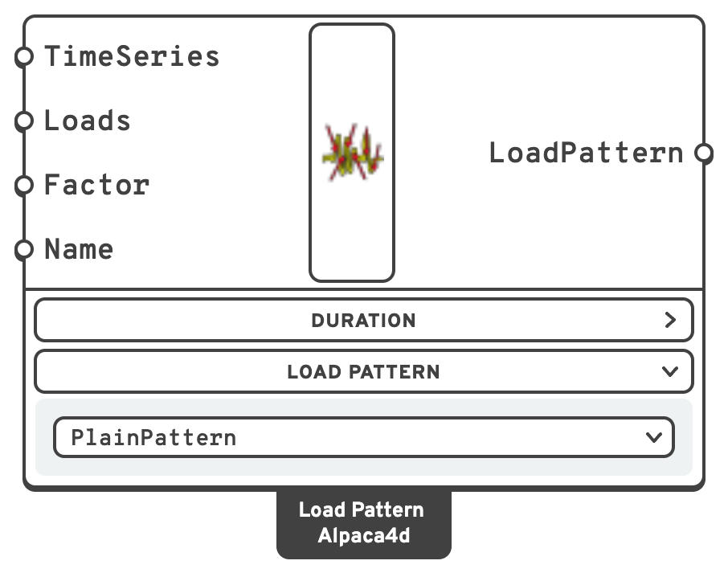
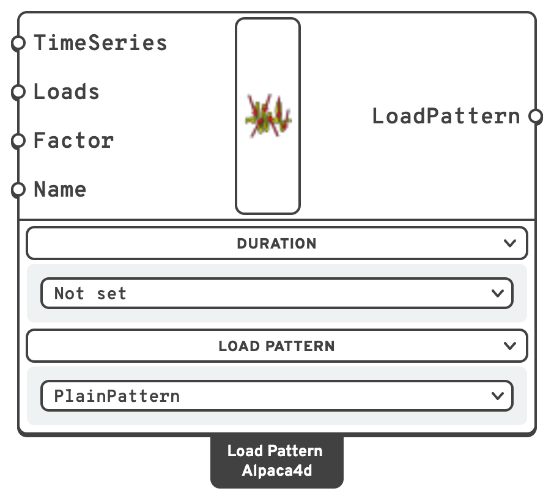

# Load Pattern

A **load pattern** groups loads and attaches a [time series](../time-history/README.md) that
says how the group varies with time. It is the object the analysis actually applies — loose
loads never reach [Assemble](../assemble.md) on their own.

## 🔧 Grasshopper component

`Load Pattern (Alpaca4d)` — **Alpaca4d ▸ 05_Load**

<figure><figcaption></figcaption></figure>

<figure><figcaption><p>With every menu open</p></figcaption></figure>

A switcher component: pick the unit in the drop-down under it, or right-click it ▸ **Units**:

- **PlainPattern** — static and quasi-static load cases.
- **UniformExcitation** — base acceleration applied to every support.

### Inputs — PlainPattern

| Name | Nick | Type | Default | Description |
| --- | --- | --- | --- | --- |
| TimeSeries | `TimeSeries` | TimeSeries | [Constant](../time-history/constant.md), factor 1 | How the pattern factor evolves with analysis time. |
| Loads | `Loads` | Load (list) | — | The loads in this pattern: point, line, surface, gravity. |
| Factor | `Factor` | Number | `1` | Constant scale applied to the whole pattern, on top of the time series. |
| Name | `Name` | Text | *(empty)* | The load case's name: Finishes, Imposed, Wind X. [Mass from Loads](mass-from-loads.md) and [Load Combination](load-combination.md) name a pattern by it, [Model View](../visualisation/model-view.md) draws its loads alone by it, and the [export to FEM-Design](../utility/alpaca4d-to-femdesign.md) names its load case. OpenSees never sees it. |

### Duration menu — PlainPattern

Below the component, folded away: only the timber check reads it.

| Menu | Default | Description |
| --- | --- | --- |
| Duration | `Not set` | How long the pattern's loads act — the load-duration class of EN 1995-1-1 (2.3.1.2, Table 2.1): `Permanent`, `Long-term`, `Medium-term`, `Short-term` or `Instantaneous`. [Utilisation](../results/utilisation.md) sets timber's k_mod from the shortest duration among the patterns of each combination (3.1.3(2)). `Not set` counts as permanent, the lowest k_mod, and Utilisation names the patterns left so. Steel, and the analysis, never read it. |

Typical classes, as Table 2.2 gives them: self-weight **permanent**; storage **long-term**; imposed
floor load **medium-term**; snow **short-term** or medium-term, as the National Annex says; wind and
accidental loads **instantaneous**.

### Inputs — UniformExcitation

| Name | Nick | Type | Default | Description |
| --- | --- | --- | --- | --- |
| Dof | `Dof` | Text | `X` | Direction the ground motion acts in. Attach a **Value List** for the options: `x`, `y`, `z` (translation along the global axes), `xx`, `yy`, `zz` (rotation about them). |
| TimeSeries | `TimeSeries` | TimeSeries | — | The ground motion, normally **acceleration** against time. |
| Velocity | `Velocity` | Number | `0` | Initial ground velocity, in `m/s`. |
| Factor | `Factor` | Number | `1` | Constant scale on the excitation — where a record in *g* gets its 9.81. |
| Name | `Name` | Text | *(empty)* | The load case's name: Finishes, Imposed, Wind X. [Mass from Loads](mass-from-loads.md) and [Load Combination](load-combination.md) name a pattern by it, [Model View](../visualisation/model-view.md) draws its loads alone by it, and the [export to FEM-Design](../utility/alpaca4d-to-femdesign.md) names its load case. OpenSees never sees it. |

### Outputs

| Name | Nick | Type | Description |
| --- | --- | --- | --- |
| LoadPattern | `LoadPattern` | LoadPattern | Pattern object, for the `LoadPatterns` input of [Assemble](../assemble.md). |

## 📈 When to use it

**PlainPattern** for everything static: dead, live, snow, wind, imposed. One pattern per load
case, so you can scale and combine them independently.

**UniformExcitation** for a seismic time-history run. It shakes the whole base at once, in
one direction, and needs a [Transient](../analysis/analysis-settings.md) analysis type with a
suitable [Integrator](../analysis/integrator.md) — `Newmark` or `CentralDifference`.

**Do not use UniformExcitation when** different supports see different motions — that needs
multiple-support excitation, which Alpaca4d does not expose.

## 💡 Workflow

1. Build the individual **loads**.
2. Group them into one or more **Load Pattern** components, each with its own time series.
3. Connect the patterns to [Assemble](../assemble.md).

Keeping loads and patterns separate is what lets the same physical load appear in several
cases at different factors.

**Name each pattern** after its load case. [Mass from Loads](mass-from-loads.md) then names
the patterns whose loads are to be mass, with a factor for each, as a mass source does in other
programs: "Finishes" at 1, "Imposed" at 0.1. [Model View](../visualisation/model-view.md) draws
the loads of one pattern when its **LoadPattern** input is given the name. The name is matched
whatever its case, and two patterns may share one. A file saved before patterns had a name opens with Name empty.

## 🔗 Relation to OpenSees

```tcl
# PlainPattern
timeSeries ...
pattern Plain $tag $tsTag -fact $factor {
    load    $nodeTag ...
    eleLoad -ele $eleTag ...
}

# UniformExcitation
pattern UniformExcitation $tag $dir -accel $tsTag -vel0 $velocity -fact $factor
```

`$dir` is the integer the **Dof** text maps to: `X`=1, `Y`=2, `Z`=3, `XX`=4, `YY`=5, `ZZ`=6.
