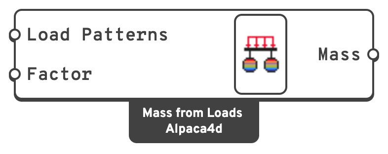

# Mass from Loads

Makes the **weight of loads into mass**, on the nodes the loads land on. A structure vibrates with
more than its own mass: the screed, the finishes, the partitions, the services and part of what
the floor carries in use. Its own weight is mass already, through the density of its materials;
Mass from Loads adds the rest, from the loads you have already drawn, with a factor for each kind.

You name the [Load Patterns](load-pattern.md) whose loads are to be mass, by the **Name** you gave
each one, and the factor for them: "Finishes" at 1, "Imposed" at 0.1. That is a mass source, as
other programs call it.

## 🔧 Grasshopper component

`Mass from Loads (Alpaca4d)` — **Alpaca4d ▸ 05_Load**

<figure><figcaption></figcaption></figure>

### Inputs

| Name | Nick | Type | Default | Description |
| --- | --- | --- | --- | --- |
| Load Patterns | `Load Patterns` | Text / LoadPattern / Load (list) | — | The names of the [Load Patterns](load-pattern.md) whose loads become mass, as their **Name** input has them, looked up among the patterns given to [Assemble](../assemble.md), whatever their case. Or the patterns themselves, or [Point](point-load.md), [Beam](beam-load.md) and [Shell](shell-load.md) loads. A pattern's own Factor is not applied, this component's is. [Gravity Load](gravity.md) is left out. |
| Factor | `Factor` | Number | `1` | How much of their weight is mass. 1 for permanent loads; about 0.1 of the imposed load for a footfall check (SCI P354); ψ2 of a variable load for an earthquake. |

### Outputs

| Name | Nick | Type | Description |
| --- | --- | --- | --- |
| Mass | `Mass` | Mass | The mass. Connect it to Assemble's `LoadPatterns` input, beside the load patterns, as you would a [Mass Point](mass-point.md). |

Use one component per factor, all into [Assemble](../assemble.md), beside the named patterns.
Or give it a tree, one branch per factor.

```
Mesh Load ──► Load Pattern  Name "Finishes" ──┐
Mesh Load ──► Load Pattern  Name "Imposed"  ──┤
                                              ├──► Assemble ──► Natural Vibration ──► Footfall
"Finishes" ──► Mass from Loads  Factor 1   ───┤
"Imposed"  ──► Mass from Loads  Factor 0.1 ───┘
```

The patterns named have to go into Assemble too: that is where the names are looked up. Natural
Vibration solves the modes without applying them, and [Run Analysis](../analysis/run-analysis.md)
applies them, so the same patterns serve the static check and make the mass.

| Analysis | Mass of the structure in use | Factor |
| --- | --- | --- |
| [Footfall](../analysis/footfall.md) (SCI P354) | self-weight + superimposed dead load + about 10% of the imposed load | 1 for finishes, screed, partitions, services; 0.1 for the imposed load |
| Earthquake (NTC 2018 3.2.4, EN 1998-1 3.2.4) | G1 + G2 + Σ ψ2 Qk | 1 for G2; ψ2: 0.3 homes and offices, 0.6 crowds and shops, 0.8 storage, 0 roofs and snow below 1000 m (EN 1998-1 4.2.4 takes φ ψ2) |

## 📈 When to use it

**Use it when**

- You are running [Natural Vibration](../analysis/natural-vibration.md), and what reads its
  modes, such as [Footfall](../analysis/footfall.md), or a transient analysis, and the structure
  carries loads whose mass counts.
- The loads are already in the model as forces: one component turns them into mass too, without
  working out a Mass Point per node.

**Do not use it when**

- The mass is a thing at one point, such as a tank, plant or a damper → [Mass Point](mass-point.md).
- You want the self-weight of the elements → it is mass already, from the material density.
  [Gravity Load](gravity.md) only adds its force.

## How the mass is made

- **Only the downward part of a load weighs.** A load pushing up gives no mass, and the sideways
  part of a slanted one is left out, with a remark. Loads in local axes are left out, with a warning.
- **It is mass along every axis.** A mass shakes sideways as readily as it falls, so the weight over
  g goes on X, Y and Z alike.
- **It lands where the load does.** A point load at its node, half of a beam load at each end of
  each beam it goes on, a shell load shared evenly among the corners of each shell. These are the
  same nodes and shares that the elements' own mass takes, so a load spread like the self-weight
  changes the frequencies by exactly √(m / (m + q/g)).
- **A beam's share goes to its ends**, as the beam's own mass does. A beam of one element between two
  supports therefore has none of it free to move. Split a beam into several elements if you want
  its own modes.
- **Assemble's Mass counts it**, so check it against a hand calculation:
  self-weight + Σ factor × load / g.
- **Assemble says what it cannot find.** A name that no pattern given to it has is a warning that
  lists the names there are, and makes no mass. A Gravity Load in a named pattern is left out,
  with a remark: the elements' own weight is mass already.

## 🔗 Relation to OpenSees

Nothing of its own. [Assemble](../assemble.md) adds the masses up node by node with the
[Mass Points](mass-point.md), and writes one line for each node:

```tcl
mass $nodeTag $m $m $m 0 0 0    ;# 6 DOF node
mass $nodeTag $m $m $m          ;# 3 DOF node
```
