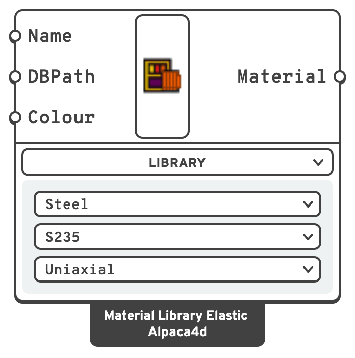

# Material Database

The **material database** turns a standard grade name into a consistent elastic material,
so you do not have to type *E*, *G*, *ν* and *ρ* by hand and get them to agree.

## 🔧 Grasshopper component

`Material Library Elastic (Alpaca4d)` — **Alpaca4d ▸ 00_Material**

<figure><figcaption></figcaption></figure>

### Options

Three dropdowns live on the component body, under the **Library** menu:

| Dropdown | Values | Default |
| --- | --- | --- |
| **Type** | Steel, Concrete, Timber, Plastic — plus any type found in a custom database | `Steel` |
| **Grade** | `All`, then the grades of the selected type | `S235` |
| **Model** | `Uniaxial` or `nD` | `Uniaxial` |

Set **Grade** to `All` for every grade of the type as a list, in the order the database lists
them — weakest first for steel, `S235` to `S450`. Pick from it with List Item and a slider to
let an optimisation choose the grade. Connect a Panel to the output to read the list: each
material shows as its name.

Built-in grades:

| Type | Grades |
| --- | --- |
| Steel | S235, S275, S355, S450 |
| Concrete | C25_30, C28_35, C30_37, C32_40, C35_45, C40_50 |
| Timber | GOB_Green_Oak; C14 to C50 and D30 to D70 (EN 338:2016); GL20h to GL32h and GL20c to GL32c (EN 14080) |
| Plastic | PVC, HDPE, PE, PP, PS, PET, PC, PLA, PVA, PTFE, PEEK, PVDF |

### Inputs

| Name | Nick | Type | Default | Description |
| --- | --- | --- | --- | --- |
| Material Name | `Name` | Text | *(empty)* | Type a grade name directly, e.g. `S235`. **Overrides the dropdowns** and moves them to match. An unknown name is an error, not a fallback. |
| DatabasePath | `DBPath` | Generic | *(empty)* | Path to a custom JSON database with the same schema as the built-in ones. Its type is merged into the **Type** dropdown, and takes priority over a built-in type of the same name. |
| Colour | `Colour` | Colour | *(empty)* | The colour the material is drawn in when [Model View](../visualisation/model-view.md) colours the elements **by material** — every grade of the list, with **Grade** set to `All`. Left empty, Model View gives each material a colour of its own. Display only: the analysis never reads it. |

### Outputs

| Name | Nick | Type | Description |
| --- | --- | --- | --- |
| Material | `Material` | Material | A [Uniaxial](Uniaxial.md) material when **Model = Uniaxial**, an [nD](ND.md) `ElasticIsotropic` material when **Model = nD**. With **Grade** set to `All`, a list of them, one per grade. |

## 💡 How the properties are derived

Each database entry stores `E` and `G` in **MPa** and `rho` in **kg/m³**. The component:

1. Converts `E` and `G` to `kN/m²` by ×1000.
2. Derives Poisson's ratio from the pair, `ν = E/(2G) − 1`, clamped to `[0, 0.4999]`.
3. Recomputes `G = E / (2(1+ν))` so the triple is internally consistent.
4. Passes `rho` through unchanged.

The grade name becomes the material name.

## 💡 Design grade

For a steel grade the material also carries its **design grade** — fy and fu from EN 1993-1-1
Table 3.1, including the lower values for plates thicker than 40 mm — which
[Utilisation](../results/utilisation.md) checks the beam against. A timber class carries its
characteristic strengths and stiffnesses — f_m,k, f_t,0,k, f_c,0,k, f_v,k, E_0,05, G_mean, ρ_k —
for the EN 1995-1-1 check, and whether it is solid timber or glulam. The solver never sees either.
Only the **Uniaxial** model carries one, since that is what beams are made of.

The timber classes follow EN 338:2016 (solid timber) and EN 14080 (glulam). The analysis takes
`E_mean` as E; `E0_05`, the strengths and, for glulam, `G_05` are for the check alone.

## 💡 Custom databases

A custom database is a JSON object keyed by grade name. The built-in steel file looks like
this:

```json
{
  "S235": {
    "rho": 7850,
    "E": 210000,
    "G": 80769,
    "fy": 235,
    "fu": 360,
    "fy_40_80": 215,
    "fu_40_80": 360,
    "epsilon_yield": 0.015,
    "epsilon_max_Stress": 0.11,
    "strainAtRupture": 0.17,
    "material_type": "Steel"
  }
}
```

`E`, `G`, `rho` and `material_type` make the elastic material. `material_type` is what the
**Type** dropdown lists, so give every entry in one file the same value.

An entry whose `material_type` is `Steel` and which gives `fy` is also a design grade, for
[Utilisation](../results/utilisation.md): `fy` and `fu` in N/mm² for plates up to 40 mm thick, and
`fy_40_80` and `fu_40_80`, if given, for 40 to 80 mm. Strain values are not read.

An entry whose `material_type` is `Timber` is a timber class, with the keys of the built-in timber
file, all in N/mm² but the densities in kg/m³: `fm_k`, `ft_0_k`, `ft_90_k`, `fc_0_k`, `fc_90_k`,
`fv_k`, `E_mean`, `E0_05`, `G_mean`, `rho_k`, `rho_mean`, and `G_05` where it is tabulated. A
`type` of `Glulam` makes it glulam; anything else is solid timber. The check needs `fm_k`,
`ft_0_k`, `fc_0_k`, `fv_k`, `E0_05` and `G_mean`; a class without one is left unchecked.

## 📈 When to use it

**Use it when**

- You want a standard grade and want `E`, `G` and `ν` to agree with each other.
- Your office has its own grades or a national standard not in the default set → point
  **DatabasePath** at a JSON file.

**Do not use it when**

- The material is non-standard → use [Uniaxial](Uniaxial.md) or [nD](ND.md) directly.
- You need non-linearity → the database is elastic only. See
  [Moment Curvature](../moment-curvature/README.md) for `Concrete01`, `Steel01` and
  `ReinforcingSteel`.
