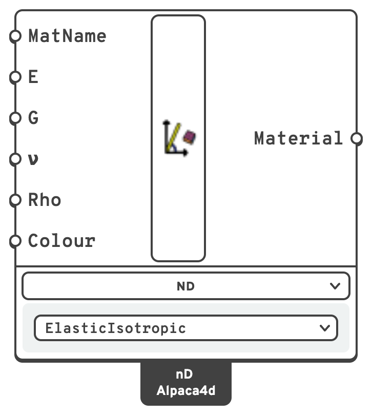

# nD

An **nD material** (n-dimensional) describes the full 2D/3D stress–strain law at the Gauss
point of a continuum element. Shells, bricks and tetrahedra all need one.

## 🔧 Grasshopper component

`nD (Alpaca4d)` — **Alpaca4d ▸ 00_Material**

<figure><figcaption></figcaption></figure>

A switcher component: pick the unit in the drop-down under it, or right-click it ▸ **Units**:

- **ElasticIsotropic** — the same stiffness in every direction.
- **ElasticOrthotropic** — different stiffness along three orthogonal directions, for
  timber, composite panels, or plates that behave differently in-plane and out-of-plane.
- **J2Plasticity** — a metal that yields: von Mises plasticity, for steel and aluminium. Elastic
  until the von Mises stress reaches `Fy`, then it yields. Works best on
  [Ten Node Tetrahedra](../elements/ten-node-tetrahedron.md); on shells, through a
  Layered Shell section.

### Inputs — ElasticIsotropic

| Name | Nick | Type | Default | Description |
| --- | --- | --- | --- | --- |
| Material Name | `MatName` | Text | *(empty)* | Label for the material. Cosmetic. |
| E | `E` | Number | `210000000` | Young's modulus, in `kN/m²`. |
| G | `G` | Number | `80760000` | Shear modulus, in `kN/m²`. |
| ν | `ν` | Number | `0.3` | Poisson's ratio. |
| Rho | `Rho` | Number | `7850` | Density, in `kg/m³`. |
| Colour | `Colour` | Colour | *(empty)* | The colour the material is drawn in when [Model View](../visualisation/model-view.md) colours the elements **by material**. Left empty, Model View gives each material a colour of its own. Display only: the analysis never reads it. |

### Inputs — ElasticOrthotropic

| Name | Nick | Type | Default | Description |
| --- | --- | --- | --- | --- |
| Material Name | `MatName` | Text | *(empty)* | Label for the material. Cosmetic. |
| Ex | `Ex` | Number | `210000000` | Young's modulus along *x*, in `kN/m²`. |
| Ey | `Ey` | Number | `210000000` | Young's modulus along *y*, in `kN/m²`. |
| Ez | `Ez` | Number | `210000000` | Young's modulus along *z*, in `kN/m²`. |
| Gxy | `Gxy` | Number | `80760000` | Shear modulus in the *xy* plane, in `kN/m²`. |
| Gyz | `Gyz` | Number | `80760000` | Shear modulus in the *yz* plane, in `kN/m²`. |
| Gzx | `Gzx` | Number | `80760000` | Shear modulus in the *zx* plane, in `kN/m²`. |
| NuXy | `NuXy` | Number | `0.3` | Poisson's ratio *xy*. |
| νYz | `νYz` | Number | `0.3` | Poisson's ratio *yz*. |
| νZx | `νZx` | Number | `0.3` | Poisson's ratio *zx*. |
| Rho | `Rho` | Number | `7850` | Density, in `kg/m³`. |
| Colour | `Colour` | Colour | *(empty)* | The colour the material is drawn in when [Model View](../visualisation/model-view.md) colours the elements **by material**. Left empty, Model View gives each material a colour of its own. Display only: the analysis never reads it. |

### Inputs — J2Plasticity

| Name | Nick | Type | Default | Description |
| --- | --- | --- | --- | --- |
| Material Name | `MatName` | Text | *(empty)* | Label for the material. Cosmetic. |
| E | `E` | Number | `210000000` | Young's modulus, in `kN/m²`. |
| ν | `ν` | Number | `0.3` | Poisson's ratio. The shear modulus follows from `E` and `ν`. |
| Fy | `Fy` | Number | `355000` | Yield stress, in `kN/m²`: the von Mises stress the material starts to yield at. `355000` is S355. |
| H | `H` | Number | `0` | Hardening modulus, in `kN/m²`: how much the yield stress rises per unit of plastic strain. `0` is perfectly plastic: past `Fy` the stress stays at `Fy`. |
| Rho | `Rho` | Number | `7850` | Density, in `kg/m³`. [Gravity Load](../loads/gravity.md) reads it for the self-weight. OpenSees takes no density for this material, so these elements have no mass in a natural vibration or a time history. |
| Colour | `Colour` | Colour | *(empty)* | The colour the material is drawn in when [Model View](../visualisation/model-view.md) colours the elements **by material**. Left empty, Model View gives each material a colour of its own. Display only: the analysis never reads it. |

### Outputs

| Name | Nick | Type | Description |
| --- | --- | --- | --- |
| Material | `Material` | Material | nD material, for a [Plate Fiber Section](../sections/plate-fiber.md), a Layered Shell, an [SSP Brick](../elements/brick.md) or a [Tetrahedron](../elements/ten-node-tetrahedron.md). |


`G` on the isotropic unit is not written to OpenSees — `ElasticIsotropic` derives its shear
modulus from `E` and `ν`. Alpaca4d keeps `G` on the material because the same material
object may also be read for section properties.



**Rho is in kg/m³, and it is what gives shells and solids their mass.**
[Shells](../elements/shell.md), [bricks](../elements/brick.md) and
[tetrahedra](../elements/ten-node-tetrahedron.md) take no mass input of their own — OpenSees
reads the density straight off this material. Alpaca4d converts it to the solver's mass unit
when the deck is written.

Before 0.11 that conversion was missing, so every shell and solid was a thousand times too
heavy and modal frequencies came out about 31.6 times too low. Static results were never
affected — density only feeds the mass matrix, and self-weight is applied as explicit nodal
loads by [Gravity Load](../loads/gravity.md).



**J2Plasticity: which element, and how to solve it.**

- **Ten Node Tetrahedra** carry it best. On a clamped steel beam they match beam theory before
  yield and level off after it, even with two elements through the depth.
- **SSP Bricks** are right up to first yield, but too strong after it: an SSP brick keeps its
  hourglass stiffness elastic. On the same beam, six bricks through the depth carry a quarter more
  than the tetrahedra, and the load is still rising. Assemble Model says so.
- **Shells** take it through a Layered Shell section, each layer
  yielding on its own. Use eight layers or more. A [Plate Fiber](../sections/plate-fiber.md)
  section works too, but its five points through the thickness read the fully plastic moment
  about 9% low.
- **Solve it with Newton and the load in steps** — a
  [Linear Time Series](../time-history/linear.md) in the [Load Pattern](../loads/load-pattern.md),
  and [Load Control](../analysis/integrator.md) of `0.05` with an
  [Analysis Step](../analysis/analysis-step.md) of `20`, say. The time series matters: Load
  Pattern's default is constant, so without it the whole load goes on at the first step and the
  steps after it change nothing. Run Analysis warns of that, and of the Linear algorithm, which
  solves once with the elastic stiffness. Past the
  collapse load the analysis stops converging; the last step that converged is close to it.
- **Read where it yields** from the Von Mises stress of
  [Brick Stresses](../results/brick-stresses.md) or
  Shell Stresses, step by step: it rises to `Fy` and
  stays there where the material has yielded.


Five examples push steel of **J2Plasticity** past first yield, each drawing where it yields, step
by step, and its load-displacement curve:

- [Steel Beam with Holes](https://alpaca4d.github.io/examples/beam-with-holes/) — Ten Node
  Tetrahedra; it yields round the middle holes, 31% past first yield.
- [Pipe T-Joint](https://alpaca4d.github.io/examples/pipe-t-joint/) — ASD Shells; the chord's wall
  yields round the brace, against EN 1993-1-8's chord face resistance.
- [Steel Plate with Yield Lines](https://alpaca4d.github.io/examples/yield-lines/) — ASD Shells; it
  yields along its diagonals at yield-line theory's pressure, within 1%.
- [Plate with a Hole](https://alpaca4d.github.io/examples/plate-with-a-hole/) — ASD Shells in their
  own plane; first yield at the hole, then the net section.
- [Thick Pipe under Pressure](https://alpaca4d.github.io/examples/thick-pipe/) — Ten Node
  Tetrahedra; it yields from the bore out, to the collapse pressure the theory gives within 0.1%.

## 📈 When to use it

**Use it when**

- The element is a shell, a brick or a tetrahedron.
- You need direction-dependent stiffness — timber panels, laminates, ribbed slabs
  smeared into an orthotropic plate → use **ElasticOrthotropic**.
- You want to see where and at what load a steel part starts to yield, and how far past it it
  can be pushed → use **J2Plasticity**.

**Do not use it when**

- The element is a beam → use a [Uniaxial](Uniaxial.md) material.
- You want a standard isotropic grade → the [Material Database](MaterialDatabase.md) will
  produce one directly.

## 🔗 Relation to OpenSees

```tcl
nDMaterial ElasticIsotropic   $matTag $E $nu $rho
nDMaterial ElasticOrthotropic $matTag $Ex $Ey $Ez $nuXy $nuYz $nuZx $Gxy $Gyz $Gzx $rho

nDMaterial J2Plasticity $matTag $K $G $Fy $Fy 0.0 $H
nDMaterial PlateFromPlaneStress $plateTag $matTag $G
```

**J2Plasticity** takes the bulk and shear moduli, which Alpaca4d works out from `E` and `ν`, and
the yield stress twice with no saturation term, so the hardening is `H` alone. Solids name
`$matTag`. Shell sections name `$plateTag`, a plate form built on the material's plane stress
version: OpenSees' own plate form of J2Plasticity stops converging on triangular shells soon
after yield. In that plate form the transverse shear stays elastic.

The material line has no density, so Alpaca4d writes it as a comment, `# alpaca:density`, for
[Deserialise](../utility/deserialise.md) to read back.

ASD Shells on a section of J2Plasticity are written with `-noeas -drillingNL` (a triangle with
`-drillingNL`): no enhanced assumed strains, and the drilling stiffness from the material's current
tangent. With the defaults, a plate yielding in its own plane stops converging just past first
yield; with them, the plate with a hole levels off at the load a plane stress model of it gives.

For the orthotropic material on shells, the axes are those of the shell section — axes 1 and 2
of **Local Axes** in Model View. On solids they are the **global** axes. On shells, set
**Local X Axis** on the [ASD Shell](../elements/shell.md) component so every face agrees on
which direction `Ex` refers to.
