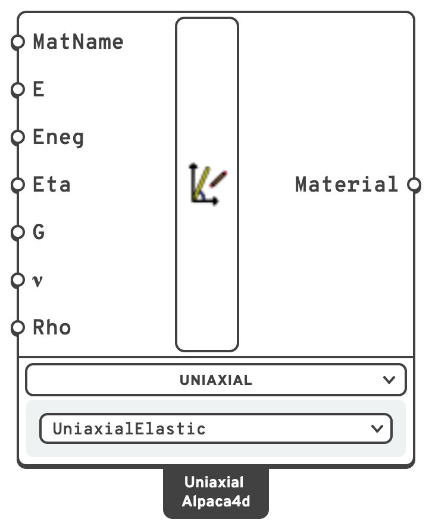

# 🔗 Uniaxial

A **uniaxial material** describes a 1D stress–strain relationship. It is what a beam
cross-section, a fibre or a hinge is made of — anywhere only one stress component matters.

## 🔧 Grasshopper component

`Uniaxial (Alpaca4d)` — **Alpaca4d ▸ 00_Material**

<figure><figcaption></figcaption></figure>

A switcher component: pick the unit in the drop-down under it, or right-click it ▸ **Units**:

- **UniaxialElastic** — linear elastic, described below.
- **ElasticPerfectlyPlastic** — *not yet implemented*. It shows its inputs — Material Name, `E`,
  `epsyP`, `epsyN`, `eps0` and `Rho` — and a warning, and outputs no material.

### Inputs — UniaxialElastic

| Name | Nick | Type | Default | Description |
| --- | --- | --- | --- | --- |
| Material Name | `MatName` | Text | *(empty)* | Label for the material. Name it after a steel grade — `S355`, `S355JR` — and [Utilisation](../results/utilisation.md) checks its beams as that grade; any other name is only a label. |
| E | `E` | Number | `210000000` | Young's modulus in tension, in `kN/m²`. |
| Eneg | `Eneg` | Number | `210000000` | Young's modulus in compression, in `kN/m²`. Equal to `E` unless you need a different one. |
| Eta | `Eta` | Number | `0.0` | Viscous damping parameter. `0.0` for purely elastic behaviour. |
| G | `G` | Number | `90760000` | Shear modulus, in `kN/m²`. |
| ν | `ν` | Number | `0.3` | Poisson's ratio. |
| Rho | `Rho` | Number | `7850` | Density, in `kg/m³`. |
| Colour | `Colour` | Colour | *(empty)* | The colour the material is drawn in when [Model View](../visualisation/model-view.md) colours the elements **by material**. Left empty, Model View gives each material a colour of its own. Display only: the analysis never reads it. |

### Outputs

| Name | Nick | Type | Description |
| --- | --- | --- | --- |
| Material | `Material` | Material | Uniaxial material, for any [section](../sections/README.md) or fibre. |


Only `E`, `Eta` and `Eneg` reach the OpenSees material. `G`, `ν` and `Rho` are used by
Alpaca4d itself — `G` for the section's torsional and shear terms, `Rho` for the element
mass density. That is why they live on the material rather than on the section.


## 📈 When to use it

**Use it when**

- You are defining a beam cross-section of any kind.
- You need a fibre material for a [Fiber Section](../moment-curvature/fiber-section.md) and
  elastic behaviour is enough.
- You want a material that is not in the standard grades.

**Do not use it when**

- The element is a shell, brick or tetrahedron → use an [nD material](ND.md).
- You want a standard grade → the [Material Database](MaterialDatabase.md) is faster and
  keeps `E`, `G` and `ρ` consistent.
- You need real non-linearity in a fibre section → use `Concrete01`, `Steel01` or
  `ReinforcingSteel` from [Moment Curvature](../moment-curvature/README.md).

## 🔗 Relation to OpenSees

```tcl
uniaxialMaterial Elastic $matTag $E $eta $Eneg
```
