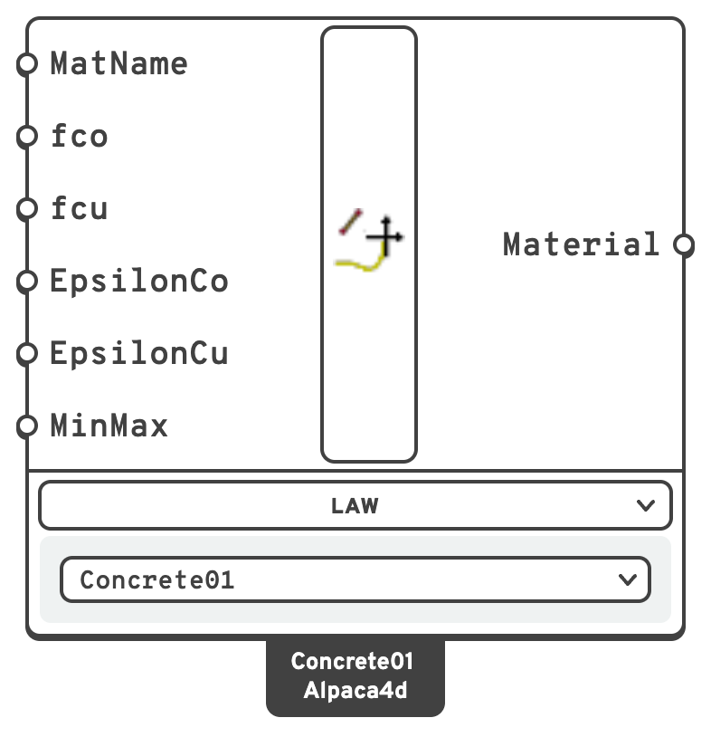

# Concrete

A concrete law for the fibres of a section. The **Law** menu (right click the component) picks one; the inputs change with it. The default is Concrete01. Stresses in `kN/m²`, strains dimensionless, **compression negative**.

## 🔧 Grasshopper component

`Concrete (Alpaca4d)` — **Alpaca4d ▸ MomentCurvature_βeta**

<figure><figcaption></figcaption></figure>

### Laws

| Law | Models | Inputs |
| --- | --- | --- |
| **Concrete01** | A parabola to the peak, a straight fall to the crushing strain, no tension. See [Concrete01](concrete01.md). | `fco`, `fcu`, `EpsilonCo`, `EpsilonCu`, `MinMax` |
| **Concrete02** | Concrete01's compression with a tensile strength and linear tension softening. | `fpc`, `EpsC0`, `fpcu`, `EpsU`, `lambda`, `ft`, `Ets`, `MinMax` |
| **Concrete04** | Popovics' curve, with an exponential tension branch when `fct` and `et` are given. | `fc`, `EpsC`, `EpsCu`, `Ec`, `fct`, `et`, `beta`, `MinMax` |

Every law has a `MatName` first, and a `Material` output for the Fibers and Layers of a [Fiber Section](fiber-section.md). Defaults are **C25/30**.


`lambda` of Concrete02 is the ratio between the unloading slope at `EpsU` and the initial slope. It defaults to 0.2: with 0.1 a Moment Curvature analysis can stall as the concrete reaches `EpsU`.


`fct` and `et` of Concrete04 go together, and `beta` needs them. Interaction Domain, Moment Curvature and the plastic hinges of a pushover hold every law to its crushing strain, as they do Concrete01.

Files saved with the old **Concrete01** component open on this one, on the Concrete01 law.
