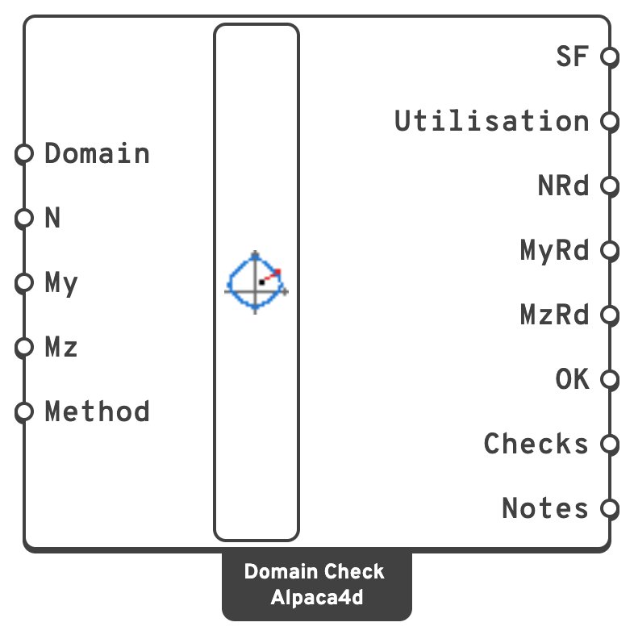

# Domain Check

Checks design forces against an [Interaction Domain](interaction-domain.md): the **safety
factor** of each combination of N, My and Mz, and the point where it meets the boundary.

## 🔧 Grasshopper component

`Domain Check (Alpaca4d)` — **Alpaca4d ▸ MomentCurvature_βeta**, nickname `Domain Check`

<figure><figcaption></figcaption></figure>

### Inputs

| Name | Nick | Type | Default | Description |
| --- | --- | --- | --- | --- |
| Domain | `Domain` | Generic | — | The domain, from [Interaction Domain](interaction-domain.md). |
| N | `N` | Number (list) | `0` | Design axial force of each combination, in `kN`: tension positive, compression negative. |
| My | `My` | Number (list) | `0` | Design moment about the local *y* axis, in `kN·m`, about the domain's centroid. |
| Mz | `Mz` | Number (list) | `0` | Design moment about the local *z* axis, in `kN·m`, about the domain's centroid. |
| Method | `Method` | Text | `Constant N` | `Constant N` or `Proportional`. See [Methods](#methods). Wire a Value List to it and it fills itself in. |

The longest of the three lists sets how many combinations there are; a shorter one repeats its
last value.

### Outputs

| Name | Nick | Type | Description |
| --- | --- | --- | --- |
| SF | `SF` | Number (list) | Safety factor: how many times the forces fit in the domain. At least 1 where the section carries them. |
| Utilisation | `Utilisation` | Number (list) | 1 / SF: at most 1 where the section carries them. |
| NRd | `NRd` | Number (list) | Axial force where the combination meets the boundary, in `kN`. |
| MyRd | `MyRd` | Number (list) | Moment about *y* there, in `kN·m`. |
| MzRd | `MzRd` | Number (list) | Moment about *z* there, in `kN·m`. |
| OK | `OK` | Boolean (list) | True where the section carries the combination. |
| Checks | `Checks` | Generic (list) | The checks, for the [views](domain-views.md) to draw. |
| Notes | `Notes` | Text (list) | Why a factor is what it is, where that needs saying. |

## Methods

| Method | Scales | Reads |
| --- | --- | --- |
| `Constant N` | the moments, with N held at its design value | the domain's level at N: how a column check, and RC-SEC, read it |
| `Proportional` | N and both moments together, along the ray from the origin | the domain in all three dimensions |

`Constant N` with no moment at all has nothing to scale, so that combination is scaled
proportionally instead, and its note says so.

A factor of **0** means no scaling of those forces reaches the domain, and the note says why:

- N is beyond the axial resistance, so no moment is carried with it;
- with this N the section needs a moment in this direction to stay inside the domain, and the
  design moment is less — a section with unsymmetric reinforcement near its axial capacity;
- for `Proportional`, the unloaded section is itself on the boundary: a section with no
  tensile resistance. Hold N instead.
