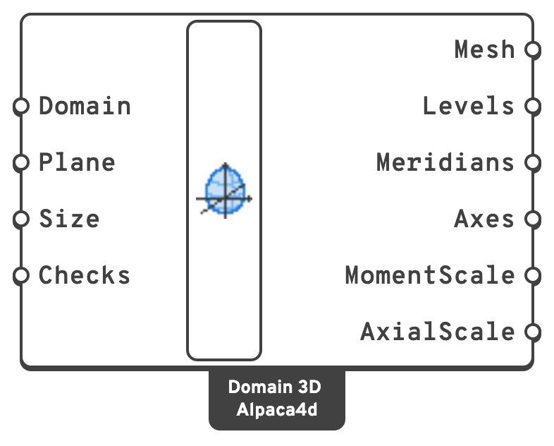
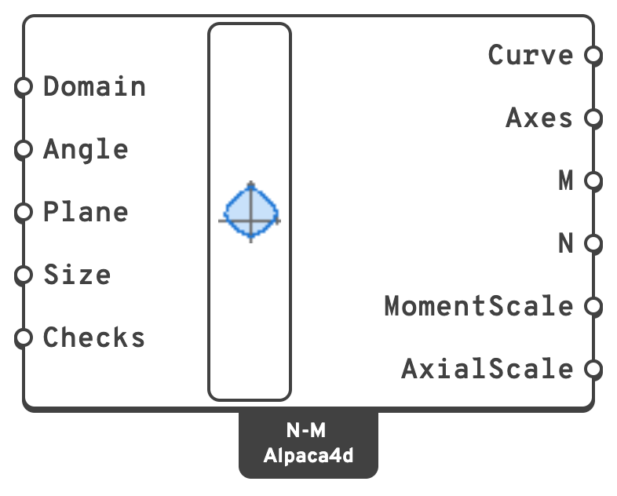
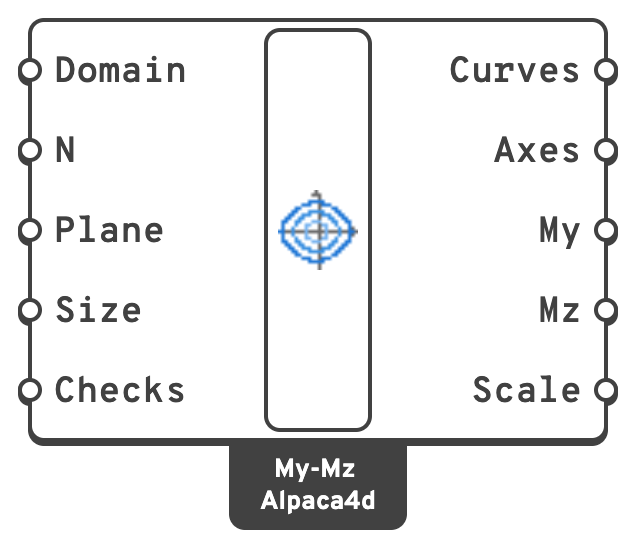

# Domain Views

Three ways to draw an [Interaction Domain](interaction-domain.md) in the Rhino viewport: the
whole surface in three dimensions, an **N–M diagram** cut through it, and **My–Mz diagrams** at
chosen axial forces. Each draws on a plane you give it, scaled to a size you give it, with
labelled axes; the curves and lines go out as geometry and bake, the labels are drawn on screen.

Wire the **Checks** of a [Domain Check](domain-check.md) to any of them to see each
combination as a black point and where it meets the boundary as a red one, joined by a red line.

## 🔧 Domain 3D

`Domain 3D (Alpaca4d)` — **Alpaca4d ▸ MomentCurvature_βeta**, nickname `Domain 3D`

<figure><figcaption></figcaption></figure>

My along the plane's X, Mz along its Y, and N along its normal, **compression up**. The N
axis is labelled in N's own sign, tension positive, so its labels grow more negative upwards.

### Inputs

| Name | Nick | Type | Default | Description |
| --- | --- | --- | --- | --- |
| Domain | `Domain` | Generic | — | The domain, from [Interaction Domain](interaction-domain.md). |
| Plane | `Plane` | Plane | — | Where the origin, no force at all, is drawn, and which way the axes go. Left empty, the world XY plane. |
| Size | `Size` | Number | `10` | How large the domain is drawn, in model units: its widest moment and its whole range of N both fit in it. |
| Checks | `Checks` | Generic (list) | — | Optional: the Checks of a [Domain Check](domain-check.md). |

### Outputs

| Name | Nick | Type | Description |
| --- | --- | --- | --- |
| Mesh | `Mesh` | Mesh | The domain's surface. |
| Levels | `Levels` | Curve (list) | The domain at each level of N. |
| Meridians | `Meridians` | Curve (list) | Lines over the surface from pure tension to pure compression. |
| Axes | `Axes` | Line (list) | The My, Mz and N axes. |
| MomentScale | `MomentScale` | Number | Model units per `kN·m`. |
| AxialScale | `AxialScale` | Number | Model units per `kN`. |

## 🔧 N-M Diagram

`N-M Diagram (Alpaca4d)` — **Alpaca4d ▸ MomentCurvature_βeta**, nickname `N-M`

<figure><figcaption></figcaption></figure>

The domain cut by the plane that holds the N axis and the moment direction **Angle**: `0` for
the N–My diagram, `90` for N–Mz, anything between for a skew one. M along the plane's X, N along
its Y with compression up. Checks are drawn projected onto the cut, so they lie exactly on it
only when their moment points along Angle.

### Inputs

| Name | Nick | Type | Default | Description |
| --- | --- | --- | --- | --- |
| Domain | `Domain` | Generic | — | The domain. |
| Angle | `Angle` | Number | `0` | The moment direction to cut along, in degrees from the *y* axis. |
| Plane | `Plane` | Plane | — | Where the origin is drawn, and which way the axes go. Left empty, the world XY plane. |
| Size | `Size` | Number | `10` | How large the diagram is drawn, in model units. |
| Checks | `Checks` | Generic (list) | — | Optional: the Checks of a [Domain Check](domain-check.md). |

### Outputs

| Name | Nick | Type | Description |
| --- | --- | --- | --- |
| Curve | `Curve` | Curve | The diagram, closed. |
| Axes | `Axes` | Line (list) | The M and N axes. |
| M | `M` | Number (list) | Moment along Angle at each point, in `kN·m`: My cos Angle + Mz sin Angle. |
| N | `N` | Number (list) | Axial force at each point, in `kN`. |
| MomentScale | `MomentScale` | Number | Model units per `kN·m`. |
| AxialScale | `AxialScale` | Number | Model units per `kN`. |

## 🔧 My-Mz Diagram

`My-Mz Diagram (Alpaca4d)` — **Alpaca4d ▸ MomentCurvature_βeta**, nickname `My-Mz`

<figure><figcaption></figcaption></figure>

The domain's level at each axial force **N**: My along the plane's X, Mz along its Y, to one
scale for both, each diagram labelled with its N. Checks are drawn by their moments, whatever
their N.

### Inputs

| Name | Nick | Type | Default | Description |
| --- | --- | --- | --- | --- |
| Domain | `Domain` | Generic | — | The domain. |
| N | `N` | Number (list) | `0` | The axial forces to draw the diagram at, in `kN`. |
| Plane | `Plane` | Plane | — | Where the origin is drawn, and which way the axes go. Left empty, the world XY plane. |
| Size | `Size` | Number | `10` | How large the diagram is drawn, in model units: the domain's widest moment fits in it. |
| Checks | `Checks` | Generic (list) | — | Optional: the Checks of a [Domain Check](domain-check.md). |

### Outputs

| Name | Nick | Type | Description |
| --- | --- | --- | --- |
| Curves | `Curves` | Curve (list) | The diagram at each N, closed. |
| Axes | `Axes` | Line (list) | The My and Mz axes. |
| My | `My` | Number (tree) | Moment about *y* round each diagram, in `kN·m`: one branch for each N. |
| Mz | `Mz` | Number (tree) | Moment about *z* round each diagram, in `kN·m`. |
| Scale | `Scale` | Number | Model units per `kN·m`. |
