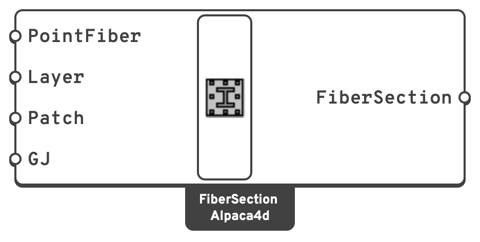

# Fiber Section

Collects fibre points, layers and patches into one section.

## 🔧 Grasshopper component

`Fiber Section (Alpaca4d)` — **Alpaca4d ▸ MomentCurvature_βeta**, nickname `FiberSection`

<figure><figcaption></figcaption></figure>

### Inputs

| Name | Nick | Type | Default | Description |
| --- | --- | --- | --- | --- |
| PointFiber | `PointFiber` | PointFiber (list) | *(empty)* | Single fibres, typically bars — from [Fiber Point](fiber-point.md). |
| Layer | `Layer` | Layer (list) | *(empty)* | Rows of fibres — from [Layer Fiber](layer.md). |
| Patch | `Patch` | Patch (list) | *(empty)* | Filled areas — from [Patch](patch.md). |
| GJ | `GJ` | Number | `1e8` | Torsional stiffness, in `kN·m²`. **Elastic and uncoupled** from the bending response. |

### Outputs

| Name | Nick | Type | Description |
| --- | --- | --- | --- |
| FiberSection | `FiberSection` | FiberSection | For [Moment Curvature](moment-curvature.md). |

### Local axes

The component draws the section's local axes at the **area centroid of its fibres**, steel
included: the point OpenSees takes the section's moments about, and the **Centroid** of
[Interaction Domain](interaction-domain.md).

| Arrow | Axis | World direction | Moment about it |
| --- | --- | --- | --- |
| **Green**, labelled `y, My` | local *y* | world **X** | My |
| **Blue**, labelled `z, Mz` | local *z* | world **Y** | Mz |
| **Red** ⊙, labelled `x` | the beam's axis, x = y × z | world **Z**, out of the drawing | — |

That is the order OpenSees writes a fibre in. Draw the section in the world XY plane and the
mapping takes care of itself; the arrows are there to confirm it.

**My is the moment about *y*, Mz the moment about *z***, by the right-hand rule with *x* coming
out of the drawing, towards you in the Top view. The double arrowheads are a moment vector's.
So:

| Positive | Stretches | Squeezes |
| --- | --- | --- |
| My | the fibres on the **+z** side | the −z side |
| Mz | the fibres on the **−y** side | the +y side |

This is the convention of [Moment Curvature](moment-curvature.md), whose Direction 0 bends the
section about *y* and 90 about *z*, of [Interaction Domain](interaction-domain.md) and
[Domain Check](domain-check.md), and of the [views](domain-views.md), which draw My along X and
Mz along Y, as the arrows here lie.

The preview also shows every fibre the section contains, so a patch whose mesh is too coarse
or a layer pointing the wrong way is visible before anything is run.

## 📈 When to use it

**Use it when** you want a section whose non-linear behaviour comes out of its materials.

**Do not use it when** the element is a beam — fibre sections cannot yet be assigned to a
[ForceBeamColumn](../elements/force-beam-column.md), which takes an
[elastic section](../sections/README.md). Today this is a section-level tool.


**GJ is a fixed elastic number.** A fibre section integrates axial and bending response from
its fibres but has no torsional stiffness of its own, so it has to be given one. The default
`1e8 kN·m²` is deliberately large: with the section under pure bending, torsion never
engages, and the value only matters if the section is ever used somewhere that torsion does.


## 🔗 Relation to OpenSees

```tcl
section Fiber $secTag -GJ $GJ {
    fiber $y1 $z1 $A1 $mat1
    fiber $y2 $z2 $A2 $mat2
    ...
}
```

Patches and layers are expanded into individual `fiber` lines. Use
[Serialize](../utility/serialize.md) to see the result.
