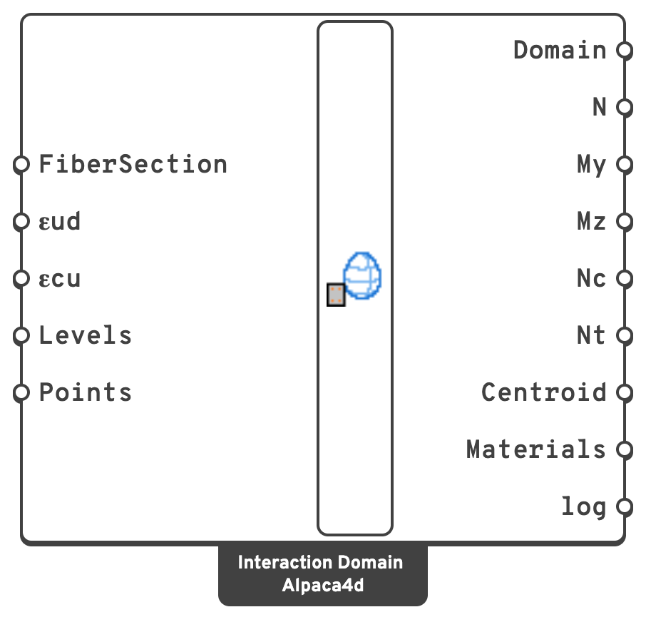

# Interaction Domain

The **N–My–Mz resistance domain** of a fibre section at the ultimate limit state: every
combination of axial force and biaxial bending the section carries before a fibre passes its
material's ultimate strain. The same surface as an interaction diagram from RC-SEC or a
column-design program, for any section a [Fiber Section](fiber-section.md) can describe:
reinforced concrete of any shape, steel, or both.

## 🔧 Grasshopper component

`Interaction Domain (Alpaca4d)` — **Alpaca4d ▸ MomentCurvature_βeta**, nickname `Interaction Domain`

<figure><figcaption></figcaption></figure>

### Inputs

| Name | Nick | Type | Default | Description |
| --- | --- | --- | --- | --- |
| FiberSection | `FiberSection` | FiberSection | — | The section, from [Fiber Section](fiber-section.md). |
| εud | `εud` | Number | `0.01` | Ultimate strain, either way, of every fibre that is not [Concrete01](concrete01.md): reinforcement and structural steel alike. A `MinMax` bound on the material holds instead where it is tighter. See [Steel sections](#steel-sections). |
| εcu | `εcu` | Number | — | Ultimate compressive strain of the concrete, positive. Empty takes each Concrete01's own `EpsilonCu`. |
| Levels | `Levels` | Integer | `20` | Levels of N the surface is drawn at between pure tension and pure compression, closer together towards both. |
| Points | `Points` | Integer | `72` | Points on each level, before more are added where the domain turns sharply. |

### Outputs

| Name | Nick | Type | Description |
| --- | --- | --- | --- |
| Domain | `Domain` | Generic | The domain. Feed it to [Domain Check](domain-check.md), and to [Domain 3D, N-M Diagram and My-Mz Diagram](domain-views.md). |
| N | `N` | Number (tree) | Axial force round each level, in `kN`, tension positive: one branch a level, from tension to compression. |
| My | `My` | Number (tree) | Moment about the local *y* axis round each level, in `kN·m`. |
| Mz | `Mz` | Number (tree) | Moment about the local *z* axis round each level, in `kN·m`. |
| Nc | `Nc` | Number | Axial resistance in compression, in `kN`: negative. |
| Nt | `Nt` | Number | Axial resistance in tension, in `kN`: zero for plain concrete. |
| Centroid | `Centroid` | Point | The point the moments are taken about. See [Moments about the centroid](#moments-about-the-centroid). |
| Materials | `Materials` | Text (list) | Each material, and the strains it is held to. |
| log | `log` | Text | The OpenSees deck that traced the materials, followed by the solver's console output. |

## 🧮 How the domain is found

The domain is swept over **strain planes**, not over loads.

1. **OpenSees traces each material's stress–strain curve**, once in tension and once in
   compression, in one short run. Whatever uniaxial material the fibres have is read the way
   OpenSees reads it.
2. **Every strain plane is scaled to its first limit.** A plane — the strain at the centroid
   and the two curvatures — is grown until the first fibre reaches its ultimate strain:

   | Material | Held to |
   | --- | --- |
   | [Concrete01](concrete01.md) | `εcu` at its most compressed point; and, when the concrete is all in compression, `εc2` (its `EpsilonCo`) at point C, (1 − εc2/εcu) of the depth from the most compressed edge — the pivots of Eurocode 2, 6.1 and Figure 6.1. No limit in tension. |
   | everything else | `±εud`, or its `MinMax` bounds where those are tighter. |

3. **The fibres are integrated** on that plane, which gives one point (N, My, Mz) of the
   boundary. Planes in every direction give the whole surface: pure tension at the bottom, pure
   compression at the top.

Nothing has to converge, so the method does not fail near the axial capacity the way a
moment–curvature analysis with a held axial force does. Each point is a ULS state under
proportional loading — every fibre strained monotonically from zero — which is what a
resistance domain assumes.

A patch is held to its limits at the **vertices of its mesh**, which reach its outline; a
point fibre or a layer's fibre is a bar, and is held where it is. Checked at the patch's fibres
instead, half a fibre inside the edge, an HEA 300's elastic moment came out 1 % high.

## 💡 Eurocode 2 domains

[Concrete01](concrete01.md) with its crushing strength equal to its peak — `fcu = fco` — is
exactly Eurocode 2's **parabola–rectangle** (n = 2), and [Steel01](steel01.md) with no
hardening — `b = 0` — is **elastic–perfectly plastic**. With design strengths that is the
domain of EN 1992-1-1, 6.1:

| Material | Inputs, C30/37 and B500, in `kN/m²` |
| --- | --- |
| Concrete01 | `fco = -17000` (0.85 × 30 / 1.5 MPa), `fcu = -17000`, `EpsilonCo = -0.002`, `EpsilonCu = -0.0035` |
| Steel01 | `fy = 434783` (500 / 1.15 MPa), `E0 = 200000000`, `b = 0` |

and `εud = 0.01`, or `0.9 εuk` for an inclined branch. A material from the library with its
characteristic strengths gives a characteristic domain, not a design one.

## 🔩 Steel sections

A section of steel only has no concrete limit to reach, so **εud decides which resistance the
domain is**:

| εud | Domain | Checked against EN 1993-1-1 on an HEA 300 |
| --- | --- | --- |
| large, e.g. `0.05` | plastic — Class 1 and 2 | N = A fy, My = Wpl,y fy exactly; Mz within 0.4 % under Wpl,z fy, as the web sits in the elastic core |
| `fy / E` | elastic — Class 3, first yield | Wel,y fy and Wel,z fy exactly, and N/Npl + My/Mel,y + Mz/Mel,z = 1 round every level |

The plastic domain is the exact one, so it differs from the formulas of 6.2.9.1 where those
approximate: with a little axial force they keep Mpl,y, while the web gives up its share of it
at once, M = Mpl,y − N²/(4 tw fy). Draw the section's outline **with its root fillets**: an HEA
300 without them has 5.6 % less area.

Local buckling (Class 4), shear and member buckling are not part of a section's domain.

## Moments about the centroid

Moments are about the **area centroid of every fibre, steel included**, which is the point
OpenSees' fibre section takes them about, so they match [Moment Curvature](moment-curvature.md)'s.
For a section with unsymmetric reinforcement this is not the concrete's centroid, and pure
compression comes with a small moment about it. Design forces given to
[Domain Check](domain-check.md) have to be about the same point.
