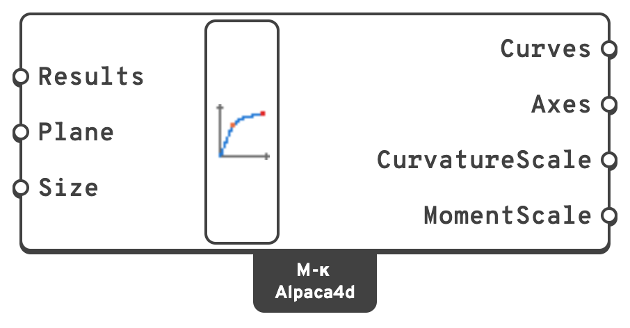

# Moment Curvature Diagram

Draws the curves of one or more [Moment Curvature](moment-curvature.md) analyses in the Rhino
viewport, with labelled axes: κ across, M up, each curve's **first yield** in orange and its
**ultimate state** in red. Wire several results to compare them, at different axial forces or in
different directions.

## 🔧 Grasshopper component

`Moment Curvature Diagram (Alpaca4d)` — **Alpaca4d ▸ MomentCurvature_βeta**, nickname `M-κ`

<figure><figcaption></figcaption></figure>

### Inputs

| Name | Nick | Type | Default | Description |
| --- | --- | --- | --- | --- |
| Results | `Results` | Generic (list) | — | The Result output of one or more [Moment Curvature](moment-curvature.md) components. |
| Plane | `Plane` | Plane | — | Where the origin, no curvature and no moment, is drawn, and which way the axes go. Left empty, the world XY plane. |
| Size | `Size` | Number | `10` | How large the diagram is drawn, in model units: the largest curvature and the largest moment both fit in it. |

### Outputs

| Name | Nick | Type | Description |
| --- | --- | --- | --- |
| Curves | `Curves` | Curve (list) | Each result's curve, from the origin. |
| Axes | `Axes` | Line (list) | The κ and M axes. |
| CurvatureScale | `CurvatureScale` | Number | Model units per `rad/m`. |
| MomentScale | `MomentScale` | Number | Model units per `kN·m`. |

The curves and axes go out as geometry and bake; the labels and the points are drawn on screen.
With several results, each curve is named by its axial force and direction at its end.
