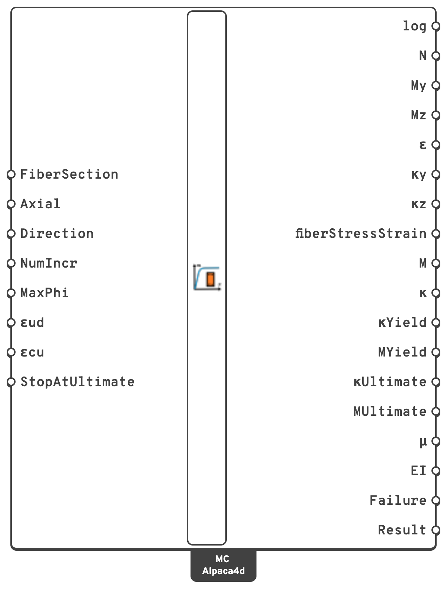

# Moment Curvature

Pushes a fibre section's curvature in any moment direction under a held axial force, and returns
the moment–curvature curve, the stress–strain history of every fibre, and the curve's **first
yield** and **ultimate state**: the ductility of the section and what makes it fail.

## 🔧 Grasshopper component

`MomentCurvature (Alpaca4d)` — **Alpaca4d ▸ MomentCurvature_βeta**, nickname `MC`

<figure><figcaption></figcaption></figure>

### Inputs

| Name | Nick | Type | Default | Description |
| --- | --- | --- | --- | --- |
| FiberSection | `FiberSection` | FiberSection | — | The section to analyse, from [Fiber Section](fiber-section.md). |
| Axial | `Axial` | Number | `0.0` | Axial force held constant while the curvature is applied, in `kN`. **Positive is tension, negative is compression.** |
| Direction | `Direction` | Number | `0` | The moment direction, in degrees from the section's local *y* axis towards *z*, from `-180` to `180`: `0` bends it about *y*, `90` about *z*, and `180` and `-90` the other way about each. See [Any direction](#any-direction). |
| NumIncr | `NumIncr` | Integer | `100` | Increments used to reach `MaxPhi`: the number of points on the curve, when it does not stop sooner. |
| MaxPhi | `MaxPhi` | Number | — | The curvature along Direction to push the section to, in `rad/m`. Left empty, it comes from the section's ultimate state: a fifth past it, or twice it when the analysis is not to stop there. |
| εud | `εud` | Number | `0.01` | Ultimate strain, either way, of every fibre that is not [Concrete01](concrete01.md), as in [Interaction Domain](interaction-domain.md). |
| εcu | `εcu` | Number | — | Ultimate compressive strain of the concrete, positive. Empty takes each Concrete01's own `EpsilonCu`. |
| StopAtUltimate | `StopAtUltimate` | Boolean | `true` | Stop at the first increment where a fibre reaches its ultimate strain. Off, the analysis follows the section past it to `MaxPhi`. |

### Outputs

| Name | Nick | Type | Description |
| --- | --- | --- | --- |
| log | `log` | Text | The OpenSees decks this component ran, the materials' curves and the analysis, followed by the solver's console output. |
| N | `N` | Number (list) | Axial force at each increment, in `kN`. |
| My | `My` | Number (list) | Moment about the local *y* axis, in `kN·m`. |
| Mz | `Mz` | Number (list) | Moment about the local *z* axis, in `kN·m`. |
| ε | `ε` | Number (list) | Axial strain at the section centroid, dimensionless. |
| κy | `κy` | Number (list) | Curvature about the local *y* axis, in `rad/m`. |
| κz | `κz` | Number (list) | Curvature about the local *z* axis, in `rad/m`. |
| fiberStressStrain | `fiberStressStrain` | Generic | Stress and strain history of every fibre. Unpack it with [Fiber Stress Strain](fiber-stress-strain.md). |
| M | `M` | Number (list) | Moment along Direction, in `kN·m`: My cos a + Mz sin a. |
| κ | `κ` | Number (list) | Curvature along Direction, in `rad/m`: κy cos a + κz sin a. Plot M against κ for the curve. |
| YieldCurvature | `κYield` | Number | Curvature along Direction at first yield. Empty when nothing yields. |
| YieldMoment | `MYield` | Number | Moment along Direction at first yield, in `kN·m`. |
| UltimateCurvature | `κUltimate` | Number | Curvature along Direction at the ultimate state. Empty when the curve ends before it. |
| UltimateMoment | `MUltimate` | Number | Moment along Direction there, in `kN·m`. |
| Ductility | `μ` | Number | Curvature ductility, κUltimate / κYield. |
| YieldStiffness | `EI` | Number | Secant stiffness to first yield, MYield / κYield, in `kN·m²`: an effective cracked stiffness. |
| Failure | `Failure` | Text | Which material reaches its ultimate strain first, and where. |
| Result | `Result` | Generic | All of it, for [Moment Curvature Diagram](moment-curvature-diagram.md) to draw. |

## 🧮 Yield and the ultimate state

The curve is read against the strain limits of [Interaction Domain](interaction-domain.md):

| Point | Where |
| --- | --- |
| **First yield** | The first fibre of [Steel01](steel01.md) or [ReinforcingSteel](reinforcing-steel.md) at its yield strain, fy / E, in tension or compression: a bar, or the extreme fibre of a steel section. |
| **Ultimate state** | The first fibre at its ultimate strain: concrete at `εcu`, or at `εc2` about point C when it is all in compression, and everything else at `±εud` or its `MinMax` bounds. |

Each is read between the increments either side of it, so it does not fall on the increment the
analysis happened to take; first yield along the curve's slope before it, which is exact for a
section that is elastic until then. **Failure** names the material and the point of the section
that reached its limit.

The analysis **stops** at the ultimate state, at the first increment past it, unless
`StopAtUltimate` is off. The point of the domain at the same N and direction is the same ultimate
state reached along a straight path; the two agree to within a few tenths of a percent.

On an HEA 300 in S355 at N = 0, εud = 5 %, the curve yields at exactly Wel,y fy, at fy / E over
half the depth, with the secant stiffness E Iy, and ends at Mpl,y at εud over half the depth: a
ductility of εud / εy = 29.6.

## Any direction

`Direction`, between −180 and 180 degrees, holds the **moment** to its direction and leaves the
curvature across it free, as bending about *y* always held Mz at zero. The two ways about an axis
differ for a section that is not symmetric: a beam with 3 φ20 at the bottom and 2 φ16 at the top,
at N = −1000 kN, reaches 249 kN·m at `0` and 264 kN·m at `180`. A section bent off its axes, or an unsymmetric one,
turns its neutral axis as it needs to, and its curve ends on the [N-M Diagram](domain-views.md#n-m-diagram)
cut at the same angle. Under the hood the element is turned so that the direction lies on a global
axis; the forces and deformations come back in the section's own axes.

## 📈 When to use it

**Use it when**

- You need the path to failure, not just failure: cracking, yield and the ultimate state, all
  from the material laws.
- You are assessing ductility: the curvature ductility of a column or a plastic hinge.
- You need an effective cracked stiffness, `EI = M/κ` on the branch that matters.
- You want the fibres' stresses under a given moment.

**Use [Interaction Domain](interaction-domain.md) instead** for the N–M or N–My–Mz
interaction at the ultimate limit state: it does not have to converge near the axial capacity,
which a held **Axial** does.

**Do not use it when**

- You want member behaviour. This is a section-level analysis; the section cannot yet be
  assigned to a [ForceBeamColumn](../elements/force-beam-column.md).

## 💡 Getting a good curve

- **Leave MaxPhi empty.** It is taken from the section's ultimate state, and the analysis stops
  there: most of the increments go into the curve. Give it only to look past the ultimate state
  with `StopAtUltimate` off.
- **Raise `NumIncr`** for a smooth curve. 100 points is enough to see the shape; 500 resolves
  the yield knee.
- **An increment that does not converge** is tried again in ten steps of a tenth, then with a
  line search, then with the initial tangent, before the curve is given up on. A curve that still
  stops short comes with a warning, and what converged is on the outputs.
- **Sign the axial force correctly.** A column carries compression, so `Axial` is negative. An
  axial force past what the section carries is refused before anything runs.
- **Moments are about the area centroid of every fibre**, steel included, where OpenSees' fibre
  section takes them.

## 🔗 Relation to OpenSees

The component first has OpenSees trace each material's stress–strain curve, for the strain
limits, as [Interaction Domain](interaction-domain.md) does. It then writes and runs a complete
section-analysis deck: a single `zeroLengthSection` element carrying the fibre section, turned
by `-orient` to the moment direction, a `Plain` pattern applying the axial force, then a
`DisplacementControl` push on the curvature DOF an increment at a time, with a fibre recorder
capturing every fibre at every step, and a check of the strain limits after each increment.

Read the whole deck from the **log** output.


Definitions made with the earlier Moment Curvature, which bent about *y* or *z* only and ran to
`MaxPhi`, open with it, and Grasshopper offers to upgrade it. The upgraded component keeps its
wires and values: a Direction of `y` becomes `0` and `z` becomes `90`, a Value List of the two
wired to it is turned into one of 0 and 90, a `MaxPhi` given stays given, and the curve now stops
at the ultimate state.

