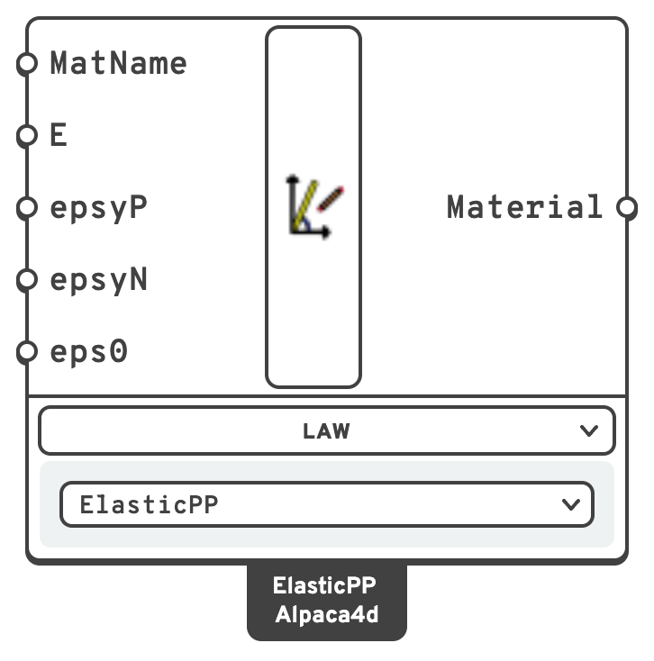

# Other Laws

A law that is neither concrete nor steel, for the fibres of a section: a spring-like material, a timber or masonry backbone, anything with its own curve. The **Law** menu picks one. Stresses in `kN/m²`, strains dimensionless.

## 🔧 Grasshopper component

`Other Laws (Alpaca4d)` — **Alpaca4d ▸ MomentCurvature_βeta**

<figure><figcaption></figcaption></figure>

### Laws

| Law | Models | Inputs |
| --- | --- | --- |
| **ElasticPP** | Elastic, then perfectly plastic (the default). | `E`, `epsyP`, `epsyN`, `eps0` |
| **Hysteretic** | A bilinear or trilinear backbone, each side of its own, with pinching and damage. | `e1p`, `s1p`, `e2p`, `s2p`, `e3p`, `s3p`, `e1n`…`s3n`, `pinchX`, `pinchY`, `damage1`, `damage2`, `beta` |

`epsyN` left empty mirrors `epsyP`. A Hysteretic backbone gives a strain and a stress for each point, two or three, rising; leave the compression side empty and it mirrors the tension side, otherwise give as many points as the tension side has.

The Interaction Domain and Moment Curvature read the first point of the backbone, or `epsyP`, as the law's yield.
