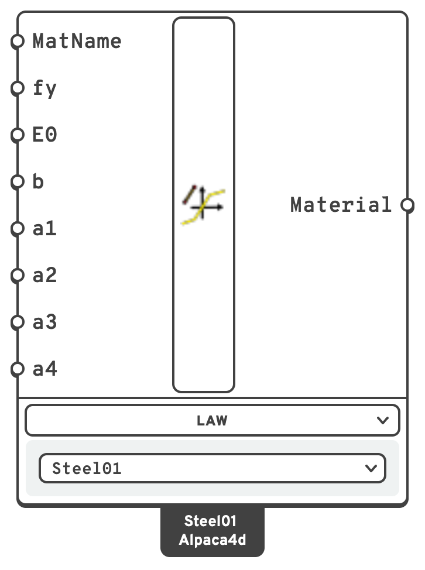

# Steel

A steel law for the fibres of a section. The **Law** menu (right click the component) picks one; the inputs change with it. The default is Steel01. Stresses in `kN/m²`, strains dimensionless.

## 🔧 Grasshopper component

`Steel (Alpaca4d)` — **Alpaca4d ▸ MomentCurvature_βeta**

<figure><figcaption></figcaption></figure>

### Laws

| Law | Models |
| --- | --- |
| **Steel01** | Bilinear with kinematic hardening. See [Steel01](steel01.md). |
| **Steel02** | Giuffré–Menegotto–Pinto: the same, with a smooth elastic to plastic transition. |
| **ReinforcingSteel** | A reinforcing bar with a strain-hardening branch to its ultimate strength. See [ReinforcingSteel](reinforcing-steel.md). |

Steel01 and Steel02 default to **S355**, ReinforcingSteel to **B450C**.

### Inputs — Steel01

| Name | Nick | Type | Default | Description |
| --- | --- | --- | --- | --- |
| Material Name | `MatName` | Text | `S355` | Label for the material. |
| fy | `fy` | Number | `355000` | Yield strength, in `kN/m²`. |
| E0 | `E0` | Number | `210000000` | Initial elastic modulus, in `kN/m²`. |
| b | `b` | Number | `0.01` | Strain-hardening ratio: the post-yield tangent divided by `E0`. |
| a1 | `a1` | Number | *(empty)* | Isotropic hardening in compression. Give `a1` to `a4` together or leave all four empty. |
| a2 | `a2` | Number | *(empty)* | Compression hardening limit. |
| a3 | `a3` | Number | *(empty)* | Isotropic hardening in tension. |
| a4 | `a4` | Number | *(empty)* | Tension hardening limit. |

### Inputs — Steel02

| Name | Nick | Type | Default | Description |
| --- | --- | --- | --- | --- |
| Material Name | `MatName` | Text | `S355` | Label for the material. |
| fy | `fy` | Number | `355000` | Yield strength, in `kN/m²`. |
| E0 | `E0` | Number | `210000000` | Initial elastic modulus, in `kN/m²`. |
| b | `b` | Number | `0.01` | Strain-hardening ratio: the post-yield tangent divided by `E0`. |
| R0 | `R0` | Number | `18` | Shape of the elastic to plastic transition, 10 to 20. |
| cR1 | `cR1` | Number | `0.925` | Shape of the transition after a reversal. |
| cR2 | `cR2` | Number | `0.15` | Shape of the transition after a reversal. |
| a1 | `a1` | Number | *(empty)* | Isotropic hardening in compression. Give `a1` to `a4` together or leave all four empty. |
| a2 | `a2` | Number | *(empty)* | Compression hardening limit. |
| a3 | `a3` | Number | *(empty)* | Isotropic hardening in tension. |
| a4 | `a4` | Number | *(empty)* | Tension hardening limit. |
| sigInit | `sigInit` | Number | *(empty)* | Initial stress, in `kN/m²`. Empty for none. It can be given without `a1` to `a4`. |

### Inputs — ReinforcingSteel

| Name | Nick | Type | Default | Description |
| --- | --- | --- | --- | --- |
| Material Name | `MatName` | Text | `B450C` | Label for the material. |
| fy | `fy` | Number | `450000` | Yield strength, in `kN/m²`. |
| fu | `fu` | Number | `540000` | Ultimate strength, in `kN/m²`. |
| Es | `Es` | Number | `200000000` | Initial elastic modulus, in `kN/m²`. |
| Esh | `Esh` | Number | `2000000` | Tangent modulus at the onset of strain hardening, in `kN/m²`. Must be greater than zero. |
| esh | `esh` | Number | `0.008` | Strain at the onset of strain hardening. Must be past the yield strain `fy/Es`. |
| eult | `eult` | Number | `0.075` | Strain at `fu`. |
| MinMax | `MinMax` | Boolean | `false` | Wrap the material so a bar **fails** once its strain passes `eult` in either direction. See [MinMax](reinforcing-steel.md#minmax). |

### Outputs

| Name | Nick | Type | Description |
| --- | --- | --- | --- |
| Material | `Material` | Material | Uniaxial material, for a [Patch](patch.md), [Layer](layer.md) or [Fiber Point](fiber-point.md) of a [Fiber Section](fiber-section.md). |


`a1` to `a4` are **one optional group of four**. Give all four or leave all four empty: a
partly filled set is an error, not a silent default.


Files saved with the old **Steel01** and **ReinforcingSteel** components open on this one, on those laws.

## 🔗 Relation to OpenSees

```tcl
uniaxialMaterial Steel01          $matTag $Fy $E0 $b <$a1 $a2 $a3 $a4>
uniaxialMaterial Steel02          $matTag $Fy $E0 $b $R0 $cR1 $cR2 <$a1 $a2 $a3 $a4 <$sigInit>>
uniaxialMaterial ReinforcingSteel $matTag $fy $fu $Es $Esh $esh $eult
uniaxialMaterial MinMax           $wrapTag $matTag -min $minStrain -max $maxStrain
```

A `sigInit` given alone is written after `0 1 0 1`, four hardening values that do nothing.
