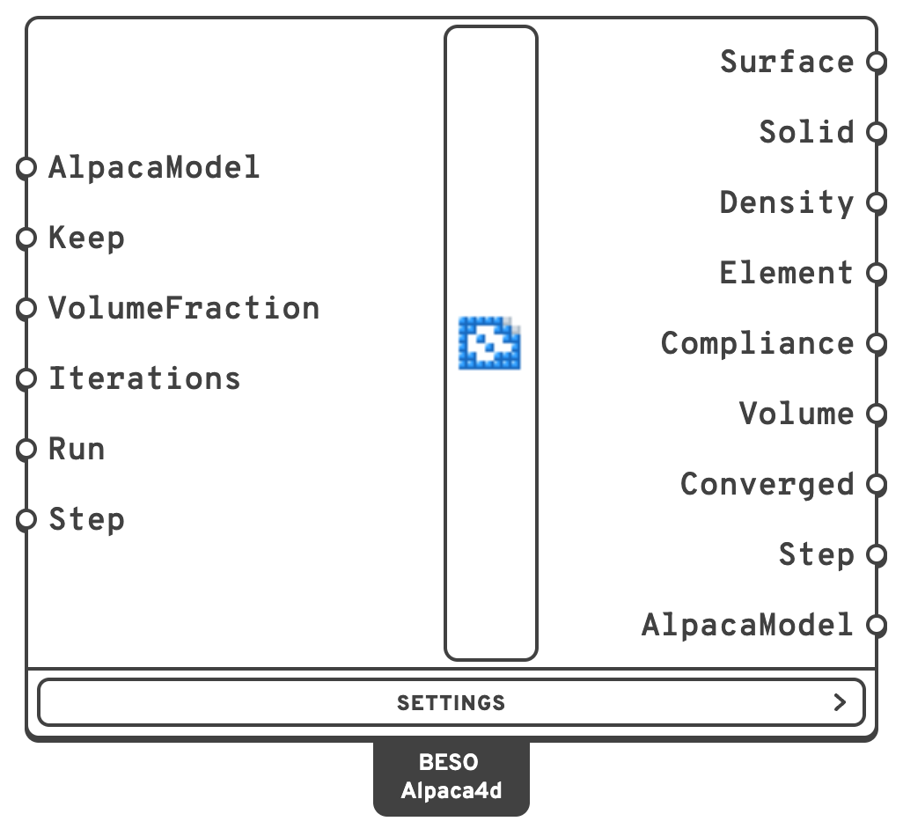
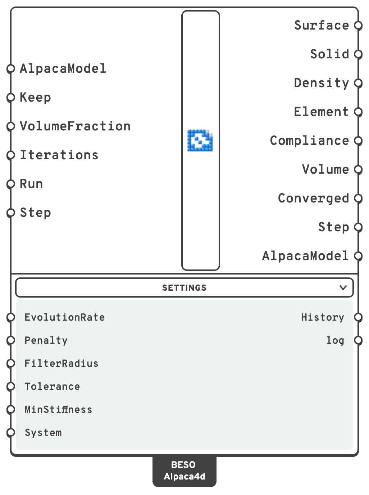

# BESO Topology

Finds where a solid needs its material by BESO, bi-directional evolutionary structural
optimisation. Model a block - the space the structure may take up - in SSP Bricks or tetrahedra,
support it and load it as usual, and BESO Topology carves it down: it starts from the whole block
and takes a little material away each iteration, from where it does least, until the share you
allow is left.

It finds what [Topology Optimisation](topology-optimisation.md) finds, another way. Read that page
first: the model, the run, Keep, Step and AlpacaModel work the same way here.

## 🔧 Grasshopper component

`BESO Topology (Alpaca4d)` — **Alpaca4d ▸ 12_Optimisation**

<figure><figcaption></figcaption></figure>

<figure><figcaption>
With every menu open
</figcaption></figure>

**Every element is solid or void, all along.** Where Topology Optimisation moves densities between
0 and 1 and settles on one design, BESO switches whole elements on and off, and the volume comes
down from the whole block to **VolumeFraction**. So every iteration is a design of its own, of the
volume reached, and **Step** shows each: drag it back to see the design with 80%, 60% or 40% of
the material, and pick the one you want.

**Nothing is ever cut out of the mesh.** A void element keeps a billionth of its stiffness, so the
model keeps all its nodes and connections, and an element can come back later.

### Which elements

The same as [Topology Optimisation](topology-optimisation.md#which-elements): SSP Bricks, solved as
OpenSees' eight point brick, and Ten Node Tetrahedra. Every solid needs an
[Elastic Isotropic material](../materials/ND.md). Beams, trusses, shells and links are analysed
with the solids but take no part.

### Inputs

| Input | Default | Description |
| --- | --- | --- |
| AlpacaModel | | The assembled model, from [Assemble Model](../assemble.md). |
| Keep | | Solids to keep solid whatever the optimisation finds, by ElementId, tag or pattern. Use it for what must be there: a deck, a slab, the material round a support or under a load. |
| VolumeFraction | `0.3` | The share of the designed solids' volume to keep at the end. The solids in Keep come on top. |
| Iterations | `200` | How many iterations at most. Coming down to VolumeFraction takes about log(VolumeFraction) / log(1 − EvolutionRate) iterations - 60 for 0.3 at 2% - and settling ten to thirty more. |
| Run | `false` | `true` runs the optimisation, `false` pauses it. |
| Step | latest | Which iteration's design the outputs show: `0` the whole block the run starts from, `1` after the first iteration, and so on. Every design is kept, so a slider dragged back shows the design of each volume on the way down. |

In the **Settings** menu:

| Input | Default | Description |
| --- | --- | --- |
| EvolutionRate | `0.02` | How much of the volume each iteration takes away, as a share of the volume before it. Smaller is slower and steadier. |
| Penalty | `3` | The penalty p of soft-kill BESO: a void element has MinStiffness of its stiffness, and its strain energy counts MinStiffness^((p−1)/p) as much, next to nothing. |
| FilterRadius | 2 elements | How far the elements' strain energies are averaged over, in model units: about the thinnest member the result can have. Much wider, a thin member's energy is averaged away with the void around it, and the member can be cut through: see [When a member is cut through](#when-a-member-is-cut-through). |
| Tolerance | `0.001` | Once VolumeFraction is reached, the run stops when the compliances of the last five iterations add up to within this share of the five before. Made smaller after a run, the run goes on from where it stopped. |
| MinStiffness | `1e-9` | The stiffness a void element keeps, as a share of the solid's. |
| System | `Auto` | The system of equations, as in [Analysis Settings](../analysis/analysis-settings.md). |

There is no Threshold: every element is 1 or 0.001, so any threshold between finds the same solids.

### Outputs

| Output | Description |
| --- | --- |
| Surface | The outline of the material kept: one closed mesh, capped where it meets the edge of the domain. It outlines what **Solid** holds. |
| Solid | The solids kept that make the design, as new copies of the model's: without pieces nothing holds, and with the elements that join a member's steps, as in [Topology Optimisation](topology-optimisation.md#analysing-the-design). |
| Density | Each solid's density, in the order of Element: 1 solid, MinStiffness^(1/Penalty) - 0.001 - void. |
| Element | The solids. |
| Compliance | The work of the loads, F·u, of each iteration's design: the lower, the stiffer. It rises as the volume comes down, then settles. |
| Volume | Each iteration's share of the designed solids' volume: from 1 down to VolumeFraction. |
| Converged | `true` when the run ended at VolumeFraction with the compliance settled within Tolerance. |
| Step | The iteration whose design the outputs show. |
| AlpacaModel | Once the run has stopped, the design as a model of its own, ready for [Run Analysis](../analysis/run-analysis.md). |
| History, log | In the Settings menu: each iteration's compliance, volume, convergence measure (NaN before VolumeFraction is reached) and timings; what OpenSees printed. |

## ⚙️ How it works

It is esoL.m, the BESO code of Xia, Xia, Huang and Xie's review (2018), step for step, in the
soft-kill form of Huang and Xie (2009).

1. **The volume comes down.** The whole block is solid at the start. Each iteration aims at the
   volume before it times 1 − EvolutionRate, until it reaches VolumeFraction, and stays there.
2. **Analysis.** OpenSees solves the design; a void element has MinStiffness of its stiffness.
3. **Sensitivity numbers.** Each element's strain energy per volume - for a void element
   x_min^(p−1) of it, next to nothing - says how hard it works.
4. **Filter.** Each number is averaged over the elements within FilterRadius, so that void
   elements next to hard-working ones get a number too and can come back, and the result is
   members rather than a checkerboard. The solids in Keep take part with their own energy, as
   every element does in esoL: that is what holds a pad under a load to the structure.
5. **History.** Each number is averaged with its value of the iteration before, which steadies
   the run.
6. **Update.** A threshold is found by bisection: the design elements above it are solid, those
   below are void, and together the solid ones fill the volume aimed at.
7. **Stopping.** Once VolumeFraction is reached, the run stops when the compliances of the last
   five iterations add up to within Tolerance of the five before.

### When a member is cut through

As the volume comes down, members get thin. Now and then the update cuts one through, and the
compliance jumps. Usually BESO mends it within a few iterations, bringing elements back, and the
run goes on. When it does not - the compliance more than 10 times the lowest of the five iterations
before, in one step or in two, and never back under 3 times that - the design has broken apart, the "breakdown" of Xia et al.'s section 3.4. The run
then stops where it would have converged, **Converged** is `false`, and a warning gives the
iteration: drag **Step** back to the last whole design, or start again with a smaller
**FilterRadius** or **EvolutionRate**, or **Keep** more.

It comes mostly from too wide a filter. On the Topology Bridge block, at 2 bricks per metre, the
default radius, 1 m, converges; 2 m, half the block's height, breaks after 62 iterations.

Without a license, BESO Topology runs on models of up to 500 elements, counting any beams, shells
and links with the solids, as Topology Optimisation does. A larger model needs one: see
[License](../../references/license.md#without-a-license).


**Which to use.** Topology Optimisation gives one design for one volume and is the quickest on
small models; on large ones BESO, needing fewer iterations, finishes first (see
[How long it takes](topology-optimisation.md#how-long-it-takes)). BESO is solid or void from the start, which needs no threshold, and passes through every
volume on its way down, so one run is a series of designs to choose from. On the same problem they
find much the same structure.


## Example

The [BESO Bridge](https://alpaca4d.github.io/examples/beso-bridge/) example carves the block of the Topology
Bridge - 16 m long, 2 m wide and 4 m high, pinned along both ends of its bottom, its top layer a deck
kept solid under 10 kN/m² - down to a fifth of its volume below the deck: two inclined legs from the
supports into the deck, with a column near each end. 3 456 bricks, 105 iterations, under 20 seconds.
Drag **Step** to go through the designs of every volume on the way down.

The [Truss Node](https://alpaca4d.github.io/examples/truss-node/) and the
[Beam-Column Joint](https://alpaca4d.github.io/examples/beam-column-joint/) examples find a node where
members meet in space - nine members of a space truss, a column and four beams - with all three
topology optimisations side by side.

## 🧪 Checked against the paper

BESO Topology was run against an independent BESO in numpy: esoL.m in three dimensions, with its
own eight node brick, its own assembly and SciPy's solver, sharing nothing with the run through
OpenSees but the problem and the algorithm.

- **esoL's clamped cantilever**, `esoL(100,50,0.6,0.02,6,2)`, as 100 x 50 bricks one brick deep:
  both runs take 39 iterations and end with every one of the 5 000 elements the same - the design
  of the review's Fig. 60.
- **A 3D cantilever**, 40 x 20 x 4 bricks, to 40% of the volume: the two runs are the same to
  1e-12 for 80 iterations; at iteration 81 one element sits on the threshold and goes the other
  way, round-off, and they end 0.06% apart, 3 192 of 3 200 elements the same.

The checks and the reference are in `Alpaca4d.Test/TopologyMethods` in the Alpaca4d repository:
`./run.sh bench beso-cantilever` runs the first.

## 📚 References

- L. Xia, Q. Xia, X. Huang, Y. M. Xie (2018). Bi-directional evolutionary structural optimization
  on advanced structures and materials: a comprehensive review. *Archives of Computational Methods
  in Engineering* 25:437–478. — esoL.m, which BESO Topology follows.
- X. Huang, Y. M. Xie (2007). Convergent and mesh-independent solutions for the bi-directional
  evolutionary structural optimization method. *Finite Elements in Analysis and Design*
  43:1039–1049. — the filter, the averaging with the iteration before, the test of convergence.
- X. Huang, Y. M. Xie (2009). Bi-directional evolutionary topology optimization of continuum
  structures with one or multiple materials. *Computational Mechanics* 43:393–401. — soft-kill
  BESO.

Alpaca4d adds what a model drawn in Grasshopper needs, as in Topology Optimisation: elements of
different sizes count by their volume, solids can be kept, and the energies come from OpenSees'
element forces.
