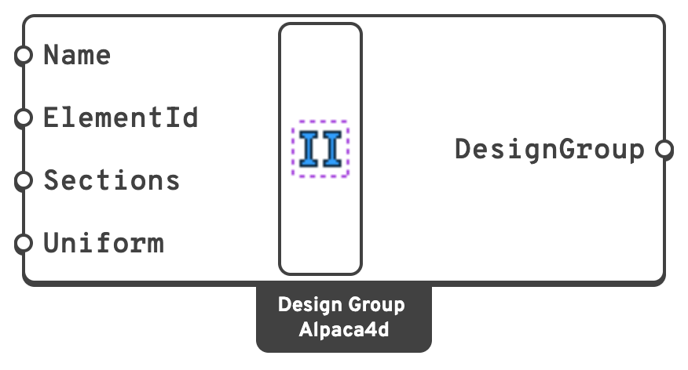

# Design Group

A **design group** is a set of beams that the [Section Optimiser](section-optimiser.md) sizes from
one list of sections. The beams are named by their ElementId, the way the result components pick
them, so a group needs no wire back to the beam components.

## 🔧 Grasshopper component

`Design Group (Alpaca4d)` — **Alpaca4d ▸ 12_Optimisation**

<figure><figcaption></figcaption></figure>

### Inputs

| Name | Nick | Type | Default | Description |
| --- | --- | --- | --- | --- |
| Name | `Name` | Text | *(empty)* | What to call the group in the optimiser's messages and its **Group** output. Left empty, the groups are Group 1, Group 2 and so on, in the order given. |
| ElementId | `ElementId` | Text (list) | — | Which beams belong to the group: an ElementId (`Col_3`), a wildcard (`Col*`), an element tag (`47`) or a regular expression (`regex:^Col`), mixed freely. A beam can be in one group only. |
| Sections | `Sections` | Section (list) | — | The sections the group's beams may have, from the [Sections](../sections/README.md) components or [Steel Section Library](../sections/library.md), in the order to try them. The group takes the first that works, so put first the one you would rather have: the lightest, the cheapest, the one in stock. The list is never sorted. Each needs a steel material and a shape to be checked: an Elastic Section cannot be. |
| Uniform | `Uniform` | Boolean | `true` | `true`: every beam of the group takes the same section, the first of the list that all of them work with. `false`: each beam takes its own, the first of the list that it works with. |

### Outputs

| Name | Nick | Type | Description |
| --- | --- | --- | --- |
| DesignGroup | `DesignGroup` | DesignGroup | The group, for the **DesignGroups** input of the [Section Optimiser](section-optimiser.md). |

## 📈 When to use it

**Use it when**

- A member drawn as several beams must be built as one: a Uniform group gives it one section.
- Some beams should be sized from a list of your own rather than their family: only the sections
  in stock, or a mix of families.

**Do not use it when**

- Every beam can be sized within the family of the section it has: leave **DesignGroups** empty.


A section whose material has no steel grade, or with no shape to check, is never picked, and the
component warns. Make the material with [Material Library Elastic](../materials/MaterialDatabase.md),
or name it after its grade (`S355`).

