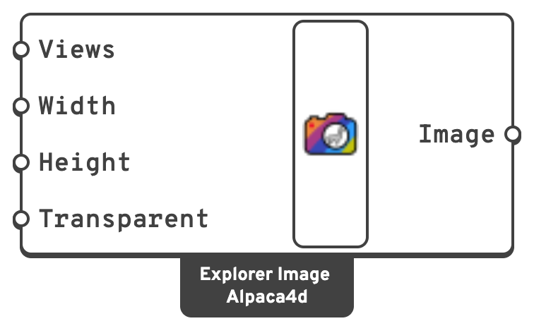

# Explorer Image

Which views [Explorer Record](explorer-record.md) takes a picture of for each design, and at
what size. Without it, Explorer Record takes the active viewport at 800 × 600.

## 🔧 Grasshopper component

`Explorer Image (Alpaca4d)` — **Alpaca4d ▸ 12_Optimisation**

<figure><figcaption></figcaption></figure>

### Inputs

| Name | Nick | Type | Default | Description |
| --- | --- | --- | --- | --- |
| Views | `Views` | Text (list) | active viewport | Viewports (`Perspective`, `Top`…) or named views, one picture each. |
| Width | `Width` | Integer | `800` | Picture width in pixels, 50 to 8000. |
| Height | `Height` | Integer | `600` | Picture height in pixels, 50 to 8000. |
| Transparent | `Transparent` | Boolean | `false` | A transparent background. |

### Outputs

| Name | Nick | Type | Description |
| --- | --- | --- | --- |
| Image | `Image` | Generic | For **Image** on [Explorer Record](explorer-record.md). |

## 📈 When to use it

**Use it when** you want more than one view of each design - an elevation and a perspective,
say - or a size other than 800 × 600. The explorer shows one picture at a time with a switch
between the views.

A **named view** is shown in the active viewport while it is taken, and the viewport is put
back afterwards. Keep 4:3 pictures for the tidiest gallery.


The component warns about a view name that is neither a viewport nor a named view. That view is
left out of each design, and its picture cell stays empty.

