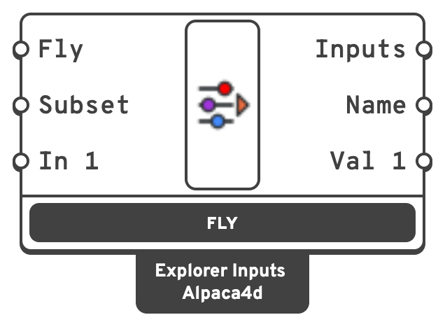

# Explorer Inputs

Runs a design study: every combination of the sliders, value lists and panels wired into it,
one solution each, for [Explorer Record](explorer-record.md) to save.

## 🔧 Grasshopper component

`Explorer Inputs (Alpaca4d)` — **Alpaca4d ▸ 12_Optimisation**

<figure><figcaption></figcaption></figure>

Press **Fly**, under the component, to start. Press it again to stop after the design being
solved, or *Esc* to stop at once; a design Esc cut short is not saved. Right-click ▸
*Test fly* runs three designs at random, to check the pictures before a long study.

### Inputs

| Name | Nick | Type | Default | Description |
| --- | --- | --- | --- | --- |
| Fly | `Fly` | Boolean | `false` | Starts the study when it turns `true`, like pressing **Fly**. |
| Subset | `Subset` | Generic | – | Runs part of the study. From [Explorer Subset](explorer-subset.md). |
| Input | `In 1`, `In 2`… | Number slider, value list or panel | – | What to step through, one per input. A new input appears when the last one is used. |

### Outputs

| Name | Nick | Type | Description |
| --- | --- | --- | --- |
| Inputs | `Inputs` | Generic (list) | The inputs of the design being solved, by name. For **Inputs** on [Explorer Record](explorer-record.md). |
| Name | `Name` | Text | The design's name, made of its input values, as Explorer Record names its files: `20_1.5_HEA200`. |
| Value | `Val 1`, `Val 2`… | Generic | The value of the matching input, for the design being solved. |

Each input and its output take the name of what is wired in.

## 📈 How it steps

| Wired in | Its steps | Written as |
| --- | --- | --- |
| Number slider | Every tick: a 0–10 integer slider has 11, a 0–1 slider with 2 decimals has 101. Even and odd sliders take only their own values. | The number |
| Value list | Every item | The item's **name**, `HEA200`, not its expression |
| Panel | Every line (turn on *Multiline Data*) | The line |

A slider or a value list is moved where it is, so the canvas shows the design being solved and
the definition reads it as usual. **A panel is not changed**: read its current line from the
matching **Val** output instead of from the panel.

The study is every combination, the first input changing fastest. The component shows how many
designs that is.


**Name every input.** The name becomes the axis in the explorer and the column in data.csv. An
unnamed value list would be called *List*; the component warns and calls it *Input 1* until it
has a name. Two inputs with the same name stop the study.



**Count before you fly.** Four sliders of 20 steps are 160 000 designs. Give sliders fewer
decimals, or take fewer steps of each with [Explorer Subset](explorer-subset.md) for a first look.


## 💡 Notes

- Designs already saved by every recording [Explorer Record](explorer-record.md) are skipped
  without being solved, so flying again only runs what is missing.
- Rhino answers between designs: the button, *Esc* and the canvas keep working. Changing the
  definition during a study changes the designs still to come.
- The study is driven one design per idle turn of Rhino, after the viewport has caught up, so
  each picture shows its own design with any preview, including Alpaca4d's.
