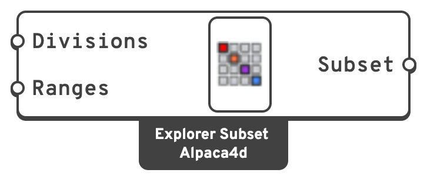

# Explorer Subset

Runs part of a study rather than all of it: fewer steps of each input, or a range of the
designs.

## 🔧 Grasshopper component

`Explorer Subset (Alpaca4d)` — **Alpaca4d ▸ 12_Optimisation**

<figure><figcaption></figcaption></figure>

### Inputs

| Name | Nick | Type | Default | Description |
| --- | --- | --- | --- | --- |
| Divisions | `Divisions` | Integer (list) | – | How many steps to take of each input of [Explorer Inputs](explorer-inputs.md), one number per input, in order. |
| Ranges | `Ranges` | Domain (list) | – | Which designs to run, by number, from 0. |

| Division | Takes |
| --- | --- |
| `0` | Every step |
| `1` | Only the step the input is on now |
| `n` | `n` steps spread evenly from the first to the last |

### Outputs

| Name | Nick | Type | Description |
| --- | --- | --- | --- |
| Subset | `Subset` | Generic | For **Subset** on [Explorer Inputs](explorer-inputs.md). |

## 📈 When to use it

**A first look.** Divisions of `3` on four sliders is 81 designs, whatever their ticks. See
where the interesting part of the space is, then fly the rest; the designs already saved are
not run again.

**Splitting a study between machines.** Explorer Inputs shows how many designs there are, say
1000. Give one machine the range `0 To 499` and another `500 To 999`, each recording into a folder
of its own. Ranges are counted after the divisions.


Divisions need one number per input. With fewer or more, Explorer Inputs warns and runs every
step instead.

