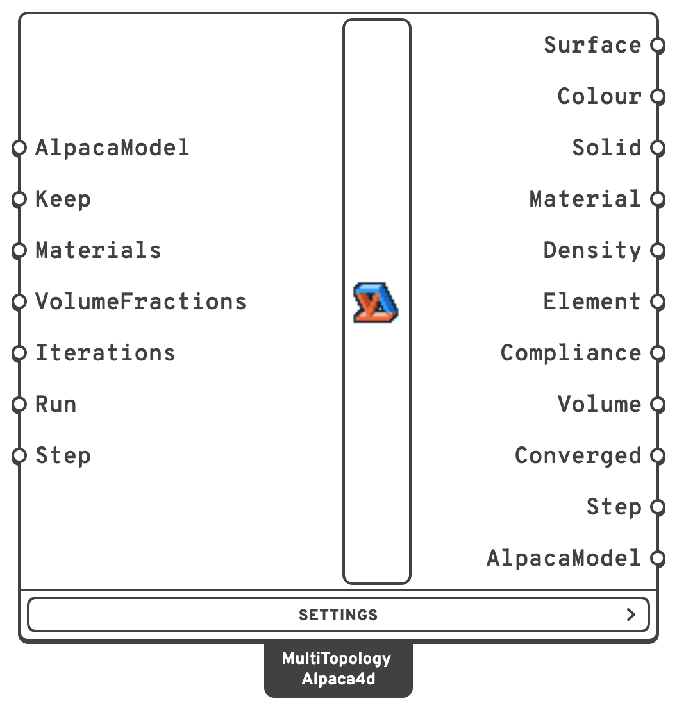
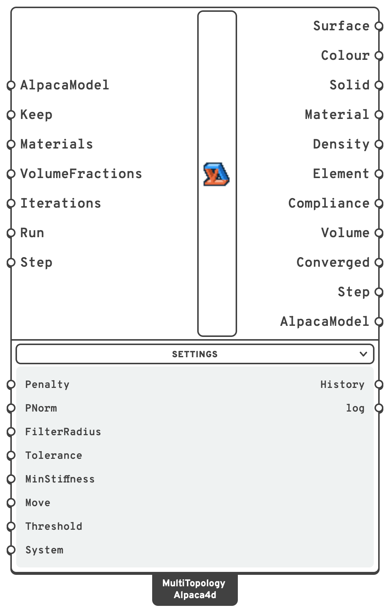

# Multi-Material Topology

Finds where each of several materials goes in a solid, and where none is needed. Model a block -
the space the structure may take up - in SSP Bricks or tetrahedra, support it and load it as
usual, give the component two or more materials and the share of the volume each may fill, and it
finds the layout that makes the block as stiff as possible: which part to keep, and of which
material.

It is [Topology Optimisation](topology-optimisation.md) with a choice of materials. Read that page
first: the model, the run, Keep, Step and AlpacaModel work the same way here.

## 🔧 Grasshopper component

`Multi-Material Topology (Alpaca4d)` — **Alpaca4d ▸ 12_Optimisation**

<figure><figcaption></figcaption></figure>

<figure><figcaption>
With every menu open
</figcaption></figure>

It takes the assembled model and works on its solids, as Topology Optimisation does. Every solid
gets a density of every material, and its stiffness mixes the materials' Young's moduli so that an
element of one material alone pays least. Each iteration analyses the model and moves every
density by MMA, the method of moving asymptotes, so that the model gets stiffer while each
material stays within its share.

**Nothing is ever cut out of the mesh.** An element with no material keeps a billionth of the
stiffest material's stiffness, so the model keeps all its nodes and connections.

### What it does not do

- **Only the Young's moduli count.** Every solid keeps the Poisson's ratio of the material it was
  modelled in; the Poisson's ratios of **Materials** are not used. The component says so when they
  differ.
- **Only stiffness is optimised.** A material strong in tension goes where its stiffness pays, not
  where the tension is: give it steel and concrete and it will not put the steel in the ties and
  the concrete in the struts. The materials differ here by how stiff they are and how much of
  each you allow, nothing else.

### Which elements

The same as [Topology Optimisation](topology-optimisation.md#which-elements): SSP Bricks, solved as
OpenSees' eight point brick, and Ten Node Tetrahedra. Every solid needs an
[Elastic Isotropic material](../materials/ND.md). Beams, trusses, shells and links are analysed
with the solids but take no part.

### Inputs

| Input | Default | Description |
| --- | --- | --- |
| AlpacaModel | | The assembled model, from [Assemble Model](../assemble.md). |
| Keep | | Solids to keep as modelled, of their own material, whatever the optimisation finds: by ElementId, tag or pattern. Use it for what must be there - a deck, the material round a support or under a load. |
| Materials | | The [Elastic Isotropic materials](../materials/ND.md) to choose from, two or more. Only their Young's moduli count. Each is drawn in its Colour, or in a colour of the brand palette when it has none. |
| VolumeFractions | `0.3` shared equally | The share of the designed solids' volume each material may fill, one per material in the order of Materials; a shorter list repeats its last value. Together at most 1. |
| Iterations | `300` | How many iterations at most. The projection is at its sharpest from iteration 251, so a run needs about 300. Raised after a run, the run goes on from where it stopped. |
| Run | `false` | `true` runs the optimisation, `false` pauses it. |
| Step | latest | Which iteration's design the outputs show: `0` the one the run starts from, `1` after the first iteration, and so on. Connect a slider to watch the run again. |

In the **Settings** menu:

| Input | Default | Description |
| --- | --- | --- |
| Penalty | `3` | The penalty n: an element's stiffness takes each material's share to the power n, which pushes it to all or nothing. |
| PNorm | `6` | The p of the interpolation's p-norm: the larger, the more an element that mixes materials is penalised. 6 balances a clear result against a steady run; much larger makes the run unsteady. |
| FilterRadius | 2 elements | How far the densities are averaged over, in model units: about the thinnest member, and the thinnest layer of one material, the result can have. |
| Tolerance | `0.001` | Once the projection is at its sharpest, the run stops when the compliances of the last five iterations add up to within this share of the five before. Made smaller after a run, the run goes on from where it stopped. |
| MinStiffness | `1e-9` | The stiffness a void element keeps, as a share of the stiffest material's. |
| Move | `0.1` | The most a density can change in one iteration. |
| Threshold | `0.5` | The density of its material from which an element counts as that material, for **Surface**, **Solid**, **Material** and **AlpacaModel**. It changes nothing in the run. |
| System | `Auto` | The system of equations, as in [Analysis Settings](../analysis/analysis-settings.md). |

### Outputs

| Output | Description |
| --- | --- |
| Surface | The outline of each material: one closed mesh per material, in the order of Materials. The component draws each in its colour. The solids in Keep show as the material nearest them in stiffness. |
| Colour | The colour each material's Surface is drawn in: its own, or the brand palette's. |
| Solid | The solids that make the design, as new copies of the model's, each of the material it ended as - the solids in Keep of their own. Pieces nothing holds are left out, as in [Topology Optimisation](topology-optimisation.md#analysing-the-design). |
| Material | Each solid's material as its index in Materials, in the order of Element; `-1` where it is void or left out. |
| Density | Each solid's density of each material, 0 to 1: a branch per material, in the order of Element. |
| Element | The solids. |
| Compliance | The work of the loads, F·u, of each iteration's design: the lower, the stiffer. |
| Volume | Each iteration's share of the designed solids' volume filled by each material: a branch per material. |
| Converged | `true` when the run ended at the sharpest projection with the compliance settled within Tolerance. |
| Step | The iteration whose design the outputs show. |
| AlpacaModel | Once the run has stopped, the design as a model of its own, ready for [Run Analysis](../analysis/run-analysis.md): **Solid**, each solid of its material at full stiffness, the model's other elements, and the supports, point loads and masses that stand on them. |
| History, log | In the Settings menu: each iteration's compliance, volume, convergence measure, timings, each material's volume and the projection's sharpness; what OpenSees printed. |

## ⚙️ How it works

It follows Zheng, Yi, Peng and Yoon (2024), who extend the 88 line code to several materials with
the mapping-based interpolation of Yi et al.

- **Densities.** Every element e has a density x of every material i, between 0.001 and 1, all
  starting at 0.5.
- **Filter.** Each material's densities are averaged over the elements within FilterRadius, as in
  Topology Optimisation, so that the result is members rather than a checkerboard.
- **Projection.** The averaged densities x̃ are pushed towards 0 or 1 by a smoothed step,
  r = (tanh(βη) + tanh(β(x̃ − η))) / (tanh(βη) + tanh(β(1 − η))), with η = 0.5. Its sharpness β
  starts at 1 and doubles every 50 iterations up to 32, from iteration 251, so the design starts
  soft and ends nearly solid or void.
- **Interpolation.** An element's modulus is

  E = Σᵢ ψᵢⁿ (Eᵢ − E_void) + E_void,  with ψᵢ = rᵢ · ‖r‖ₚ / (‖r‖₁ + δ)

  ψᵢ is rᵢ when the element has material i alone; when it mixes materials, the p-norm over the
  1-norm makes each share count for less, so mixing does not pay. n is **Penalty** and p is
  **PNorm**.
- **Update.** Each material has a volume limit of its own: Σ v·r of material i at most its share
  of the designed volume. Several limits are more than the optimality criteria of Topology
  Optimisation can take, so the densities are moved by MMA (Svanberg 1987), as the paper does.
  The compliance's derivatives come from each element's strain energy in OpenSees, through the
  interpolation, the projection and the filter.
- **Stopping.** Some density moves by the full move limit in every iteration, even at the end, so
  the run stops on the compliance instead: once β is 32, when the last five compliances add up to
  within Tolerance of the five before, the test [BESO Topology](beso-topology.md) uses.


**Give it 300 iterations.** The design only becomes clear once the projection is sharp, after
iteration 200 or so. A run of fewer iterations ends grey, with most elements a little of
everything.


Without a license, Multi-Material Topology runs on models of up to 500 elements, counting any
beams, shells and links with the solids, as Topology Optimisation does. A larger model needs one:
see [License](../../references/license.md#without-a-license).

### How long it takes

Each iteration is an analysis, as long as one of Topology Optimisation, and an update by MMA, which
takes longer the more materials and elements there are. The 27 000 bricks of the benchmark below
took about 1.5 s of analysis and 1 to 3 s of update per iteration in the test bench, on an Apple M2
Pro, so its 300 iterations took about a quarter of an hour.

## Example

The [Multi-Material Bridge](https://alpaca4d.github.io/examples/multi-material-bridge/) example is
the block of the Topology Bridge - 16 m long, 2 m wide and 4 m high, pinned along both ends of its
bottom, its top layer a deck kept solid under 10 kN/m² - in steel and concrete, with at most 5% of
the block below the deck in steel and 15% in concrete. The concrete goes into two broad legs from
the supports to the deck; the steel into an arch slung under the middle of the deck. 3 456 bricks,
265 iterations, under a minute. Its last group analyses the design from **AlpacaModel**, each brick
of its material.

The [Truss Node](https://alpaca4d.github.io/examples/truss-node/) and the
[Beam-Column Joint](https://alpaca4d.github.io/examples/beam-column-joint/) examples find a node where
members meet in space - nine members of a space truss, a column and four beams - with all three
topology optimisations side by side.

## 🧪 Checked against the papers

- **MMA.** Svanberg's own test problem, from his note on MMA and GCMMA: every iterate is his
  table's to its four decimals, ending at f₀ = 8.7702.
- **The derivatives.** The compliance's derivatives by every kind of density, worked out through
  OpenSees, match central differences to about 1e-7, at a soft projection and a sharp one.
- **The paper's 3D cantilever.** Zheng et al.'s cantilever on the grid of their Appendix B, 60 x 30
  x 15 bricks, held at one end and loaded along the bottom edge of the other, with half the volume
  shared equally among the materials, filter radius 5 and 300 iterations:

  | Materials | E | Compliance | The paper's | Apart |
  | --- | --- | --- | --- | --- |
  | 2 | 1 and 5 | 437.50 | 432.94 | +1.1% |
  | 3 | 1, 2 and 5 | 433.19 | 433.05 | +0.03% |
  | 5 | 1, 2, 3, 4 and 5 | 400.98 | 400.24 | +0.2% |

  Two MMA codes take slightly different paths through a problem with many local optima, and a
  percent apart is as close as two of them come. The paper's code also projects the densities
  with the old sharpness once after each doubling, and has no void stiffness.

The checks and the benchmark are in `Alpaca4d.Test/TopologyMethods` in the Alpaca4d repository:
`./run.sh bench zheng 3` runs the cantilever.

## 📚 References

- R. Zheng, B. Yi, X. Peng, G.-H. Yoon (2024). An efficient code for the multi-material topology
  optimization of 2D/3D continuum structures written in Matlab. *Applied Sciences* 14:657. — the
  method, which Multi-Material Topology follows.
- K. Svanberg (1987). The method of moving asymptotes - a new method for structural optimization.
  *International Journal for Numerical Methods in Engineering* 24:359–373.
- K. Svanberg (2007). MMA and GCMMA - two methods for nonlinear optimization. KTH, Stockholm. —
  the MMA written here, equation by equation.
- F. Wang, B. S. Lazarov, O. Sigmund (2011). On projection methods, convergence and robust
  formulations in topology optimization. *Structural and Multidisciplinary Optimization*
  43:767–784. — the projection.
- T. E. Bruns, D. A. Tortorelli (2001). Topology optimization of non-linear elastic structures and
  compliant mechanisms. *Computer Methods in Applied Mechanics and Engineering* 190:3443–3459. —
  the density filter.

Alpaca4d adds what a model drawn in Grasshopper needs, as in Topology Optimisation: elements of
different sizes count by their volume, solids can be kept, and the energies come from OpenSees'
element forces. The paper's code projects the densities with the old sharpness once after each
doubling; here they are projected with the new one.
