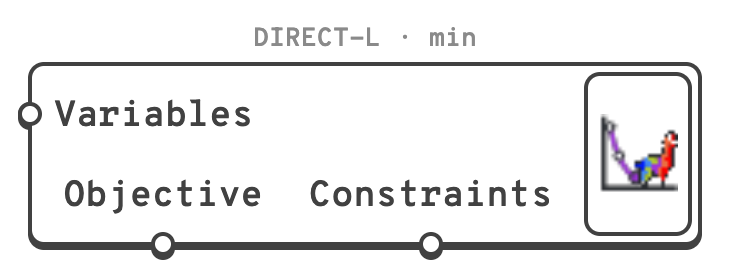

# Non-Linear Optimisation

Minimises or maximises one number of a definition, such as the mass of a structure, by moving
its number sliders, and can keep other numbers, such as the utilisation, within limits as it
does. The algorithms are the derivative-free ones of [NLopt](https://github.com/stevengj/nlopt).

## 🔧 Grasshopper component

`Non-Linear Optimisation (Alpaca4d)` — **Alpaca4d ▸ 12_Optimisation**

<figure><figcaption></figcaption></figure>

Like Galapagos, it is an object on the canvas rather than a component with wires. It is linked
to the sliders it moves and to the numbers it reads by dragging from its grips, because a wire
from the result back to the sliders would be a loop. On the canvas it is light green, orange
while it runs, and shows over itself the algorithm and the goal, then the evaluations as it
runs, then the best value it found.

### Grips

| Grip | Where | Links to |
| --- | --- | --- |
| Variables | Left | Number sliders, or Galapagos gene pools, one variable per gene. Each slider's bounds are its variable's bounds, and the run starts from where the slider is. |
| Objective | Underneath, left | The number to minimise or maximise: a parameter on its own, or the output of a component. It must hold **one number** for every design. |
| Constraints | Underneath, right | Parameters whose every number must end up **less than or equal to 0**. Only COBYLA and ISRES take them. |

Drag from a grip and let go over what to link, as with a wire: a plain drag replaces the links
with that one, *Shift* adds it to them, *Ctrl* removes it. The objective has a single link. An
input of a component cannot be linked, since it only repeats what feeds it; link the output it
comes from.

Selected, the optimiser draws a box round what it is linked to: the variables in blue, the
objective in purple, the constraints in orange.

### Right-click

| On | Item | Does |
| --- | --- | --- |
| Variables | All Sliders | Links every number slider in the document. |
| Variables | Selected Sliders and Gene Pools | Links those selected on the canvas. |
| Variables | Remove Variable ▸ | Unlinks one, or all. Hovering one outlines it on the canvas. |
| Objective | Unlink Objective | |
| Constraints | Remove Constraint ▸ | Unlinks one, or all. |
| The optimiser | Open… | Opens the window. Double-clicking it does too. |
| The optimiser | Stop | While it runs. |

### The window

| Setting | Default | Does |
| --- | --- | --- |
| Algorithm | `DIRECT-L` | Which algorithm searches, described under the list, and below. |
| Goal | `Minimise` | *Minimise* or *Maximise* the objective. |
| Stop after … evaluations | `1000` | Each evaluation is one solution of the definition. `0` for no limit. |
| Stop after … seconds | `0` | `0` for no limit. |
| … when the objective reaches | off | Stops as soon as the objective is this good. |
| Tolerances | `0.0001`, `0.0001` | Stops when a step moves the **variables**, or changes the **objective**, by less than this fraction of them. |
| Seed | `1` | The random numbers CRS2-LM and ISRES draw: the same seed gives the same run. |

The run stops at whichever of these comes first, or when the algorithm has nothing left to
try. The settings are saved with the definition, so it opens ready to run as it last ran.

| Button | Does |
| --- | --- |
| Start | Runs the optimisation, or says what stops it. |
| Stop | Stops after the design being solved. *Esc*, on the canvas or in the window, does the same. |
| Reinstate best | Puts the sliders back on the best design, after they have been moved. |
| Copy history | Copies every design evaluated as CSV, for a spreadsheet: the evaluation, each variable, the objective, each constraint, whether the constraints were met and whether the design was a repeat. |

Under the buttons, a chart plots each design's objective as it is solved: in grey, in orange
when it breaks a constraint, and the best so far as a purple line.

## 🧮 Algorithms

A **global** algorithm searches the whole of the sliders' ranges. A **local** one improves on
where the sliders are when it starts, so it finds the bottom of the valley it starts in, which
may not be the deepest.

| Algorithm | NLopt | Search | Constraints | Use it |
| --- | --- | --- | --- | --- |
| DIRECT-L | `GN_DIRECT_L` | global | – | A first choice for a few variables when the objective may have many valleys. Divides the sliders' ranges into boxes and keeps dividing the most promising. Deterministic; ignores where the sliders start. |
| CRS2-LM | `GN_CRS2_LM` | global | – | Often quicker than DIRECT-L to find a good region. A population of random designs that shrinks towards the best; the seed changes the run. |
| ISRES | `GN_ISRES` | global | ✓ | The global choice with constraints. An evolution strategy that ranks designs by objective and constraint violation together; it needs many evaluations. |
| COBYLA | `LN_COBYLA` | local | ✓ | The local choice with constraints. Builds linear approximations of the objective and the constraints around the sliders and steps across them. |
| BOBYQA | `LN_BOBYQA` | local | – | Usually the fastest local algorithm for a smooth objective without constraints. Builds a quadratic model of the objective. |
| Nelder-Mead | `LN_NELDERMEAD` | local | – | Robust to a noisy objective, but slows down with many variables. The simplex method. |
| Sbplx | `LN_SBPLX` | local | – | Nelder-Mead's robustness for many more variables: it works on a few at a time. |

A good recipe: a global algorithm to find the right region, then a local one, which starts from
where the first left the sliders, to settle on the best design in it.

The gradient-based algorithms of NLopt are not offered: a Grasshopper definition has no
gradient to give them.

## 📏 Writing the objective and the constraints

**The objective is one number per design.** Link a total or a largest value - the mass, the
largest displacement - not a list. A list, no value or a value that is not a number stops the
run with a message that names the slider values that caused it; the best design found before
it is kept.

**A constraint is met when it is at or below zero.** Write a limit as *value - limit*:

| Limit | Constraint |
| --- | --- |
| Utilisation at most 1 | `utilisation - 1` |
| Deflection at most L/250 | `deflection / (L / 250) - 1` |
| Frequency at least 3 Hz | `3 - frequency` |

Every number a constraint parameter holds is a constraint of its own, so the
[Utilisation](../results/utilisation.md) of every beam minus 1 is one constraint per beam.
Ratios such as `deflection / limit - 1` keep constraints in different units comparable. Every
design must give the same number of constraint values.

A design that meets every constraint is better than one that does not, whatever their
objectives; of two that do not, the one that breaks them by less is better.


**An algorithm without constraints can still respect a limit**, through a penalty on the
objective: minimise `mass + 1000 * max(0, utilisation - 1)` and any design over the limit costs
more than every design within it. Pick the factor so that the penalty outweighs the objective.


## 🎚️ Sliders and steps

A slider only takes the values its decimals allow, and the definition sees what the slider
took. Local algorithms feel their way with small steps, which a coarse slider rounds away:
give each slider **at least 1000 steps between its bounds** - 0 to 10 with two decimals is
1000 - or choose a global algorithm. Start warns when a local algorithm has sliders coarser
than that.

A design that rounds to one already solved is not solved again. It counts as an evaluation,
and the window reports how many were repeats.

## 🏃 Running

- **Rhino stays usable.** Designs are solved one at a time, and Rhino answers between them.
  Most are solved without redrawing; every half second one is solved with a redraw, so the
  canvas and the viewports follow the run.
- **Stop**, or *Esc* on the canvas or in the window, stops after the design being solved.
  Closing the window stops the run too, and so does deleting a slider it moves.
- **At the end**, however it ended, the sliders are left on the best design found. **One Undo**
  puts them back where they were before Start.
- **Start refuses**, and says why, when there are no variables or no objective, when the
  objective is not one number, when constraints are linked to an algorithm that cannot take
  them, when the Grasshopper solver is disabled, and while another optimisation, or a study of
  [Explorer Inputs](explorer-inputs.md), runs in the same document.
- **A license is needed to run it.** Linking and setting it up work without one; Start then
  opens the License window. See [License](../../references/license.md#without-a-license).

## 💡 Notes

- A run takes one solution of the definition per evaluation. Time one before setting the
  number to stop after: at ten seconds a solution, 1000 evaluations take almost three hours.
- Narrow the sliders' bounds to designs that make sense. A global algorithm spends its
  evaluations across the whole of each range.
- Non-Linear Optimisation brings DoDo's NL-Opt into Alpaca4d. DoDo drove NLopt through a 32-bit
  Windows library, so it ran in no 64-bit Rhino and on no Mac. Here NLopt's derivative-free
  algorithms are ported to C#, so the optimiser runs on Windows and on Mac with nothing else to
  install. The algorithms keep NLopt's MIT license.
