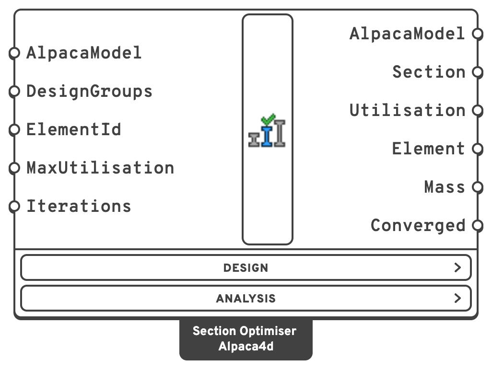
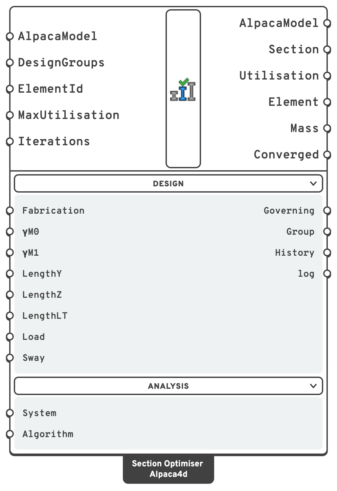

# Section Optimiser

The **Section Optimiser** sizes steel beams from lists of sections. It analyses the model, checks
every beam with every section of its list to EN 1993-1-1 on the forces the beam carried, as
[Utilisation](../results/utilisation.md) does, puts each beam on the first section of its list
that keeps it at or below **MaxUtilisation**, and analyses again: the new sections change the
self-weight and, in a statically indeterminate structure, where the forces go. It stops when no
section changes, or after **Iterations** analyses.

## 🔧 Grasshopper component

`Section Optimiser (Alpaca4d)` — **Alpaca4d ▸ 12_Optimisation**

<figure><figcaption></figcaption></figure>

<figure><figcaption>
With every menu open
</figcaption></figure>

A beam's list is its [Design Group](design-group.md)'s, in the order given. A beam in no group is
sized within the family of the section it starts with in
[Steel Section Library](../sections/library.md), smallest area first: an HEA200 among the HEAs, a
CHS among the CHS. A section that is not from the library has no family, and keeps its place.

The **Design** menu holds how the members are made and held, set once and left alone, and the
outputs about each beam's check; the **Analysis** menu, how each analysis is solved. Each analysis
is static, in one step. Press **Escape** to stop after the iteration under way.

### Inputs

| Name | Nick | Type | Default | Description |
| --- | --- | --- | --- | --- |
| AlpacaModel | `AlpacaModel` | Model | — | The assembled model, from [Assemble](../assemble.md). Its beams start from the sections they have. |
| DesignGroups | `DesignGroups` | DesignGroup (list) | *(empty)* | Which beams to size from which sections: one [Design Group](design-group.md) per list. Left empty, every beam is sized within its family in Steel Section Library. |
| ElementId | `ElementId` | Text (list) | *(empty)* = every beam | Optimise only some of the beams: an ElementId (`MyBeam_3`), a wildcard (`MyBeam*`, `Col_?`), an element tag (`47`) or a regular expression (`regex:^Col`), mixed freely. The beams it leaves out keep their sections, whatever group they are in, but are still analysed and checked. |
| MaxUtilisation | `MaxUtilisation` | Number | `1` | The utilisation each beam taking part should end up at or below: `1` is exactly at the limit, `0.8` keeps a fifth in hand. |
| Iterations | `Iterations` | Integer | `10` | How many analyses at most. Each one sizes the beams on the forces it finds, for the next to check. |
| Fabrication | `Fabrication` | Text | `Rolled` | How the sections are made, which sets the buckling curves: `Rolled` (rolled I-sections, hot-finished hollow sections) or `Welded` (welded I-sections, cold-formed hollow sections). In the **Design** menu. |
| γM0 | `γM0` | Number | `1.0` | Partial factor for the resistance of cross-sections. A National Annex may set another. In the **Design** menu. |
| γM1 | `γM1` | Number | `1.0` | Partial factor for the resistance of members to instability. In the **Design** menu. |
| LengthY | `LengthY` | Number (list) | each beam's length | Buckling length about local *y*, the minor axis of an I, in `m`. One value for every beam, or one per beam, in the order of the model's beams. It stays with the beam whatever its section. In the **Design** menu. |
| LengthZ | `LengthZ` | Number (list) | each beam's length | Buckling length about local *z*, the major axis of an I, in `m`. One value, or one per beam. In the **Design** menu. |
| LengthLT | `LengthLT` | Number (list) | each beam's length | Distance between lateral restraints, for lateral-torsional buckling, in `m`, as in Utilisation. Left empty, each beam's own length: not safe for a cantilever, whose tip is not held. In the **Design** menu. |
| Load | `Load` | Text (list) | `ShearCentre` | Where the load along each beam acts on its section, for lateral-torsional buckling: `ShearCentre`, `Destabilising` (or `Top`) or `Stabilising` (or `Bottom`). One value, or one per beam. In the **Design** menu. |
| Sway | `Sway` | Boolean (list) | `false` | The beam belongs to a frame that buckles by swaying: Cm = 0.9 about both axes (Table B.3). One value, or one per beam. In the **Design** menu. |
| System | `System` | Text | `Auto` | How the system of equations is solved, as in [Analysis Settings](../analysis/analysis-settings.md): Mumps on every core when the OpenSees has it, BandSPD when not. Reach for `UmfPack` if a model refuses to solve. In the **Analysis** menu. |
| Algorithm | `Algorithm` | Text | `Newton` | How each analysis is iterated to equilibrium. `Linear` does one solve with no iteration: a little faster on an elastic model, and only right on one. In the **Analysis** menu. |

### Outputs

| Name | Nick | Type | Description |
| --- | --- | --- | --- |
| AlpacaModel | `AlpacaModel` | Model | The last design, analysed: for Utilisation, Beam Forces or [Model View](../visualisation/model-view.md), or for Natural Vibration or Linear Buckling. Empty when the first analysis failed. |
| Section | `Section` | Section (list) | Each beam's section in the last design, in the order of **Element**. |
| Utilisation | `Utilisation` | Number (list) | Each beam's utilisation in the last design, as Utilisation's **Max**. Empty where it could not be checked. Torsional and torsional-flexural buckling (6.3.1.4) are not checked yet. |
| Element | `Element` | Element (list) | The beams, in the order of the other outputs. |
| Mass | `Mass` | Number (list) | The model's mass in each iteration, in `kg`, the last being the last design's. |
| Converged | `Converged` | Boolean | `true` when the last iteration changed nothing: every beam taking part has the first section of its list that works for it. |
| Governing | `Governing` | Text (list) | Which check gives each beam's utilisation, or why there is none. In the **Design** menu. |
| Group | `Group` | Text (list) | Each beam's design group, by name, or its family (`HEA family`) for a beam in no group; empty for a beam that takes no part. In the **Design** menu. |
| History | `History` | Generic (list) | One item per iteration: mass, largest utilisation, beams above MaxUtilisation, sections changed, and how long the analysis and the checks took. In the **Design** menu. |
| log | `log` | Text | What OpenSees printed in the last iteration. In the **Design** menu. |

## 📈 When to use it

**Use it when**

- You want the lightest sections of a steel frame, truss or beam grid that pass EN 1993-1-1 under
  its loads, and the forces depend on the sections themselves.
- A member drawn as several beams must end up with one section: give it a Design Group of its own.

**Do not use it when**

- The members are not steel: the check, and so the sizing, is steel only.
- You want to compare a few designs side by side: [Explorer Inputs](explorer-inputs.md) steps
  through them and records each.

The [Two-Span Beam](https://alpaca4d.github.io/examples/two-span-beam/) example sizes a curved beam
over two spans from a list of HEAs, element by element and as one section.


A beam can move back up its list as well as down it. When a design comes round again, the
iterations after it only let beams move on down their lists, so the run ends.

