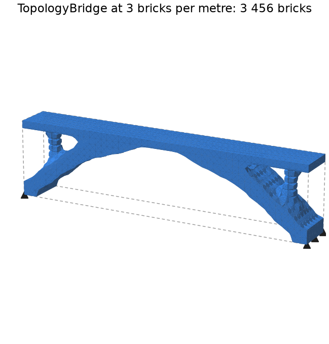
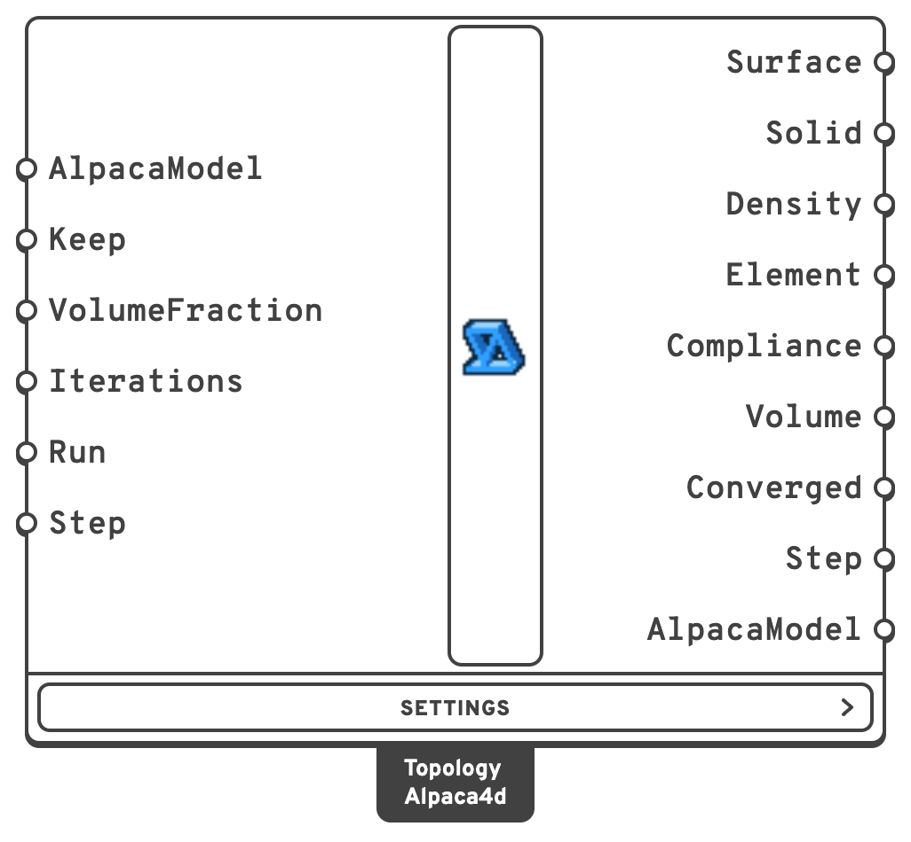
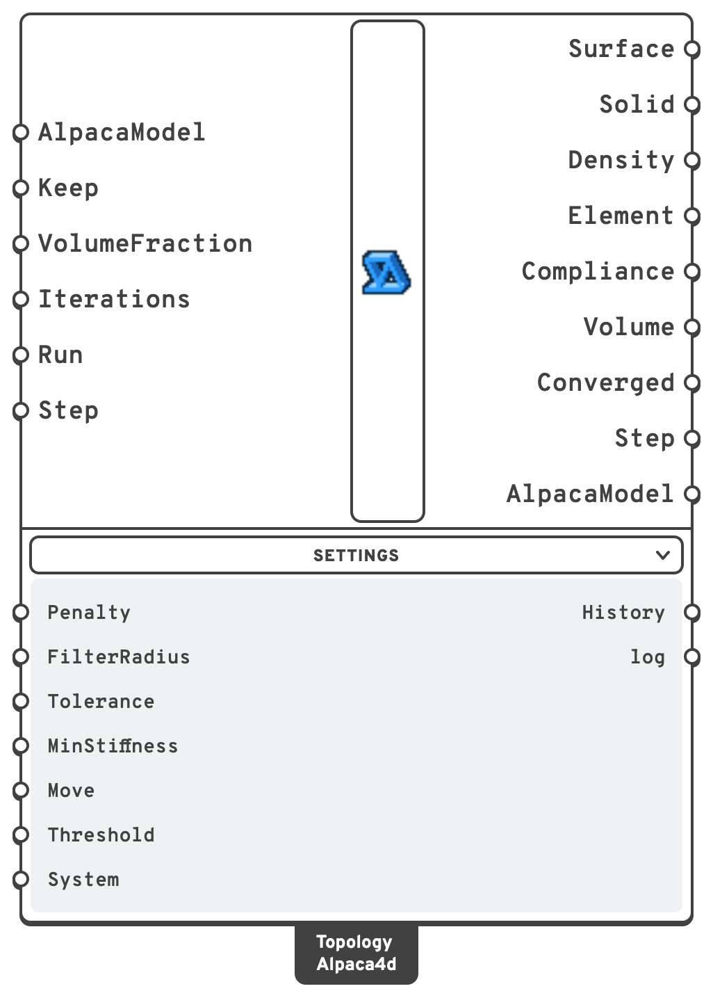
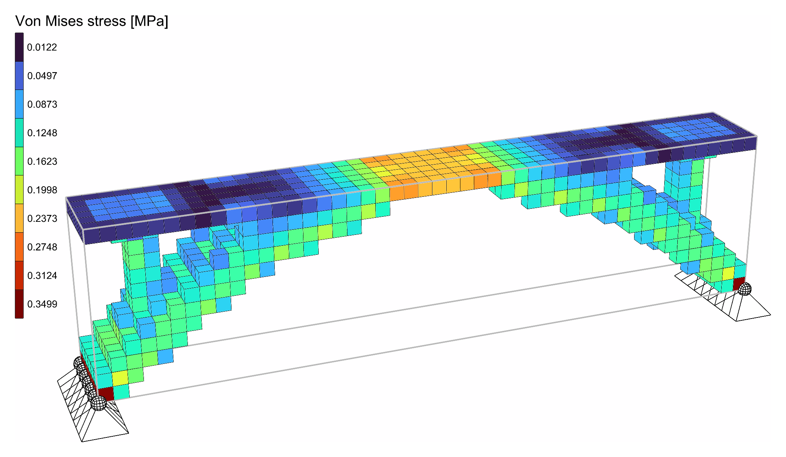
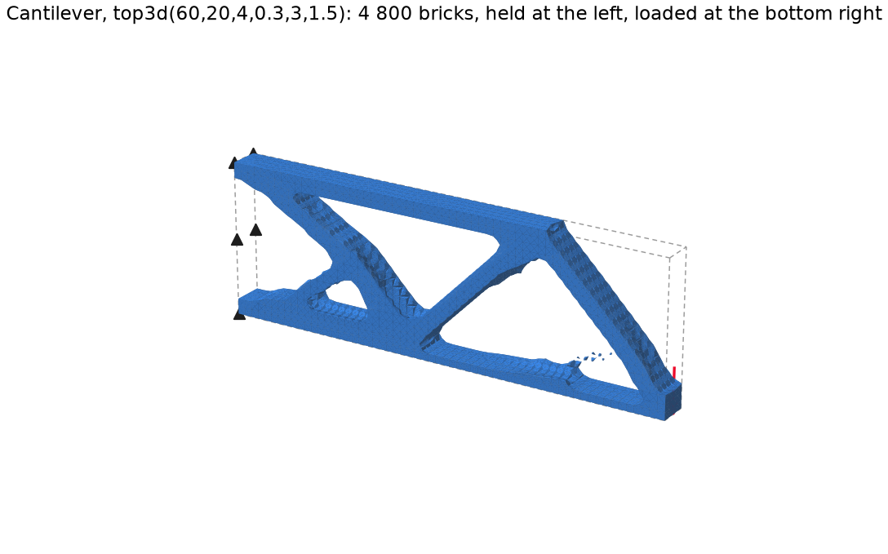
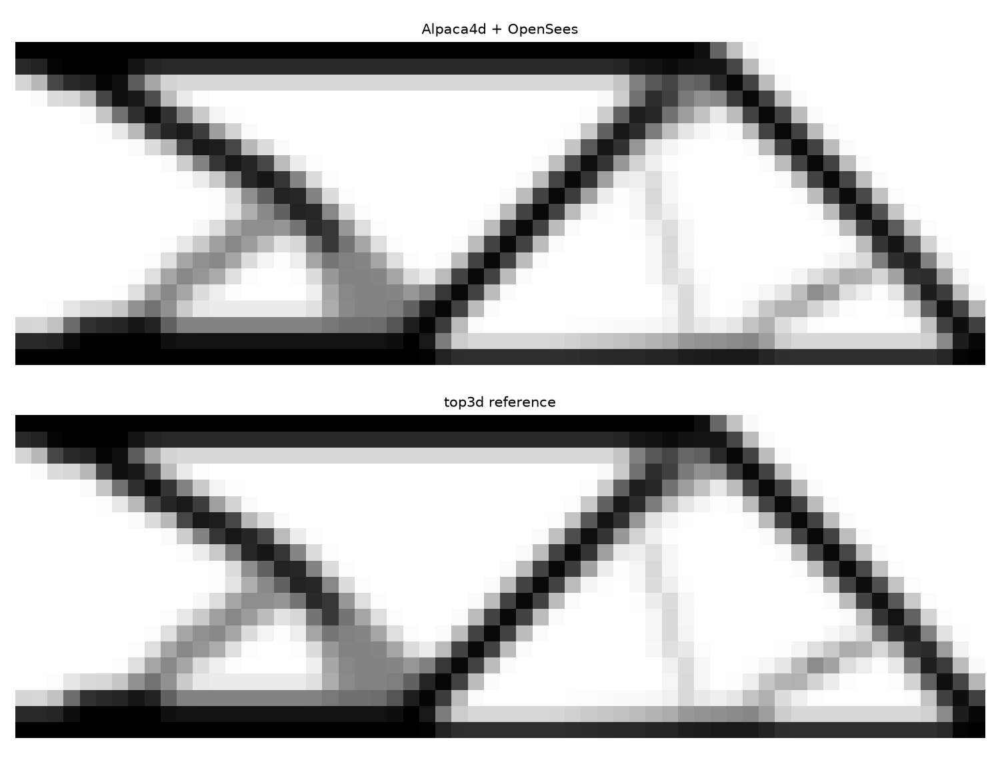
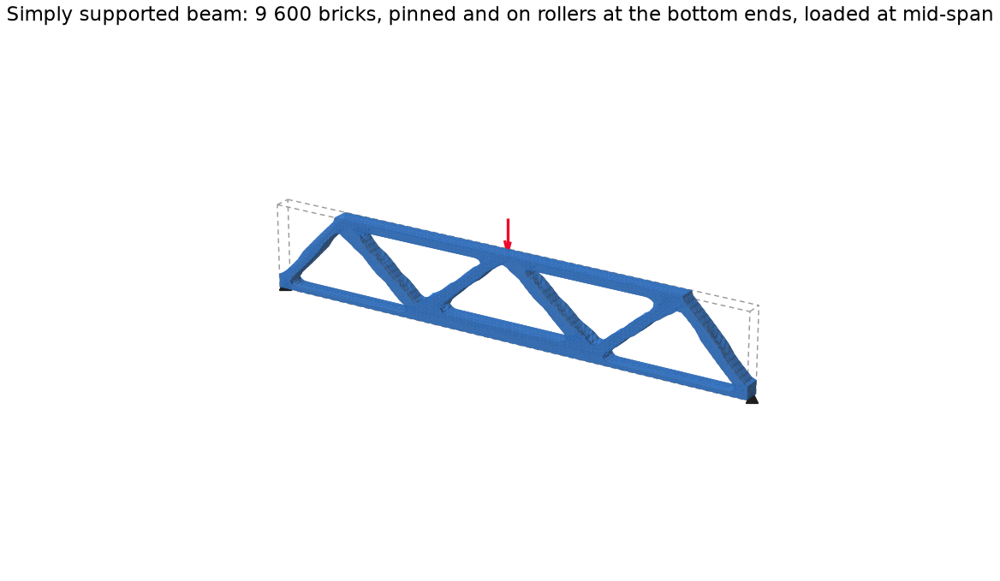
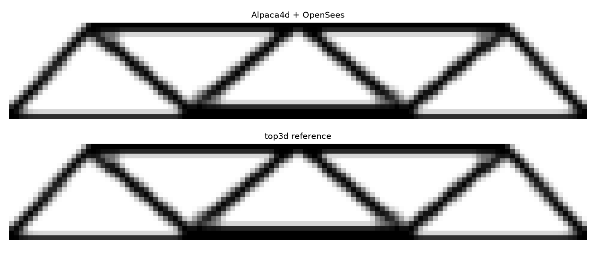

# Topology Optimisation

Finds where a solid needs its material. Model a block - the space the structure may take up - in
SSP Bricks or tetrahedra, support it and load it as usual, and Topology Optimisation finds which
part of it to keep to make it as stiff as possible with the share of material you allow.

<figure><figcaption>
The <a href="#example">bridge example</a>: what 20% of a 16 x 2 x 4 m block under a solid deck keeps.
</figcaption></figure>

## 🔧 Grasshopper component

`Topology Optimisation (Alpaca4d)` — **Alpaca4d ▸ 12_Optimisation**

<figure><figcaption></figcaption></figure>

<figure><figcaption>
With every menu open
</figcaption></figure>

It takes the assembled model and works on its solids. Each solid gets a density between 0 and 1,
and a stiffness of density³ times its material's: SIMP, the method of top3d and of most topology
optimisation codes. Each iteration analyses the model, works out from every element's strain
energy how much stiffness its material buys, and moves material from where it does little to
where it does most, keeping the volume. A density filter averages each element with its
neighbours, so that the result is members rather than a checkerboard.

**Nothing is ever cut out of the mesh.** An element that loses its material keeps a billionth of
its stiffness, so the model keeps all its nodes and connections, and the analysis never meets a
loose part.

### Which elements

| Element | Solved as |
| --- | --- |
| [SSP Brick](../elements/brick.md) | OpenSees' eight point brick (`stdBrick`), on the same nodes. An SSP Brick works out part of its stiffness once, when it is built, from the modulus it starts with, so it cannot be softened afterwards. The eight point brick is also the brick top3d optimises with. |
| [Ten Node Tetrahedron](../elements/ten-node-tetrahedron.md) | Itself. Needs an OpenSees from the master branch since 16 October 2026, as Run Analysis does. |

Every solid needs an [Elastic Isotropic material](../materials/ND.md): its modulus is what is
scaled. Beams, trusses, shells and links in the model are analysed with the solids but take no
part: they keep their full stiffness, their strain energy is not in Compliance, and the component
warns that they are there.

### Inputs

| Input | Default | Description |
| --- | --- | --- |
| AlpacaModel | | The assembled model, from [Assemble Model](../assemble.md). |
| Keep | | Solids to keep solid whatever the optimisation finds, by ElementId, tag or pattern, as the result components' ElementId input takes them. Use it for what must be there: a deck, a slab, the material round a support or under a load. |
| VolumeFraction | `0.3` | The share of the designed solids' volume to keep. The solids in Keep come on top. |
| Iterations | `100` | How many iterations at most, counted from the first. A run usually settles in 50 to 200. Raised after a run, the run goes on from where it stopped. |
| Run | `false` | `true` runs the optimisation, `false` pauses it. |
| Step | latest | Which iteration's design Surface, Solid, Density and AlpacaModel show: `0` the one the run starts from, `1` after the first iteration, and so on. Connect a slider to watch the run again. |

In the **Settings** menu:

| Input | Default | Description |
| --- | --- | --- |
| Penalty | `3` | The SIMP penalty p: an element of density x has x^p of its stiffness. 3 pushes the result to solid or void. |
| FilterRadius | 1.5 elements | How far each element's density is averaged over, in model units: about the thinnest member the result can have. |
| Tolerance | `0.01` | The run stops when no density changes by more than this in an iteration. Made smaller after a run, the run goes on from where it stopped. |
| MinStiffness | `1e-9` | The stiffness a void element keeps, as a share of the solid's. |
| Move | `0.2` | The most a density can change in one iteration. |
| Threshold | `0.5` | The density from which an element counts as solid, for **Surface**, **Solid** and **AlpacaModel**. It changes nothing in the run. |
| System | `Auto` | The system of equations, as in [Analysis Settings](../analysis/analysis-settings.md): Mumps on every core when the OpenSees has it, BandSPD when not. |

### Outputs

| Output | Description |
| --- | --- |
| Surface | The outline of the material kept: one closed mesh through where the density crosses Threshold, capped where it meets the edge of the domain. It outlines what **Solid** holds, without the crumbs a thin member's surface breaks into where it fades out around Threshold. |
| Solid | The solids that make the design, as new copies of the model's: those at or above Threshold, without pieces nothing holds, and with the elements that join a member's steps. See [Analysing the design](#analysing-the-design). |
| Density | Each solid's density, 0 to 1, in the order of Element. |
| Element | The solids. |
| Compliance | The work of the loads, F·u, of each iteration's design: the lower, the stiffer. |
| Volume | Each iteration's share of the designed solids' volume. |
| Converged | `true` when the run ended because the densities stopped moving. |
| Step | The iteration whose design Surface, Solid, Density and AlpacaModel show. |
| AlpacaModel | Once the run has stopped, the design as a model of its own, ready for [Run Analysis](../analysis/run-analysis.md): **Solid** at full stiffness, the model's other elements, and the supports, point loads and masses that stand on them. |
| History, log | In the Settings menu: each iteration's compliance, volume, change and timings; what OpenSees printed. |

## ▶️ Running it

1. Model the design domain in SSP Bricks - [Mesh Series to Brick](../utility/mesh-series-to-brick.md) turns a
   series of meshes into bricks - or in Ten Node Tetrahedra.
2. Give anything that must stay an ElementId, and name it in **Keep**.
3. Support and load the model as for an analysis, and assemble it.
4. Set **Run** to `true`.

The run goes on its own thread, so Rhino stays free. About once a second the component solves
again with the design reached so far: **Surface** and the other outputs follow the run, and the
component shows the iteration it is on. One OpenSees stays open for the whole run, so the model is
built once, not once per iteration.

### Pausing and going on

A run that stops before it has settled can go on from where it stopped:

| You | The run |
| --- | --- |
| Set **Run** to `false` | Pauses after the iteration under way, and keeps the design it has reached. |
| Set **Run** to `true` again | Goes on from there. |
| Raise **Iterations** - 200 to 500, say - after a run stopped at 200 | Goes on from iteration 201. While it runs, it just goes further. |
| Lower **Tolerance** after a run that settled | Goes on from where it settled. |
| Lower **Iterations** below what has run | Starts again from the beginning: the design after fewer iterations is not kept. |
| Change anything else - the model, Keep, VolumeFraction, a setting | Starts again from the beginning. |

Going on gives exactly what one run of all the iterations gives: the optimisation carries nothing
from one iteration to the next but the densities, and those are kept.

### Watching the run again

Every iteration's design is kept, so a slider on **Step** plays the run back: from the uniform
block it starts as, through the first rough members, to the design it settles on. Left empty, or
at its end, Step shows the latest design, live while the run goes.

The designs are kept small: a density as a byte - steps of 0.004, finer than any surface drawn
from it can show - and each design stored as its change from the one before, which is nearly
nothing once a run settles, compressed. The 200 designs of the cantilever below take 92 KB,
82 times less than as numbers, and any one of them is back in a fraction of a millisecond.


**Keep material round supports and loads.** A support or a load on a single row of nodes asks
for material there and nowhere around it: give the elements round them an ElementId and keep
them, so the result does not hang on a few elements.



**Self-weight stays as it was.** Gravity Load turns the weight of every element into loads on
its nodes once, when the model is assembled, so an element the optimisation empties still
weighs what it did. The component warns when the model has Gravity. Leave it out to optimise
for the other loads.


Topology Optimisation needs a license.

### How long it takes

On an Apple M2 Pro, with Mumps:

| Bricks | Unknowns | Per iteration | 100 iterations |
| --- | --- | --- | --- |
| 3 456 | 13 400 | 0.17 s | 17 s |
| 4 800 | 19 200 | 0.23 s | 23 s |
| 9 600 | 38 100 | 0.46 s | 46 s |
| 19 200 | 67 800 | 1.0 s | 100 s |

## 🔍 Analysing the design

Once the run has stopped, **AlpacaModel** is the design as a model of its own: wire it to
[Run Analysis](../analysis/run-analysis.md) and read it as any analysed model, with View Results,
Nodal Displacements or the other result components. Three things happen on the way from the
densities to a model:

- **Solid or void.** The elements at or above Threshold are solid, at their material's full
  stiffness. The others are left out of the model, rather than kept at a billionth of it.
- **Pieces nothing holds are left out.** Solid elements make one piece where they share a face. A
  piece the supports on its nodes do not hold still - every translation and rotation stopped - is
  left out: the bits the optimisation leaves floating carry nothing, and an analysis would find
  them free to move. A piece that touches a beam or a shell is kept, as the beam may hold it.
- **Steps are joined.** On a coarse mesh a diagonal member one or two elements thick comes out
  as a staircase, its steps meeting only along edges, where it would hinge. The material the
  filter spread between the steps is there, just under Threshold: where two pieces meet only along
  an edge or at a corner, the denser of the elements that join them face to face is made solid too.

**Solid** holds the same elements, and **Surface** outlines them. Where a thin member fades out
around Threshold, the surface through the averaged densities can break into crumbs, apart from the
rest though the member's elements are joined to it: Surface leaves out pieces under a hundredth of
the largest. The component says how many elements it left out or added, and how many crumbs.

Supports that stand where the design is void are left out of the model: the cantilever below is
held all over its end, and the design opens a gap in the middle of it. A load that stands on void
is left out too, with a warning, as the model no longer carries every load the design was made
for: keep the solids under the loads.

<figure><figcaption>
The <a href="#example">bridge</a>'s design, analysed: its Von Mises stresses.
</figcaption></figure>

Solid and void, the design comes out a little stiffer than the optimiser's last compliance says,
by about a quarter on the benchmarks below: the grey elements it keeps get their full stiffness.


**Copies.** Solid and AlpacaModel hand out new copies of the model's solids. Assembling the
model's own again would renumber them under the run.


## 🧪 Benchmarks

Two problems run with Alpaca4d and OpenSees, and with top3d itself - a numpy port of Liu and
Tovar's code ([An efficient 3D topology optimization code written in Matlab](https://doi.org/10.1007/s00158-014-1107-x),
2014), with its own brick, assembly and solver. Both use top3d's settings: 30% of the volume,
penalty 3, a filter of 1.5 elements, unit modulus and loads.

### Cantilever

top3d's own problem, `top3d(60,20,4,0.3,3,1.5)`: 60 x 20 x 4 bricks, held at one end, loaded at the
bottom of the other.

<figure><figcaption></figcaption></figure>

<figure><figcaption>
The density through the depth, by Alpaca4d (top) and top3d (bottom).
</figcaption></figure>

### Simply supported beam

120 x 20 x 4 bricks, pinned along the bottom of one end and on rollers along the other, loaded
at the top in the middle.

<figure><figcaption></figcaption></figure>

<figure><figcaption>
The density through the depth, by Alpaca4d (top) and top3d (bottom).
</figcaption></figure>

### The numbers

| | Cantilever | Simply supported |
| --- | --- | --- |
| Bricks | 4 800 | 9 600 |
| First compliance, Alpaca4d against top3d | 7.7e-12 apart | 5.9e-12 apart |
| Compliance after 200 iterations | 2415.86 / 2415.82 | 1203.0263 / 1203.0263 |
| Densities after 200 iterations | 4.5e-4 apart on average | 8.1e-5 apart at most |

The first analyses agree to round-off: OpenSees' eight point brick is top3d's brick. The runs then
follow each other: the simply supported beam to 2e-8 all the way, and the cantilever to within
0.2% while its design rearranges itself, around iteration 70, before both come out at the same
design. The checks and the reference are in `Alpaca4d.Test/TopologyOptimisation` in the Alpaca4d
repository.

To run both in Grasshopper, open `Tools/Examples/TopologyBenchmarks.gh` from the Alpaca4d
repository: each problem has its own **Run** toggle, and panels beside it give the compliance to
expect after 200 iterations.

## Example

`Tools/Examples/TopologyBridge.gh` in the Alpaca4d repository: a steel block 16 m long, 2 m wide
and 4 m high, pinned along both ends of its bottom. Its top layer is a deck, kept solid through
Keep, carrying 10 kN/m². With 20% of the rest, the optimisation finds an arch from support to
support that rises into the deck at mid-span, with a column up to the deck near each end - 3 456
bricks, 77 iterations, 14 seconds. At two bricks per metre the deck is a 0.5 m slab of solid steel,
stiff enough to span most of the way itself, and the steel goes into two legs that shorten its
span instead: what is best depends on what is already there.

## 📚 References

- M. P. Bendsøe (1989). Optimal shape design as a material distribution problem. *Structural
  Optimization* 1:193–202. — SIMP.
- M. P. Bendsøe, O. Sigmund (1999). Material interpolation schemes in topology optimization.
  *Archive of Applied Mechanics* 69:635–654.
- O. Sigmund (2001). A 99 line topology optimization code written in Matlab. *Structural and
  Multidisciplinary Optimization* 21:120–127.
- T. E. Bruns, D. A. Tortorelli (2001). Topology optimization of non-linear elastic structures and
  compliant mechanisms. *Computer Methods in Applied Mechanics and Engineering* 190:3443–3459. — the
  density filter.
- B. Bourdin (2001). Filters in topology optimization. *International Journal for Numerical Methods
  in Engineering* 50:2143–2158.
- E. Andreassen, A. Clausen, M. Schevenels, B. S. Lazarov, O. Sigmund (2011). Efficient topology
  optimization in MATLAB using 88 lines of code. *Structural and Multidisciplinary Optimization*
  43:1–16. — the stiffness of a void element, Emin, and the update as coded.
- K. Liu, A. Tovar (2014). An efficient 3D topology optimization code written in Matlab.
  *Structural and Multidisciplinary Optimization* 50:1175–1196. — top3d, which Topology
  Optimisation follows step for step.

Alpaca4d adds to top3d what a model drawn in Grasshopper needs: elements of different sizes count
by their volume, in the filter and in the volume kept; solids can be kept solid; and the element
energies come from OpenSees' own element forces, so any solid it solves can be optimised.
