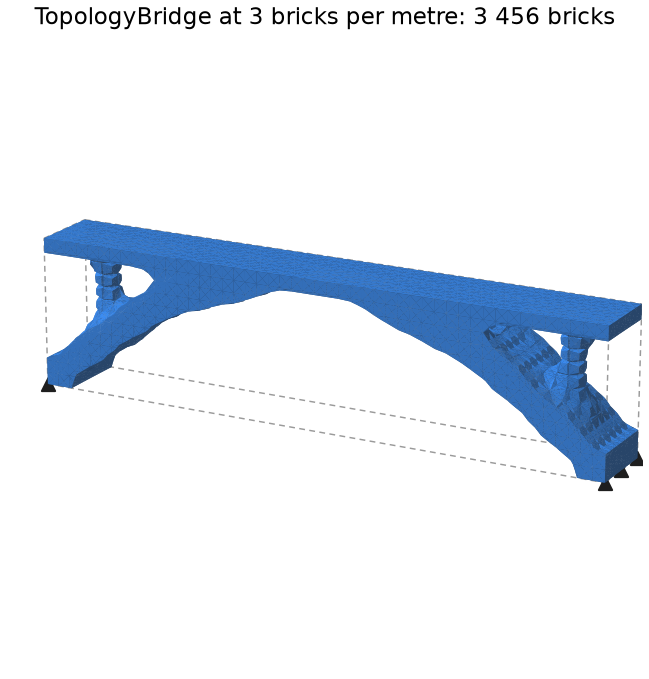
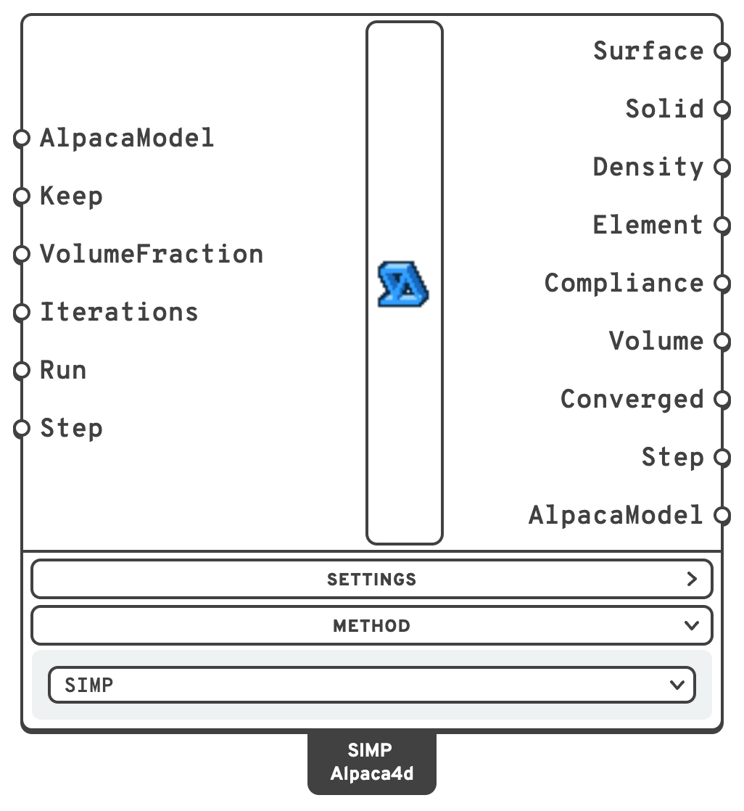
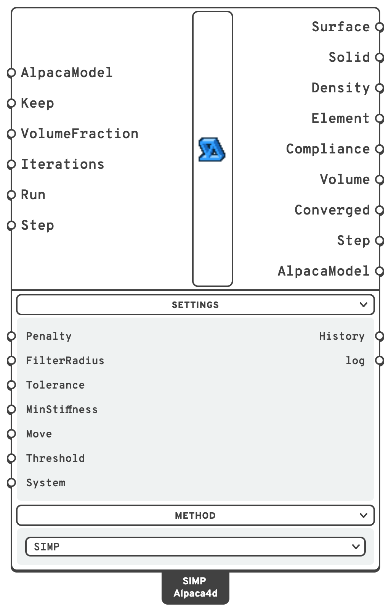
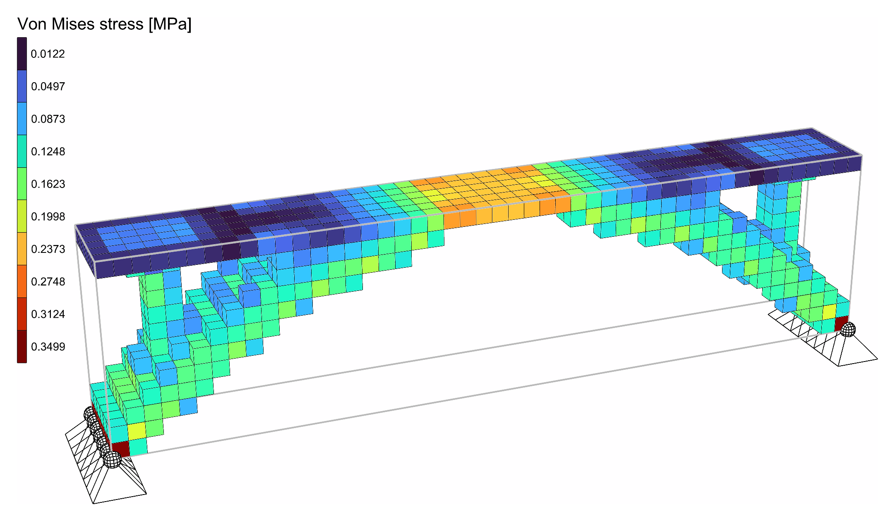
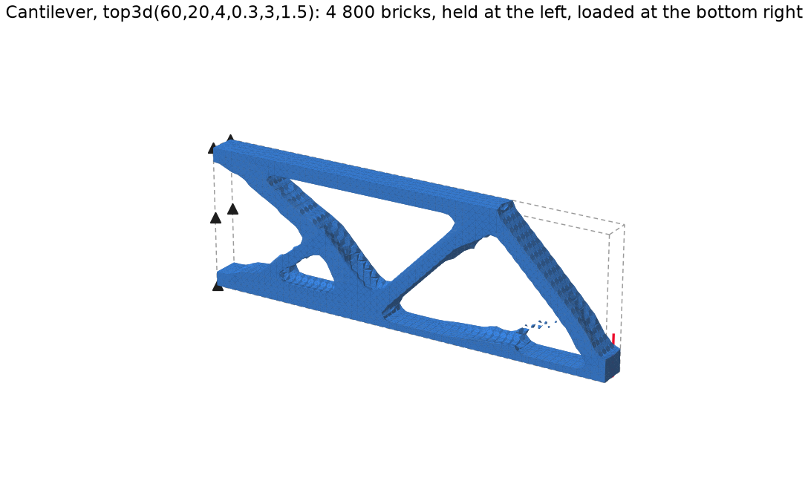
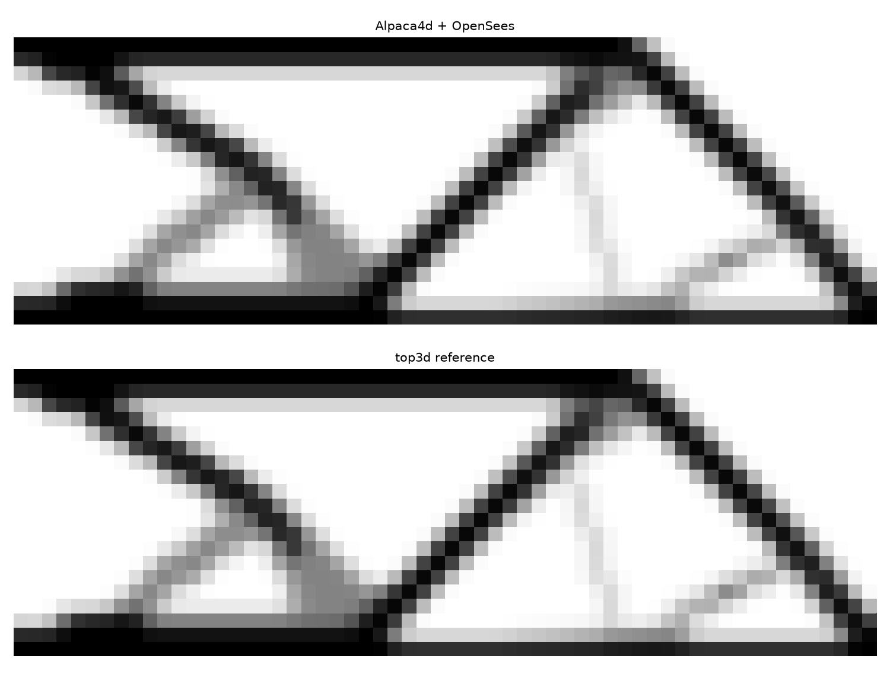
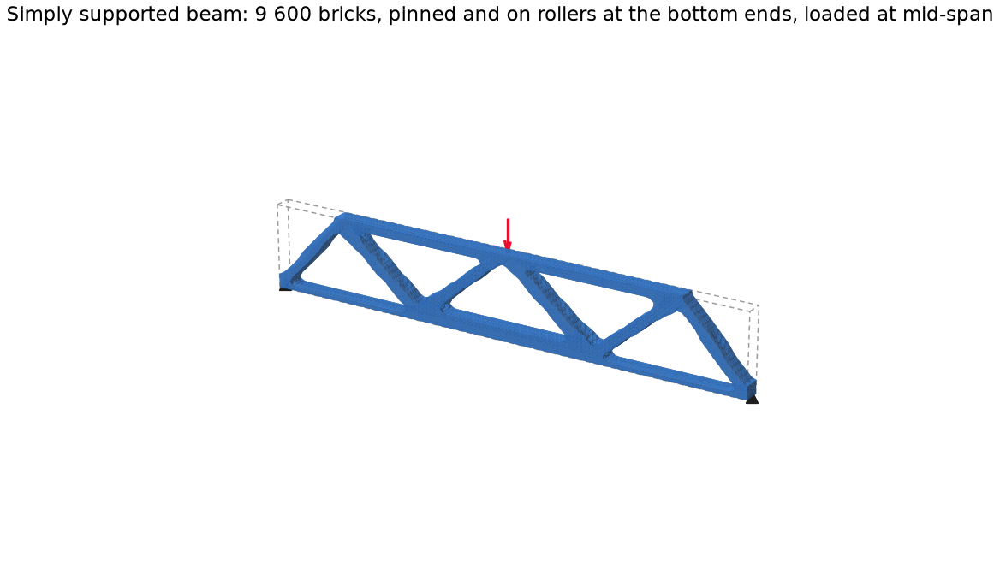
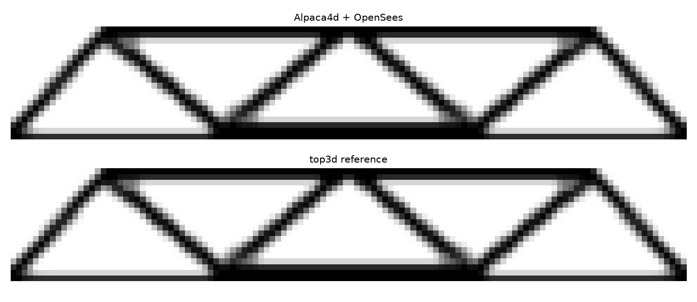
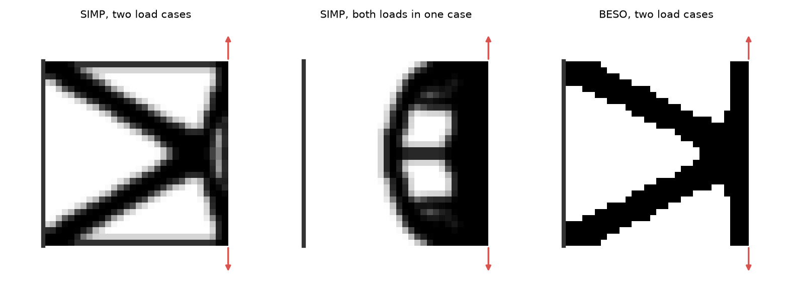

# Topology Optimisation

Finds where a solid needs its material. Model a block - the space the structure may take up - in
SSP Bricks or tetrahedra, support it and load it as usual, and Topology Optimisation finds which
part of it to keep to make it as stiff as possible with the share of material you allow. Its
**Multi-Material** method also finds which of several materials goes where.

<figure><figcaption>
The <a href="#example">bridge example</a>: what 20% of a 16 x 2 x 4 m block under a solid deck keeps.
</figcaption></figure>

## 🔧 Grasshopper component

`Topology Optimisation (Alpaca4d)` — **Alpaca4d ▸ 12_Optimisation**

<figure><figcaption></figcaption></figure>

<figure><figcaption>
With every menu open
</figcaption></figure>

It takes the assembled model and works on its solids. **Method**, in the right-click menu, picks
how; the inputs and outputs change with it, and a switch starts any run again.

| Method | Finds | Each element |
| --- | --- | --- |
| **SIMP**, the default | Where one material goes, for the volume you allow | A density between 0 and 1; Threshold decides what counts as solid |
| **BESO** | Where one material goes, at every volume from the whole block down to the one you allow | Solid or void, all along |
| **Multi-Material** | Where each of several materials goes, and where none is needed | A density of every material, pushed to one material alone or void |

[How each method works](#how-each-method-works) says more, and [Which method](#which-method)
compares them.

**Nothing is ever cut out of the mesh.** An element that loses its material keeps a billionth of
its stiffness, so the model keeps all its nodes and connections, the analysis never meets a loose
part, and an element can come back later.

### Which elements

| Element | Solved as |
| --- | --- |
| [SSP Brick](../elements/brick.md) | OpenSees' eight point brick (`stdBrick`), on the same nodes. An SSP Brick works out part of its stiffness once, when it is built, from the modulus it starts with, so it cannot be softened afterwards. The eight point brick is also the brick top3d optimises with. |
| [Ten Node Tetrahedron](../elements/ten-node-tetrahedron.md) | Itself. Needs an OpenSees from the master branch since 16 October 2026, as Run Analysis does. |

Every solid needs an [Elastic Isotropic material](../materials/ND.md): its modulus is what is
scaled. Beams, trusses, shells and links in the model are analysed with the solids but take no
part: they keep their full stiffness, their strain energy is not in Compliance, and the component
warns that they are there.

### Inputs — SIMP

| Name | Nick | Type | Default | Description |
| --- | --- | --- | --- | --- |
| AlpacaModel | `AlpacaModel` | Model | — | The assembled model, from [Assemble Model](../assemble.md). Its solids are the design domain; supports, loads and any beams or shells stay as they are. |
| Keep | `Keep` | Text (list) | *(empty)* | Solids to keep solid whatever the optimisation finds, by ElementId, tag or pattern, as the result components' ElementId input takes them. Use it for what must be there: a deck, a slab, the material round a support or under a load. |
| VolumeFraction | `VolumeFraction` | Number | `0.3` | The share of the designed solids' volume to keep. The solids in Keep come on top. |
| Iterations | `Iterations` | Integer | `100` | How many iterations at most, counted from the first. A run usually settles in 50 to 200. Raised after a run, the run goes on from where it stopped. |
| Run | `Run` | Boolean | `false` | `true` runs the optimisation, `false` pauses it. |
| Penalty | `Penalty` | Number | `3` | The SIMP penalty p: an element of density x has x^p of its stiffness. 3 pushes the result to solid or void. In the **Settings** menu. |
| FilterRadius | `FilterRadius` | Number | 1.5 elements | How far each element's density is averaged over, in model units: about the thinnest member the result can have. In the **Settings** menu. |
| Tolerance | `Tolerance` | Number | `0.01` | The run stops when no density changes by more than this in an iteration. Made smaller after a run, the run goes on from where it stopped. In the **Settings** menu. |
| MinStiffness | `MinStiffness` | Number | `1e-9` | The stiffness a void element keeps, as a share of the solid's. In the **Settings** menu. |
| Move | `Move` | Number | `0.2` | The most a density can change in one iteration. In the **Settings** menu. |
| Threshold | `Threshold` | Number | `0.5` | The density from which an element counts as solid, for **Surface**, **Solid** and **AlpacaModel**. It changes nothing in the run. In the **Settings** menu. |
| System | `System` | Text | `Auto` | The system of equations, as in [Analysis Settings](../analysis/analysis-settings.md): Mumps on every core when the OpenSees has it, BandSPD when not. A value list connected to it fills with the options. In the **Settings** menu. |
| Step | `Step` | Integer | latest | Which iteration's design Surface, Solid, Density and AlpacaModel show: `0` the one the run starts from, `1` after the first iteration, and so on. Connect a slider to watch the run again. |

### Inputs — BESO

| Name | Nick | Type | Default | Description |
| --- | --- | --- | --- | --- |
| AlpacaModel | `AlpacaModel` | Model | — | The assembled model, from [Assemble Model](../assemble.md). |
| Keep | `Keep` | Text (list) | *(empty)* | Solids to keep solid whatever the optimisation finds, by ElementId, tag or pattern. Use it for what must be there: a deck, a slab, the material round a support or under a load. |
| VolumeFraction | `VolumeFraction` | Number | `0.3` | The share of the designed solids' volume to keep at the end. The solids in Keep come on top. |
| Iterations | `Iterations` | Integer | `200` | How many iterations at most. Coming down to VolumeFraction takes about log(VolumeFraction) / log(1 − EvolutionRate) iterations - 60 for 0.3 at 2% - and settling ten to thirty more. |
| Run | `Run` | Boolean | `false` | `true` runs the optimisation, `false` pauses it. |
| EvolutionRate | `EvolutionRate` | Number | `0.02` | How much of the volume each iteration takes away, as a share of the volume before it. Smaller is slower and steadier. In the **Settings** menu. |
| Penalty | `Penalty` | Number | `3` | The penalty p of soft-kill BESO: a void element has MinStiffness of its stiffness, and its strain energy counts MinStiffness^((p−1)/p) as much, next to nothing. In the **Settings** menu. |
| FilterRadius | `FilterRadius` | Number | 2 elements | How far the elements' strain energies are averaged over, in model units: about the thinnest member the result can have. Much wider, a thin member's energy is averaged away with the void around it, and the member can be cut through: see [When a member is cut through](#when-a-member-is-cut-through). In the **Settings** menu. |
| Tolerance | `Tolerance` | Number | `0.001` | Once VolumeFraction is reached, the run stops when the compliances of the last five iterations add up to within this share of the five before. Made smaller after a run, the run goes on from where it stopped. In the **Settings** menu. |
| MinStiffness | `MinStiffness` | Number | `1e-9` | The stiffness a void element keeps, as a share of the solid's. In the **Settings** menu. |
| System | `System` | Text | `Auto` | The system of equations, as in [Analysis Settings](../analysis/analysis-settings.md). A value list connected to it fills with the options. In the **Settings** menu. |
| Step | `Step` | Integer | latest | Which iteration's design the outputs show: `0` the whole block the run starts from, `1` after the first iteration, and so on. Every design is kept, so a slider dragged back shows the design of each volume on the way down. |

There is no Threshold: every element is solid or void, so any threshold between finds the same
solids.

### Inputs — Multi-Material

| Name | Nick | Type | Default | Description |
| --- | --- | --- | --- | --- |
| AlpacaModel | `AlpacaModel` | Model | — | The assembled model, from [Assemble Model](../assemble.md). |
| Keep | `Keep` | Text (list) | *(empty)* | Solids to keep as modelled, of their own material, whatever the optimisation finds: by ElementId, tag or pattern. Use it for what must be there - a deck, the material round a support or under a load. |
| Materials | `Materials` | Material (list) | — | The [Elastic Isotropic materials](../materials/ND.md) to choose from, two or more. Only their Young's moduli count. Each is drawn in its Colour, or in a colour of the brand palette when it has none. |
| VolumeFractions | `VolumeFractions` | Number (list) | `0.3` shared equally | The share of the designed solids' volume each material may fill, one per material in the order of Materials; a shorter list repeats its last value. Together at most 1. |
| Iterations | `Iterations` | Integer | `300` | How many iterations at most. The projection is at its sharpest from iteration 251, so a run needs about 300. Raised after a run, the run goes on from where it stopped. |
| Run | `Run` | Boolean | `false` | `true` runs the optimisation, `false` pauses it. |
| Penalty | `Penalty` | Number | `3` | The penalty n: an element's stiffness takes each material's share to the power n, which pushes it to all or nothing. In the **Settings** menu. |
| PNorm | `PNorm` | Number | `6` | The p of the interpolation's p-norm: the larger, the more an element that mixes materials is penalised. 6 balances a clear result against a steady run; much larger makes the run unsteady. In the **Settings** menu. |
| FilterRadius | `FilterRadius` | Number | 2 elements | How far the densities are averaged over, in model units: about the thinnest member, and the thinnest layer of one material, the result can have. In the **Settings** menu. |
| Tolerance | `Tolerance` | Number | `0.001` | Once the projection is at its sharpest, the run stops when the compliances of the last five iterations add up to within this share of the five before. Made smaller after a run, the run goes on from where it stopped. In the **Settings** menu. |
| MinStiffness | `MinStiffness` | Number | `1e-9` | The stiffness a void element keeps, as a share of the stiffest material's. In the **Settings** menu. |
| Move | `Move` | Number | `0.1` | The most a density can change in one iteration. In the **Settings** menu. |
| Threshold | `Threshold` | Number | `0.5` | The density of its material from which an element counts as that material, for **Surface**, **Solid**, **Material** and **AlpacaModel**. It changes nothing in the run. In the **Settings** menu. |
| System | `System` | Text | `Auto` | The system of equations, as in [Analysis Settings](../analysis/analysis-settings.md). A value list connected to it fills with the options. In the **Settings** menu. |
| Step | `Step` | Integer | latest | Which iteration's design the outputs show: `0` the one the run starts from, `1` after the first iteration, and so on. Connect a slider to watch the run again. |

With two load combinations or more, the right-click menu's **Load combinations** picks what is
made least: the sum of their compliances, or the worst case. See [Worst case](#worst-case).

### Outputs — SIMP

| Name | Nick | Type | Description |
| --- | --- | --- | --- |
| Surface | `Surface` | Mesh | The outline of the material kept: one closed mesh through where the density crosses Threshold, capped where it meets the edge of the domain. It outlines what **Solid** holds, without the crumbs a thin member's surface breaks into where it fades out around Threshold. |
| Solid | `Solid` | Element (list) | The solids that make the design, as new copies of the model's: those at or above Threshold, without pieces nothing holds, and with the elements that join a member's steps. See [Analysing the design](#analysing-the-design). |
| Density | `Density` | Number (list) | Each solid's density, 0 to 1, in the order of Element. |
| Element | `Element` | Element (list) | The solids. |
| Compliance | `Compliance` | Number (list) | The work of the loads, F·u, of each iteration's design: the lower, the stiffer. With [load combinations](#load-combinations), the sum of theirs. |
| Volume | `Volume` | Number (list) | Each iteration's share of the designed solids' volume. |
| Converged | `Converged` | Boolean | `true` when the run ended because the densities stopped moving. |
| History | `History` | History (list) | Each iteration's compliance, volume, change and timings. In the **Settings** menu. |
| log | `log` | Text | What OpenSees printed. Read it when the run fails. In the **Settings** menu. |
| Step | `Step` | Integer | The iteration whose design Surface, Solid, Density and AlpacaModel show. |
| AlpacaModel | `AlpacaModel` | Model | Once the run has stopped, the design as a model of its own, ready for [Run Analysis](../analysis/run-analysis.md): **Solid** at full stiffness, the model's other elements, and the supports, point loads and masses that stand on them. |

### Outputs — BESO

| Name | Nick | Type | Description |
| --- | --- | --- | --- |
| Surface | `Surface` | Mesh | The outline of the material kept: one closed mesh, capped where it meets the edge of the domain. It outlines what **Solid** holds. |
| Solid | `Solid` | Element (list) | The solids kept that make the design, as new copies of the model's: without pieces nothing holds, and with the elements that join a member's steps. See [Analysing the design](#analysing-the-design). |
| Density | `Density` | Number (list) | Each solid's density, in the order of Element: 1 solid, MinStiffness^(1/Penalty) - 0.001 - void. |
| Element | `Element` | Element (list) | The solids. |
| Compliance | `Compliance` | Number (list) | The work of the loads, F·u, of each iteration's design: the lower, the stiffer. It rises as the volume comes down, then settles. With [load combinations](#load-combinations), the sum of theirs. |
| Volume | `Volume` | Number (list) | Each iteration's share of the designed solids' volume: from 1 down to VolumeFraction. |
| Converged | `Converged` | Boolean | `true` when the run ended at VolumeFraction with the compliance settled within Tolerance. |
| History | `History` | History (list) | Each iteration's compliance, volume, convergence measure (NaN before VolumeFraction is reached) and timings. In the **Settings** menu. |
| log | `log` | Text | What OpenSees printed. Read it when the run fails. In the **Settings** menu. |
| Step | `Step` | Integer | The iteration whose design the outputs show. |
| AlpacaModel | `AlpacaModel` | Model | Once the run has stopped, the design as a model of its own, ready for [Run Analysis](../analysis/run-analysis.md). |

### Outputs — Multi-Material

| Name | Nick | Type | Description |
| --- | --- | --- | --- |
| Surface | `Surface` | Mesh (list) | The outline of each material: one closed mesh per material, in the order of Materials. The component draws each in its colour. The solids in Keep show as the material nearest them in stiffness. |
| Colour | `Colour` | Colour (list) | The colour each material's Surface is drawn in: its own, or the brand palette's. |
| Solid | `Solid` | Element (list) | The solids that make the design, as new copies of the model's, each of the material it ended as - the solids in Keep of their own. Pieces nothing holds are left out, as [Analysing the design](#analysing-the-design) says. |
| Material | `Material` | Integer (list) | Each solid's material as its index in Materials, in the order of Element; `-1` where it is void or left out. |
| Density | `Density` | Number (tree) | Each solid's density of each material, 0 to 1: a branch per material, in the order of Element. |
| Element | `Element` | Element (list) | The solids. |
| Compliance | `Compliance` | Number (list) | The work of the loads, F·u, of each iteration's design: the lower, the stiffer. With [load combinations](#load-combinations), the sum of theirs, or the largest with [Worst case](#worst-case). |
| Volume | `Volume` | Number (tree) | Each iteration's share of the designed solids' volume filled by each material: a branch per material. |
| Converged | `Converged` | Boolean | `true` when the run ended at the sharpest projection with the compliance settled within Tolerance. |
| History | `History` | History (list) | Each iteration's compliance, volume, convergence measure, timings, each material's volume and the projection's sharpness. In the **Settings** menu. |
| log | `log` | Text | What OpenSees printed. Read it when the run fails. In the **Settings** menu. |
| Step | `Step` | Integer | The iteration whose design the outputs show. |
| AlpacaModel | `AlpacaModel` | Model | Once the run has stopped, the design as a model of its own, ready for [Run Analysis](../analysis/run-analysis.md): **Solid**, each solid of its material at full stiffness, the model's other elements, and the supports, point loads and masses that stand on them. |

### Which method

The three methods take the same model and run the same way, with Run, Iterations and Step, and
share their main outputs - Surface, Solid, Step, AlpacaModel.

| | SIMP | BESO | Multi-Material |
| --- | --- | --- | --- |
| Update | Optimality criteria, as top3d | The elements that work hardest are kept, the rest let go | MMA, with a volume limit per material |
| A run | One design for VolumeFraction; the quickest on small models | From the whole block down to VolumeFraction: Step shows the design of every volume on the way; about 100 iterations, the quickest on large models | About 260 iterations, each a quarter longer: four to seven times as long as the quicker of the other two |

On the same problem SIMP and BESO find much the same structure. SIMP gives one design for one
volume and is the quickest on small models; on large ones BESO, needing fewer iterations, finishes
first. BESO is solid or void from the start, which needs no threshold, and passes through every
volume on its way down, so one run is a series of designs to choose from.
[How long it takes](#how-long-it-takes) compares them.

### Load combinations

A model with no combinations is optimised for all its load patterns at once, as Run Analysis
solves it. Give it combinations with [Load Combination](../loads/load-combination.md), between
Assemble and the optimisation, and it is optimised for each of them: every iteration solves the
design once per combination, with only the patterns it names, each scaled by its factor, and
**Compliance** is the sum of theirs. Every method does this.

This matters when loads can act one way or the other. A `Wind +X` and a `Wind -X` in one model
cancel, so a design for all patterns at once has no wind in it. With `1.35 G + 1.5 W+` and
`1.35 G + 1.5 W-` as two combinations, the design carries both. The sum is what the 99 and 88 line
codes do with several load cases. [Two load cases](#two-load-cases) below shows the difference.

- **One combination** is optimised for its patterns times their factors. One combination of a
  single pattern, at factor 1, gives the same run as the pattern on its own, to the last digit.
- **A pattern in no combination is left out**, as Run Analysis leaves it out. The component says
  which.
- **Multi-Material can take the worst case instead:** right-click the component, then **Load
  combinations ▸ Worst case**. It then makes the largest of the compliances least, not their sum.
  See [Worst case](#worst-case).
- **A run takes one analysis per combination** in each iteration, so three combinations take
  about three times as long.
- **AlpacaModel keeps the combinations**, so Run Analysis solves the design for the same ones.

## ▶️ Running it

1. Model the design domain in SSP Bricks - [Mesh Series to Brick](../utility/mesh-series-to-brick.md) turns a
   series of meshes into bricks - or in Ten Node Tetrahedra.
2. Give anything that must stay an ElementId, and name it in **Keep**.
3. Support and load the model as for an analysis, and assemble it.
4. Pick the **Method** in the right-click menu, and set **Run** to `true`.

The run goes on its own thread, so Rhino stays free. About once a second the component solves
again with the design reached so far: **Surface** and the other outputs follow the run, and the
component shows the iteration it is on. One OpenSees stays open for the whole run, so the model is
built once, not once per iteration.

### Pausing and going on

A run that stops before it has settled can go on from where it stopped:

| You | The run |
| --- | --- |
| Set **Run** to `false` | Pauses after the iteration under way, and keeps the design it has reached. |
| Set **Run** to `true` again | Goes on from there. |
| Raise **Iterations** - 200 to 500, say - after a run stopped at 200 | Goes on from iteration 201. While it runs, it just goes further. |
| Lower **Tolerance** after a run that settled | Goes on from where it settled. |
| Lower **Iterations** below what has run | Starts again from the beginning: the design after fewer iterations is not kept. |
| Change anything else - the model, Keep, VolumeFraction, a setting, the Method | Starts again from the beginning. |

Going on gives exactly what one run of all the iterations gives: the optimisation carries nothing
from one iteration to the next but the densities, and those are kept.

### Watching the run again

Every iteration's design is kept, so a slider on **Step** plays the run back: from the uniform
block it starts as, through the first rough members, to the design it settles on. Left empty, or
at its end, Step shows the latest design, live while the run goes. With BESO, it shows the design
of each volume on the way down.

The designs are kept small: a density as a byte - steps of 0.004, finer than any surface drawn
from it can show - and each design stored as its change from the one before, which is nearly
nothing once a run settles, compressed. The 200 designs of the cantilever below take 92 KB,
82 times less than as numbers, and any one of them is back in a fraction of a millisecond.


**Keep material round supports and loads.** A support or a load on a single row of nodes asks
for material there and nowhere around it: give the elements round them an ElementId and keep
them, so the result does not hang on a few elements.



**Self-weight stays as it was.** Gravity Load turns the weight of every element into loads on
its nodes once, when the model is assembled, so an element the optimisation empties still
weighs what it did. The component warns when the model has Gravity. Leave it out to optimise
for the other loads.


Without a license, Topology Optimisation runs on models of up to 500 elements, counting any
beams, shells and links with the solids, by any method. The design it finds, its AlpacaModel
output, is analysed, and drawn by Model View, without a license up to the same 500, although other
models stop at 50. A larger model needs one: see [License](../../references/license.md#without-a-license).

### How long it takes

SIMP, on an Apple M2 Pro, with Mumps:

| Bricks | Unknowns | Per iteration | 100 iterations |
| --- | --- | --- | --- |
| 3 456 | 13 400 | 0.17 s | 17 s |
| 4 800 | 19 200 | 0.23 s | 23 s |
| 9 600 | 38 100 | 0.46 s | 46 s |
| 19 200 | 67 800 | 1.0 s | 100 s |

The three methods side by side, on the block of the
[Topology Bridge](https://alpaca4d.github.io/examples/topology-bridge/), one run at a time on the same
machine, each keeping a fifth of the block below the deck - Multi-Material 5% in steel and 15% in
concrete:

| Bricks | SIMP | BESO | Multi-Material |
| --- | --- | --- | --- |
| 1 024 | 2.6 s, 44 iterations | 4.9 s, 92 iterations | 19 s, 267 iterations |
| 3 456 | 13 s, 77 | 17 s, 102 | 59 s, 263 |
| 8 192 | 49 s, 109 | 36 s, 90 | 2 min 21 s, 260 |
| 16 000 | 1 min 48 s, 123 | 1 min 18 s, 95 | 4 min 53 s, 260 |

An analysis takes as long whichever method asks for it, so the difference is in how many
iterations each makes, and in the update: Multi-Material's, MMA, takes about a quarter of its
time, the other two's next to nothing. SIMP's compliance is within 1% of where it ends after about
30 iterations at every size; the rest of its run settles the densities. BESO comes down 2% of the
volume an iteration, so its design is there only near the end. Multi-Material sharpens its
projection every 50 iterations up to the 251st, so a run is never much shorter than 260.

MMA takes longer the more materials and elements there are. The 27 000 bricks of the
[Multi-Material benchmark](#multi-material-against-the-papers) took about 1.5 s of analysis and 1
to 3 s of update per iteration in the test bench, so its 300 iterations took about a quarter of an
hour.

## ⚙️ How each method works

### SIMP

Each solid gets a density between 0 and 1, and a stiffness of density³ times its material's: SIMP,
the method of top3d and of most topology optimisation codes. Each iteration analyses the model,
works out from every element's strain energy how much stiffness its material buys, and moves
material from where it does little to where it does most, keeping the volume. A density filter
averages each element with its neighbours, so that the result is members rather than a
checkerboard. It follows top3d step for step.

### BESO

Bi-directional evolutionary structural optimisation. It starts from the whole block and takes a
little material away each iteration, from where it does least, until the share you allow is left.
Every element is solid or void all along, so every iteration is a design of its own, of the volume
reached: drag **Step** back to see the design with 80%, 60% or 40% of the material, and pick the one
you want.

It is esoL.m, the BESO code of Xia, Xia, Huang and Xie's review (2018), step for step, in the
soft-kill form of Huang and Xie (2009).

1. **The volume comes down.** The whole block is solid at the start. Each iteration aims at the
   volume before it times 1 − EvolutionRate, until it reaches VolumeFraction, and stays there.
2. **Analysis.** OpenSees solves the design; a void element has MinStiffness of its stiffness.
3. **Sensitivity numbers.** Each element's strain energy per volume - for a void element
   x_min^(p−1) of it, next to nothing - says how hard it works.
4. **Filter.** Each number is averaged over the elements within FilterRadius, so that void
   elements next to hard-working ones get a number too and can come back, and the result is
   members rather than a checkerboard. The solids in Keep take part with their own energy, as
   every element does in esoL: that is what holds a pad under a load to the structure.
5. **History.** Each number is averaged with its value of the iteration before, which steadies
   the run.
6. **Update.** A threshold is found by bisection: the design elements above it are solid, those
   below are void, and together the solid ones fill the volume aimed at.
7. **Stopping.** Once VolumeFraction is reached, the run stops when the compliances of the last
   five iterations add up to within Tolerance of the five before.

#### When a member is cut through

As the volume comes down, members get thin. Now and then the update cuts one through, and the
compliance jumps. Usually BESO mends it within a few iterations, bringing elements back, and the
run goes on. When it does not - the compliance more than 10 times the lowest of the five iterations
before, in one step or in two, and never back under 3 times that - the design has broken apart, the
"breakdown" of Xia et al.'s section 3.4. The run then stops where it would have converged,
**Converged** is `false`, and a warning gives the iteration: drag **Step** back to the last whole
design, or start again with a smaller **FilterRadius** or **EvolutionRate**, or **Keep** more.

It comes mostly from too wide a filter. On the Topology Bridge block, at 2 bricks per metre, the
default radius, 1 m, converges; 2 m, half the block's height, breaks after 62 iterations.

### Multi-Material

Every solid gets a density of every material, and its stiffness mixes the materials' Young's
moduli so that an element of one material alone pays least. Each iteration analyses the model and
moves every density by MMA, the method of moving asymptotes, so that the model gets stiffer while
each material stays within its share. An element with no material keeps a billionth of the
stiffest material's stiffness.

It follows Zheng, Yi, Peng and Yoon (2024), who extend the 88 line code to several materials with
the mapping-based interpolation of Yi et al.

- **Densities.** Every element e has a density x of every material i, between 0.001 and 1, all
  starting at 0.5.
- **Filter.** Each material's densities are averaged over the elements within FilterRadius, as in
  SIMP, so that the result is members rather than a checkerboard.
- **Projection.** The averaged densities x̃ are pushed towards 0 or 1 by a smoothed step,
  r = (tanh(βη) + tanh(β(x̃ − η))) / (tanh(βη) + tanh(β(1 − η))), with η = 0.5. Its sharpness β
  starts at 1 and doubles every 50 iterations up to 32, from iteration 251, so the design starts
  soft and ends nearly solid or void.
- **Interpolation.** An element's modulus is

  E = Σᵢ ψᵢⁿ (Eᵢ − E_void) + E_void,  with ψᵢ = rᵢ · ‖r‖ₚ / (‖r‖₁ + δ)

  ψᵢ is rᵢ when the element has material i alone; when it mixes materials, the p-norm over the
  1-norm makes each share count for less, so mixing does not pay. n is **Penalty** and p is
  **PNorm**.
- **Update.** Each material has a volume limit of its own: Σ v·r of material i at most its share
  of the designed volume. Several limits are more than the optimality criteria of SIMP can take,
  so the densities are moved by MMA (Svanberg 1987), as the paper does. The compliance's
  derivatives come from each element's strain energy in OpenSees, through the interpolation, the
  projection and the filter.
- **Stopping.** Some density moves by the full move limit in every iteration, even at the end, so
  the run stops on the compliance instead: once β is 32, when the last five compliances add up to
  within Tolerance of the five before, the test BESO uses.


**Give it 300 iterations.** The design only becomes clear once the projection is sharp, after
iteration 200 or so. A run of fewer iterations ends grey, with most elements a little of
everything.


What it does not do:

- **Only the Young's moduli count.** Every solid keeps the Poisson's ratio of the material it was
  modelled in; the Poisson's ratios of **Materials** are not used. The component says so when they
  differ.
- **Only stiffness is optimised.** A material strong in tension goes where its stiffness pays, not
  where the tension is: give it steel and concrete and it will not put the steel in the ties and
  the concrete in the struts. The materials differ here by how stiff they are and how much of
  each you allow, nothing else.

#### Worst case

With two load combinations or more, the right-click menu's **Load combinations** says what
Multi-Material makes least:

- **Sum of their compliances**, the default: the design stiffest on average over the
  combinations, as SIMP and BESO always do.
- **Worst case**: the design whose softest combination is as stiff as it can be. MMA does this in
  its min-max form (Svanberg 2007): it makes a bound z least, with each combination's compliance a
  constraint of its own, at most z, beside the volume of each material. **Compliance** is then the
  largest of the combinations'.

The two differ when the combinations differ. A square clamped on one side, pulled up at the top
corner of its free end in one combination and down at the bottom corner, twice as hard, in the
other (16 x 16 bricks, two materials of 20% each, 120 iterations): the sum ends at 249 up and 759
down, the worst case at 645 and 645. Its softer combination is stiffer, and the two come out
equal, as a worst case design should. With a single combination, or none, **Worst case** changes
nothing: the run is the one it always was.

## 🔍 Analysing the design

Once the run has stopped, **AlpacaModel** is the design as a model of its own: wire it to
[Run Analysis](../analysis/run-analysis.md) and read it as any analysed model, with Model View,
Nodal Displacements or the other result components. Three things happen on the way from the
densities to a model:

- **Solid or void.** The elements at or above Threshold are solid, at their material's full
  stiffness. The others are left out of the model, rather than kept at a billionth of it.
- **Pieces nothing holds are left out.** Solid elements make one piece where they share a face. A
  piece the supports on its nodes do not hold still - every translation and rotation stopped - is
  left out: the bits the optimisation leaves floating carry nothing, and an analysis would find
  them free to move. A piece that touches a beam or a shell is kept, as the beam may hold it.
- **Steps are joined.** On a coarse mesh a diagonal member one or two elements thick comes out
  as a staircase, its steps meeting only along edges, where it would hinge. The material the
  filter spread between the steps is there, just under Threshold: where two pieces meet only along
  an edge or at a corner, the denser of the elements that join them face to face is made solid too.

**Solid** holds the same elements, and **Surface** outlines them. Where a thin member fades out
around Threshold, the surface through the averaged densities can break into crumbs, apart from the
rest though the member's elements are joined to it: Surface leaves out pieces under a hundredth of
the largest. The component says how many elements it left out or added, and how many crumbs.

Supports that stand where the design is void are left out of the model: the cantilever below is
held all over its end, and the design opens a gap in the middle of it. A load that stands on void
is left out too, with a warning, as the model no longer carries every load the design was made
for: keep the solids under the loads.

<figure><figcaption>
The <a href="#example">bridge</a>'s design, analysed: its Von Mises stresses.
</figcaption></figure>

Solid and void, the design comes out a little stiffer than the optimiser's last compliance says,
by about a quarter on the benchmarks below: the grey elements it keeps get their full stiffness.


**Copies.** Solid and AlpacaModel hand out new copies of the model's solids. Assembling the
model's own again would renumber them under the run.


## 🧪 Benchmarks

Two problems run by SIMP with Alpaca4d and OpenSees, and with top3d itself - a numpy port of Liu and
Tovar's code ([An efficient 3D topology optimization code written in Matlab](https://doi.org/10.1007/s00158-014-1107-x),
2014), with its own brick, assembly and solver. Both use top3d's settings: 30% of the volume,
penalty 3, a filter of 1.5 elements, unit modulus and loads.

### Cantilever

top3d's own problem, `top3d(60,20,4,0.3,3,1.5)`: 60 x 20 x 4 bricks, held at one end, loaded at the
bottom of the other.

<figure><figcaption></figcaption></figure>

<figure><figcaption>
The density through the depth, by Alpaca4d (top) and top3d (bottom).
</figcaption></figure>

### Simply supported beam

120 x 20 x 4 bricks, pinned along the bottom of one end and on rollers along the other, loaded
at the top in the middle.

<figure><figcaption></figcaption></figure>

<figure><figcaption>
The density through the depth, by Alpaca4d (top) and top3d (bottom).
</figcaption></figure>

### The numbers

| | Cantilever | Simply supported |
| --- | --- | --- |
| Bricks | 4 800 | 9 600 |
| First compliance, Alpaca4d against top3d | 7.7e-12 apart | 5.9e-12 apart |
| Compliance after 200 iterations | 2415.86 / 2415.82 | 1203.0263 / 1203.0263 |
| Densities after 200 iterations | 4.5e-4 apart on average | 8.1e-5 apart at most |

The first analyses agree to round-off: OpenSees' eight point brick is top3d's brick. The runs then
follow each other: the simply supported beam to 2e-8 all the way, and the cantilever to within
0.2% while its design rearranges itself, around iteration 70, before both come out at the same
design. The checks and the reference are in `Alpaca4d.Test/TopologyOptimisation` in the Alpaca4d
repository.

### Two load cases

The 88 line code's example of several load cases (Andreassen et al. 2011, section 5.2), in three
dimensions: a square 30 x 30 bricks, 2 deep, clamped along its left side. One load pulls the top
corner of the free end up, the other pulls the bottom corner down, each of 1 at every node of its
edge. The paper runs it on a square of 150 with a sensitivity filter; here it uses top3d's density
filter of 1.5 elements and 40% of the volume. The reference is top3d in numpy with the paper's
change made to it: a load vector per case, and the compliance and its sensitivity summed over them.

<figure><figcaption>
The density through the depth. Both loads in one case pull the free end apart and balance each other, so the design never reaches the support.
</figcaption></figure>

| | SIMP, two cases | SIMP, both in one case | BESO, two cases |
| --- | --- | --- | --- |
| Iterations | 59 | 45 | 55 |
| Compliance at the end, Alpaca4d / reference | 311.000998 / 311.000998 | 82.441012 / 82.441012 | 336.52726 / 336.52726 |
| Largest gap over the run | 8.5e-13 | 2.9e-14 | 7.9e-13 |
| Final design | densities 2.4e-11 apart at most | densities 1.5e-11 apart at most | the same 1 800 elements solid |
| The design under each load alone | 155.5 and 155.5 | 2.0e10 and 2.0e10 | 168.2 and 168.2 |

The runs follow the references to round-off. The design for both loads at once looks stiffer -
82 against 311 - but only for the two together: under either load alone it hangs off nothing,
at a billionth of the stiffness, and is 100 million times softer than the design for two cases.
The BESO reference is esoL in numpy with the same change, in `Alpaca4d.Test/TopologyMethods`.

To run both in Grasshopper, download the [Topology Benchmarks](https://alpaca4d.github.io/examples/topology-benchmarks/)
example: each problem has its own **Run** toggle, and panels beside it give the compliance to
expect after 200 iterations.

### BESO against the paper

BESO was run against an independent BESO in numpy: esoL.m in three dimensions, with its own eight
node brick, its own assembly and SciPy's solver, sharing nothing with the run through OpenSees but
the problem and the algorithm.

- **esoL's clamped cantilever**, `esoL(100,50,0.6,0.02,6,2)`, as 100 x 50 bricks one brick deep:
  both runs take 39 iterations and end with every one of the 5 000 elements the same - the design
  of the review's Fig. 60.
- **A 3D cantilever**, 40 x 20 x 4 bricks, to 40% of the volume: the two runs are the same to
  1e-12 for 80 iterations; at iteration 81 one element sits on the threshold and goes the other
  way, round-off, and they end 0.06% apart, 3 192 of 3 200 elements the same.

The checks and the reference are in `Alpaca4d.Test/TopologyMethods` in the Alpaca4d repository:
`./run.sh bench beso-cantilever` runs the first.

### Multi-Material against the papers

- **MMA.** Svanberg's own test problem, from his note on MMA and GCMMA: every iterate is his
  table's to its four decimals, ending at f₀ = 8.7702.
- **The derivatives.** The compliance's derivatives by every kind of density, worked out through
  OpenSees, match central differences to about 1e-7, at a soft projection and a sharp one.
- **The paper's 3D cantilever.** Zheng et al.'s cantilever on the grid of their Appendix B, 60 x 30
  x 15 bricks, held at one end and loaded along the bottom edge of the other, with half the volume
  shared equally among the materials, filter radius 5 and 300 iterations:

  | Materials | E | Compliance | The paper's | Apart |
  | --- | --- | --- | --- | --- |
  | 2 | 1 and 5 | 437.50 | 432.94 | +1.1% |
  | 3 | 1, 2 and 5 | 433.19 | 433.05 | +0.03% |
  | 5 | 1, 2, 3, 4 and 5 | 400.98 | 400.24 | +0.2% |

  Two MMA codes take slightly different paths through a problem with many local optima, and a
  percent apart is as close as two of them come. The paper's code also projects the densities
  with the old sharpness once after each doubling, and has no void stiffness.

The checks and the benchmark are in `Alpaca4d.Test/TopologyMethods` in the Alpaca4d repository:
`./run.sh bench zheng 3` runs the cantilever.

## Example

The [Topology Bridge](https://alpaca4d.github.io/examples/topology-bridge/) example is a steel block
16 m long, 2 m wide and 4 m high, pinned along both ends of its bottom. Its top layer is a deck, kept solid through
Keep, carrying 10 kN/m². The three methods run side by side on it, each with its own **Run** and
**Step**, each keeping a fifth of the block below the deck; at 3 bricks per metre, 3 456 bricks:

- SIMP finds an arch from support to support that rises into the deck at mid-span, with a column
  up to the deck near each end: 77 iterations, 15 seconds. At two bricks per metre the deck is a
  0.5 m slab of solid steel, stiff enough to span most of the way itself, and the steel goes into
  two legs that shorten its span instead: what is best depends on what is already there.
- BESO carves the block down to two inclined legs from the supports into the deck, with a column
  near each end: 105 iterations, under 20 seconds. Drag its **Step** to go through the designs of
  every volume on the way down.
- Multi-Material, with at most 5% of the block below the deck in steel and 15% in concrete, puts
  the concrete into two broad legs from the supports to the deck and the steel into an arch slung
  under the middle of the deck: 265 iterations, under a minute and a half.

Its last group analyses each design from its **AlpacaModel** once its run has stopped, as in the
picture above, each brick of its material.

The [Truss Node](https://alpaca4d.github.io/examples/truss-node/) and the
[Beam-Column Joint](https://alpaca4d.github.io/examples/beam-column-joint/) examples find a node where
members meet in space - nine members of a space truss, a column and four beams - with all three
methods side by side.

The [Cantilever, Penalty 1 to 5](https://alpaca4d.github.io/examples/cantilever-penalties/) and the
[L-Bracket](https://alpaca4d.github.io/examples/l-bracket/) examples run two classic problems of the
papers the three ways, the cantilever by SIMP at every penalty from 1 to 5 as papers compare them.

## 📚 References

SIMP:

- M. P. Bendsøe (1989). Optimal shape design as a material distribution problem. *Structural
  Optimization* 1:193–202. — SIMP.
- M. P. Bendsøe, O. Sigmund (1999). Material interpolation schemes in topology optimization.
  *Archive of Applied Mechanics* 69:635–654.
- O. Sigmund (2001). A 99 line topology optimization code written in Matlab. *Structural and
  Multidisciplinary Optimization* 21:120–127.
- T. E. Bruns, D. A. Tortorelli (2001). Topology optimization of non-linear elastic structures and
  compliant mechanisms. *Computer Methods in Applied Mechanics and Engineering* 190:3443–3459. — the
  density filter, of SIMP and Multi-Material.
- B. Bourdin (2001). Filters in topology optimization. *International Journal for Numerical Methods
  in Engineering* 50:2143–2158.
- E. Andreassen, A. Clausen, M. Schevenels, B. S. Lazarov, O. Sigmund (2011). Efficient topology
  optimization in MATLAB using 88 lines of code. *Structural and Multidisciplinary Optimization*
  43:1–16. — the stiffness of a void element, Emin, and the update as coded.
- K. Liu, A. Tovar (2014). An efficient 3D topology optimization code written in Matlab.
  *Structural and Multidisciplinary Optimization* 50:1175–1196. — top3d, which SIMP follows step
  for step.

BESO:

- L. Xia, Q. Xia, X. Huang, Y. M. Xie (2018). Bi-directional evolutionary structural optimization
  on advanced structures and materials: a comprehensive review. *Archives of Computational Methods
  in Engineering* 25:437–478. — esoL.m, which BESO follows.
- X. Huang, Y. M. Xie (2007). Convergent and mesh-independent solutions for the bi-directional
  evolutionary structural optimization method. *Finite Elements in Analysis and Design*
  43:1039–1049. — the filter, the averaging with the iteration before, the test of convergence.
- X. Huang, Y. M. Xie (2009). Bi-directional evolutionary topology optimization of continuum
  structures with one or multiple materials. *Computational Mechanics* 43:393–401. — soft-kill
  BESO.

Multi-Material:

- R. Zheng, B. Yi, X. Peng, G.-H. Yoon (2024). An efficient code for the multi-material topology
  optimization of 2D/3D continuum structures written in Matlab. *Applied Sciences* 14:657. — the
  method, which Multi-Material follows.
- K. Svanberg (1987). The method of moving asymptotes - a new method for structural optimization.
  *International Journal for Numerical Methods in Engineering* 24:359–373.
- K. Svanberg (2007). MMA and GCMMA - two methods for nonlinear optimization. KTH, Stockholm. —
  the MMA written here, equation by equation, and the min-max form behind the worst case.
- F. Wang, B. S. Lazarov, O. Sigmund (2011). On projection methods, convergence and robust
  formulations in topology optimization. *Structural and Multidisciplinary Optimization*
  43:767–784. — the projection.

Alpaca4d adds what a model drawn in Grasshopper needs: elements of different sizes count by their
volume, in the filter and in the volume kept; solids can be kept solid; and the element energies
come from OpenSees' own element forces, so any solid it solves can be optimised. Zheng et al.'s
code projects the densities with the old sharpness once after each doubling; here they are
projected with the new one.
