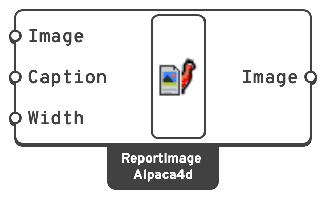

# Report Image

A picture from outside Rhino for the report: a site photo, a drawing from the architect, a scan. What does not live in Grasshopper still goes in the report.

## 🔧 Grasshopper component

`Report Image (Alpaca4d)` — **Alpaca4d ▸ 13_Report**

<figure><figcaption></figcaption></figure>

### Inputs

| Name | Nick | Type | Description |
| --- | --- | --- | --- |
| Image | `Image` | Text, File Path or Bitmap | The picture: the path of an image file, or a bitmap from Grasshopper's image components. A list gives a figure each. A relative path starts from the folder of the `.gh` file. |
| Caption | `Caption` | Text | The text under the picture, after its figure number. One for each picture, or one for all. Optional. |
| Width | `Width` | Number | How much of the text's width the picture takes, 0 to 1. Default 1. |

### Outputs

| Name | Nick | Type | Description |
| --- | --- | --- | --- |
| Image | `Image` | Generic | The pictures, for the **Content** of the [Report](report.md). |

## 📈 When to use it

**Use it when** the report needs something the model cannot draw: the site, an existing drawing, a detail from a catalogue.

Each picture is a figure, numbered with the model's figures in the order they come. A bitmap is saved as a PNG in the `Alpaca4d/ReportImages` folder of the temp folder, once for the same pixels. A file that is missing or cannot be read stays in the report as a line saying why, and the component gives a message.
