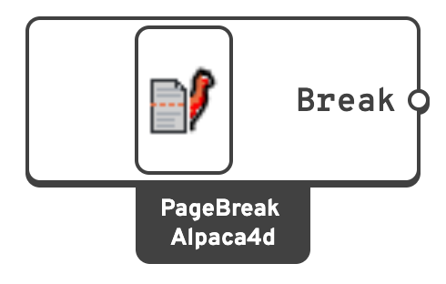

# Report Page Break

A page break: what follows it in the report starts on a new page.

## 🔧 Grasshopper component

`Report Page Break (Alpaca4d)` — **Alpaca4d ▸ 13_Report**

<figure><figcaption></figcaption></figure>

### Inputs

None.

### Outputs

| Name | Nick | Type | Description |
| --- | --- | --- | --- |
| Break | `Break` | Generic | The page break, for the **Content** of the [Report](report.md). |

## 📈 When to use it

**Use it when**

- A chapter is to start on a page of its own.

The report starts a new page by itself where a table, a figure or a heading does not fit; a heading
is never left alone at the foot of a page. A page break at the top of a page does nothing.
