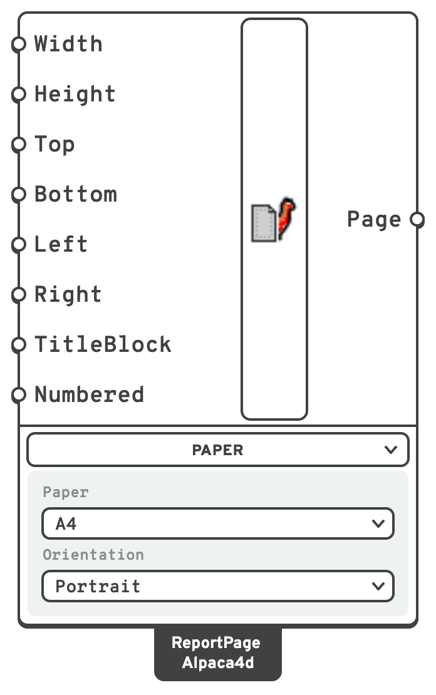

# Report Page

The page of the report: the paper, which way round, the margins, and the title block drawn on every
page.

## 🔧 Grasshopper component

`Report Page (Alpaca4d)` — **Alpaca4d ▸ 13_Report**

<figure><figcaption></figcaption></figure>

The **Paper** menu picks the paper — `A4`, `A3`, `A2`, `A1`, `A0`, `Letter`, `Legal`, or `Custom`
for a size of your own — and which way round, `Portrait` or `Landscape`.

### Inputs

| Name | Nick | Type | Default | Description |
| --- | --- | --- | --- | --- |
| Width | `Width` | Number | `210` | The paper's width in mm, with **Paper** set to `Custom`. |
| Height | `Height` | Number | `297` | The paper's height in mm, with **Paper** set to `Custom`. |
| Top | `Top` | Number | `24` | The top margin in mm: room for the top of the title block. |
| Bottom | `Bottom` | Number | `22` | The bottom margin in mm: room for the bottom of the title block. |
| Left | `Left` | Number | `20` | The left margin in mm. |
| Right | `Right` | Number | `20` | The right margin in mm. |
| TitleBlock | `TitleBlock` | Generic | *(none)* | What is drawn on every page, from [Report Title Block](report-title-block.md). Left empty, a plain header and footer: the title, and the date and the page number. |
| Numbered | `Numbered` | Boolean | `True` | True to number the headings as they come — 1, 1.1, 1.1.1 — before their text; False for headings as they are typed. See [Report Text](report-text.md). |

### Outputs

| Name | Nick | Type | Description |
| --- | --- | --- | --- |
| Page | `Page` | Generic | The page, for the **Page** input of the [Report](report.md). |

## 📈 When to use it

**Use it when**

- The report is to be on another paper than A4, or turned to landscape.
- Your office has a title block of its own: the margins leave room for it, and the content stays
  clear of it.

The content flows inside the margins: a table, a figure or a paragraph never goes into them. The title
block is drawn in them, so make them as deep as its top and its bottom.
