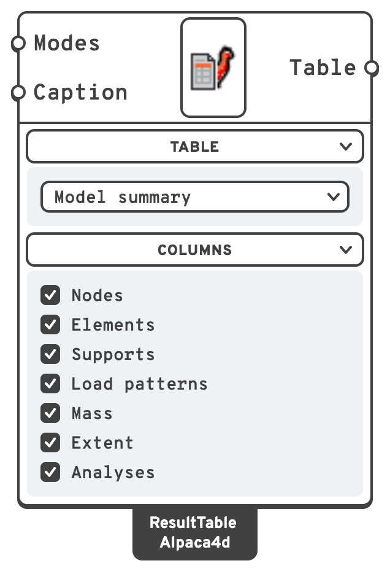

# Report Result Table

One of the tables Alpaca4d makes of a model: what it is made of, and what an analysis found.

## 🔧 Grasshopper component

`Report Result Table (Alpaca4d)` — **Alpaca4d ▸ 13_Report**

<figure><figcaption></figcaption></figure>

Report Result Table holds no model: the [Report](report.md) makes the table of its own model of the
kind the table needs, from its **AlpacaModel** input. The **Table** menu picks the table:

| Table | Holds | Needs the model from |
| --- | --- | --- |
| `Model summary` | Nodes, elements by type, supports, load patterns, mass, extent and the analyses. | any |
| `Beam sections` | Each beam section: material, how many elements, their length, A, Iy, Iz and J. | any |
| `Beam materials` | Each beam material: E, G, Poisson's ratio and density. | any |
| `Supports` | Each support: where it is, and which of Tx, Ty, Tz, Rx, Ry, Rz it holds. | any |
| `Displacements` | The largest and smallest displacement along X, Y and Z, and the largest overall, with their nodes. | [Run Analysis](../analysis/run-analysis.md) |
| `Support reactions` | The reactions at each support, and their sum, in the global axes. | [Run Analysis](../analysis/run-analysis.md) |
| `Natural frequencies` | Each mode's eigenvalue, angular frequency, frequency and period. | [Natural Vibration](../analysis/natural-vibration.md) |
| `Participating mass` | Each mode's participating mass along X, Y and Z, as a percentage, and the running total. | [Natural Vibration](../analysis/natural-vibration.md) |
| `Buckling factors` | Each buckling mode's load factor. | [Linear Buckling](../analysis/linear-buckling.md) |
| `Footfall response` | The nodes that respond most to footfall, worst first: their response factor R, its steady-state and transient parts, their accelerations and the pace that gives R. | [Footfall Analysis](../analysis/footfall.md) |

The **Columns** menu holds a checkbox for each thing the table picked can show — its columns, and
rows such as the sum of the reactions or the note under the table — all ticked to start with. Untick
what the report has no use for: Length of **Beam sections**, the eigenvalue of **Natural
frequencies**. Each table keeps its own.

| Table | What can be left out |
| --- | --- |
| `Model summary` | Nodes, Elements, Supports, Load patterns, Mass, Extent, Analyses |
| `Beam sections` | Material, Elements, Length, A, Iy, Iz, J |
| `Beam materials` | E, G, Poisson's ratio, Density |
| `Supports` | X, Y, Z, Tx, Ty, Tz, Rx, Ry, Rz |
| `Displacements` | Ux, Uy, Uz, \|U\| (rows), Smallest, Nodes, Note below |
| `Support reactions` | Fx, Fy, Fz, Mx, My, Mz, Sum (row), Note below |
| `Natural frequencies` | Eigenvalue, Angular frequency, Frequency, Period |
| `Participating mass` | Ux, Uy, Uz, Sum Ux, Sum Uy, Sum Uz, Note below |
| `Buckling factors` | Note below |
| `Footfall response` | Response factor R, Steady-state R, Transient R, Steady-state acceleration, Transient acceleration, Pace, Note below |

**Note below** is the line of small print under the table: what it is after, and how to read it.

### Inputs

| Name | Nick | Type | Default | Description |
| --- | --- | --- | --- | --- |
| Modes | `Modes` | Text | *all* | For a table of modes: which — `all`, a range such as `1-6`, or `1,3,5`. For **Footfall response**, how many nodes, the worst first: 10 if left empty. |
| Caption | `Caption` | Text | *the table's own* | Written above the table in place of its own caption. |

### Outputs

| Name | Nick | Type | Description |
| --- | --- | --- | --- |
| Table | `Table` | Generic | The table, for the **Content** of the [Report](report.md). |

## 📈 When to use it

**Use it when**

- The report shows what the model is made of, or the numbers an analysis found.

A table of what a picture draws — the frequencies over the mode shapes, the reactions under the
deformed shape — can come with the picture instead: tick it in the **Tables** menu of
[Report View](report-view.md). Report Result Table is for a table on its own.

The table is read when the report is written, so it is always the model's as it is then. When the
Report has no model of the kind the table needs, that is noted in the report where the table would
have been, and in its **Log**.

The static tables read the last step the analysis recorded.
