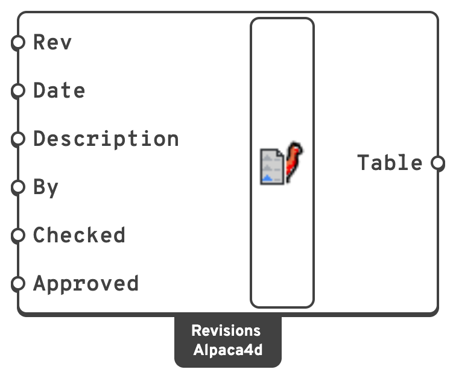

# Report Revisions

The report's revisions: a row for each issue, with its letter, its date, what changed, and who
wrote, checked and approved it. A calculation sent out for checking keeps this record on its first
page.

## 🔧 Grasshopper component

`Report Revisions (Alpaca4d)` — **Alpaca4d ▸ 13_Report**

<figure><figcaption></figcaption></figure>

Each input is a list, an item for each issue, oldest first. A shorter list leaves its last cells
empty.

### Inputs

| Name | Nick | Type | Default | Description |
| --- | --- | --- | --- | --- |
| Revision | `Rev` | Text (list) | — | Each issue's letter or number: A, B, C, or P01, C01. |
| Date | `Date` | Text (list) | *(empty)* | When each was issued. |
| Description | `Description` | Text (list) | *(empty)* | What each issue is, or what changed in it: First issue, For checking, Beams resized. |
| By | `By` | Text (list) | *(empty)* | Who wrote each. |
| Checked | `Checked` | Text (list) | *(empty)* | Who checked each. |
| Approved | `Approved` | Text (list) | *(empty)* | Who approved each. Left empty everywhere, the column is left out, as By and Checked are. |

### Outputs

| Name | Nick | Type | Description |
| --- | --- | --- | --- |
| Table | `Table` | Generic | The table of revisions, for the **Content** of the [Report](report.md). |

## 📈 When to use it

**Use it when**

- The report goes out for checking or to a client, and each issue has to be told apart.

Put it in **Content** after the title, before the [table of contents](report-text.md). The table is
headed **Revisions**, in bold, and is not numbered among the tables of the calculation. The
**Title page** of the Report's [templates](report.md#templates) puts one on the canvas with the
first issue filled in: type your initials over the panels.

In a template written in JSON, the same table is
`{ "table": { "caption": "Revisions", "numbered": false, "header": ["Revision", "Date", "Description"], "rows": [["A", "2026-11-16", "First issue"]] } }`.
