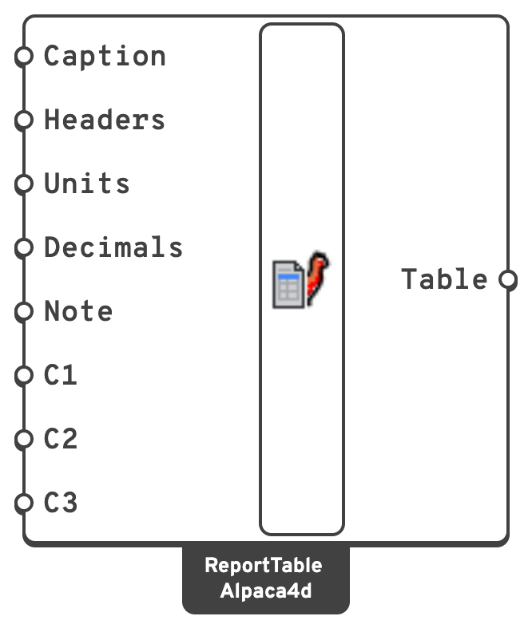

# Report Table

A table of your own for the report: a caption, a header and a unit per column, and the values.

## 🔧 Grasshopper component

`Report Table (Alpaca4d)` — **Alpaca4d ▸ 13_Report**

<figure><figcaption></figcaption></figure>

Each column is an input of its own: zoom in on the component and click the **+** to add one, the
**−** to take one away. It starts with three.

### Inputs

| Name | Nick | Type | Default | Description |
| --- | --- | --- | --- | --- |
| Caption | `Caption` | Text | *(none)* | Written above the table, after its number. |
| Headers | `Headers` | Text (list) | *the columns' names* | A header per column. Left empty, the column inputs' names: rename them to name the columns. |
| Units | `Units` | Text (list) | *(none)* | A unit per column, written after its header in brackets: `Hz` for `f [Hz]`. Empty for none. |
| Decimals | `Decimals` | Integer | `2` | How many decimals a number is written with; `-1` for as it is. |
| Note | `Note` | Text | *(none)* | A line of small print under the table. |
| Column 1, 2, ... | `C1`, `C2`, ... | Generic (list) | — | A column's values, top to bottom: numbers or text. |

### Outputs

| Name | Nick | Type | Description |
| --- | --- | --- | --- |
| Table | `Table` | Generic | The table, for the **Content** of the [Report](report.md). |

## 📈 When to use it

**Use it when**

- The report needs a table Alpaca4d does not make: the loads, the design criteria, a check of your
  own, a list of drawings.

For the tables of a model and of its results, use [Report Result Table](report-result-table.md).

A column of numbers is lined up on the right, a column of text on the left. A shorter column leaves
its last cells empty. A table too long for the page carries its header onto the next.
