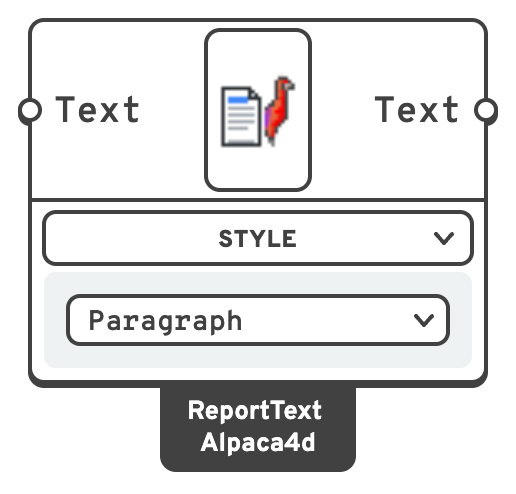

# Report Text

Text for the report: the title, a heading, a paragraph or a note. Headings are numbered by the report
as they come: 1, 1.1, 1.1.1.

## 🔧 Grasshopper component

`Report Text (Alpaca4d)` — **Alpaca4d ▸ 13_Report**

<figure><figcaption></figcaption></figure>

The **Style** menu sets how the text is set:

| Style | What it makes |
| --- | --- |
| `Title` | The first text set large, the second under it as the subtitle, and the date. The first is the report's title too: `{title}` in the [title block](report-title-block.md), and the header of the pages. |
| `Heading` | A chapter heading, with a blue rule under it: numbered 1, 2, 3. |
| `Subheading` | A section heading in the chapter: 1.1, 1.2. |
| `Sub-subheading` | A part of the section: 1.2.1, 1.2.2. |
| `Paragraph` | Running text: each text a paragraph of its own. |
| `Note` | Small grey type. |

### Inputs

| Name | Nick | Type | Default | Description |
| --- | --- | --- | --- | --- |
| Text | `Text` | Text (list) | — | The text: a paragraph each, or for a **Title** the title and then the subtitle. |

### Outputs

| Name | Nick | Type | Description |
| --- | --- | --- | --- |
| Text | `Text` | Generic | The text, for the **Content** of the [Report](report.md). |

## 📈 When to use it

**Use it when**

- The report needs words between its tables and pictures: what the structure is, what an analysis
  found.

## 💡 Numbered headings

Type a heading's text alone — `Static analysis`, not `2 Static analysis` — and the report numbers it,
counting the headings in the order they come in **Content**: a heading starts the next number, a
subheading the next under it, a sub-subheading the next under that.

| Text | Style | Written |
| --- | --- | --- |
| The model | Heading | **1** The model |
| Members | Subheading | **1.1** Members |
| Loads | Subheading | **1.2** Loads |
| Static analysis | Heading | **2** Static analysis |
| Forces | Subheading | **2.1** Forces |
| In the members | Sub-subheading | **2.1.1** In the members |
| At the supports | Sub-subheading | **2.1.2** At the supports |

Set **Numbered** to False on [Report Page](report-page.md) for headings as they are typed. In a
template, `"numbered": false` on one heading leaves it out of the count, for an appendix or a summary.

## 💡 Numbers in the text

A text may hold placeholders, filled in when the report is written: `{model.mass:N0}` for the mass
in kg, `{static.maxDisplacement:F1}` for the largest displacement in mm, `{vibration.frequency[1]:F2}`
for the first frequency, `{buckling.factor[1]:F2}` for the first buckling factor. The
[Report](report.md#placeholders) page lists them all.
