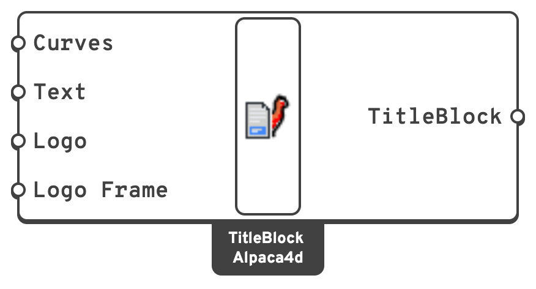

# Report Title Block

The title block of the report: your office's frame — its lines, its texts and its logo — drawn on
every page.

## 🔧 Grasshopper component

`Report Title Block (Alpaca4d)` — **Alpaca4d ▸ 13_Report**

<figure><figcaption></figcaption></figure>

### Inputs

| Name | Nick | Type | Default | Description |
| --- | --- | --- | --- | --- |
| Curves | `Curves` | Curve (list) | *(none)* | The title block's lines: the border, the rules, the boxes. |
| Text | `Text` | Generic (list) | *(none)* | The title block's texts: Rhino text objects or text dots, referenced or made in Grasshopper. Each keeps its place, its height and its justification. A text may hold `{page}`, `{pages}`, `{title}` and `{date}`. |
| Logo | `Logo` | Text | *(none)* | A picture file, a PNG or a JPEG: your office's logo. |
| Logo Frame | `Logo Frame` | Curve | *(none)* | The rectangle the logo fills, as it is on the page. |

### Outputs

| Name | Nick | Type | Description |
| --- | --- | --- | --- |
| TitleBlock | `TitleBlock` | Generic | The title block, for the **TitleBlock** input of [Report Page](report-page.md). |

## 📈 When to use it

**Use it when**

- Your reports go out with your office's frame: a logo, the project, the page number.

## 💡 Keeping a title block

Draw the title block once, as it is on the page: at 1:1, with the page's bottom left corner at the
world origin — 210 by 297 mm for A4 portrait. Keep it in a Rhino file, or in a Grasshopper
definition, and load it as it is:

- **From a Rhino file**: open or import it, and reference its curves into **Curves** and its texts
  into **Text** — a **Geometry** parameter takes Rhino 8's text objects.
- **From a Grasshopper definition**: make the curves and the texts there — a script can make Rhino
  text objects — and wire them in.

A Rhino file in metres works as well as one in millimetres: the title block is read in the file's
own units. Each text keeps its place, its height and its justification, left, centre or right, top,
middle or bottom; a text turned at an angle is written level.

Keep it in the margins of [Report Page](report-page.md): the content does not move out of its way.

`Page {page} of {pages}` numbers the pages. `{title}` is the report's title — the
[Report Text](report-text.md) set as **Title** — and `{date}` today's.
