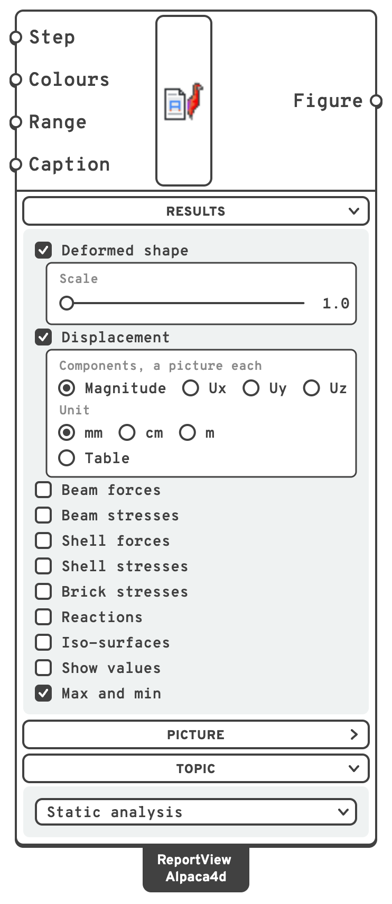
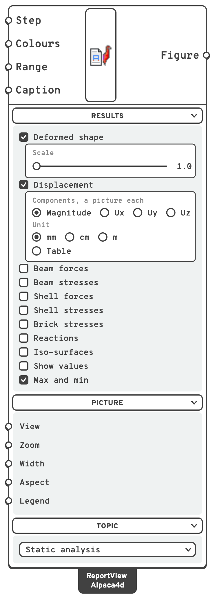
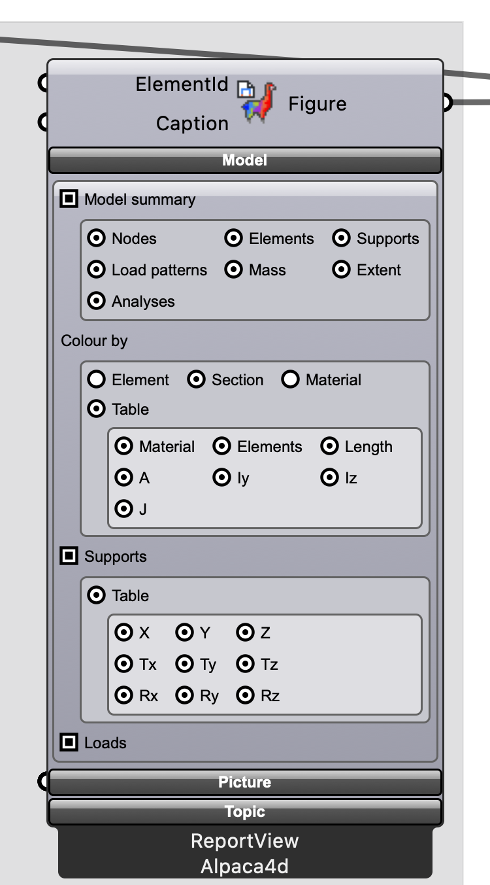
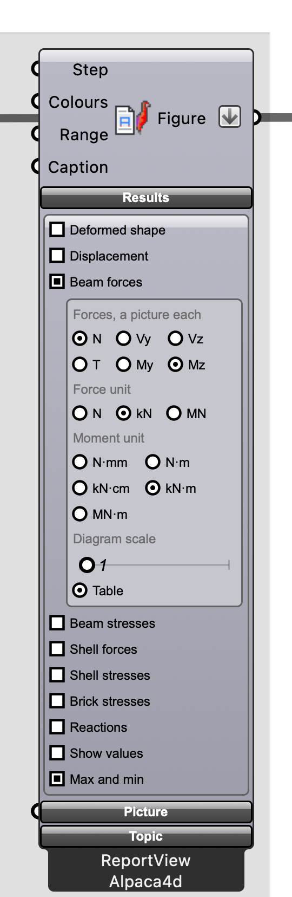
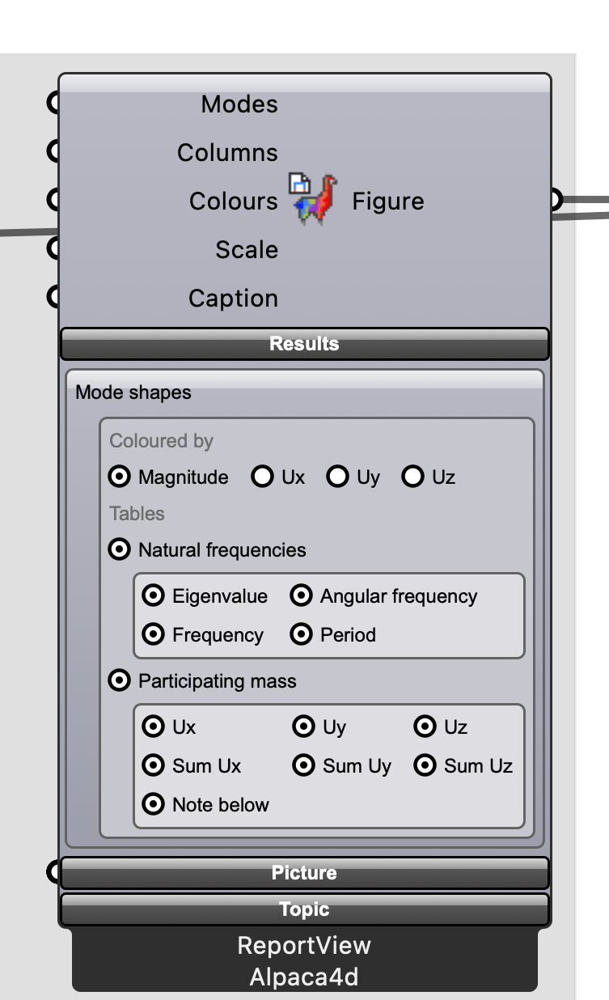
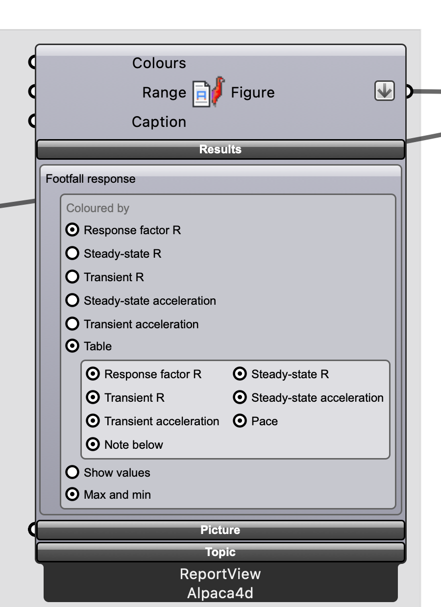

# Report View

A picture for the report, by topic: the model, a static analysis, the natural vibration modes, the
buckling modes, a pushover, or footfall.

## 🔧 Grasshopper component

`Report View (Alpaca4d)` — **Alpaca4d ▸ 13_Report**

<figure><figcaption></figcaption></figure>

<figure><figcaption>
With every menu open
</figcaption></figure>

Report View holds no model. It says what to draw, and the [Report](report.md) draws it of its own
model of that topic, from its **AlpacaModel** input: the model as built, the one
[Run Analysis](../analysis/run-analysis.md), [Natural Vibration](../analysis/natural-vibration.md),
[Linear Buckling](../analysis/linear-buckling.md), [Pushover Analysis](../analysis/pushover.md) or
[Footfall Analysis](../analysis/footfall.md) hands on. Pick the topic from the **Topic** drop-down at the bottom: each asks for what it needs.

Every topic has a **Caption** and a **Picture** menu, below its own inputs, and a menu of what its
picture draws — **Results**, or **Model** for the model. In it, each thing drawn has a square checkbox
at the left, and what goes with it — its component, its unit, its table — is in a frame under it, so
that it reads as that thing's. Each choice is a grid of round buttons, one of them ticked, all in sight:
there is no drop-down. A table ticked is written after the picture and says what the picture draws.

### Inputs — Model

| Name | Nick | Type | Default | Description |
| --- | --- | --- | --- | --- |
| ElementId | `ElementId` | Text (list) | *all* | Only these elements; the rest greyed. |
| Caption | `Caption` | Text | *(none)* | Written under the picture. |

<figure><figcaption>
The Model menu, every table ticked
</figcaption></figure>

What is drawn is picked from the **Model** menu, and in a frame under each, what goes with it:

- **Model summary**, a table of the model: nodes, elements, supports, load patterns, mass, extent and
  the analyses.
- **Colour by**: in its frame, `Element`, `Section` (to start with) or `Material`, and **Table**: the
  beam sections when coloured by section, the beam materials when by material.
- **Supports**, drawn to start with; in its frame, **Table**: each support, where it is and what it
  holds.
- **Loads**, drawn to start with.

### Inputs — Static analysis

| Name | Nick | Type | Default | Description |
| --- | --- | --- | --- | --- |
| Step | `Step` | Integer | *the last* | The recorded step to draw, from 0: left empty, the last, with the loads all on. |
| Colours | `Colours` | Colour (list) | *Model View's* | The gradient, low to high: the [Colors](../visualisation/colors.md) component's, for one. |
| Range | `Range` | Domain | *what is drawn* | The values the gradient spans, in the unit drawn. |
| Caption | `Caption` | Text | *the result and the component* | Written under each picture: `{result}`, `{component}` and `{unit}` take what it draws. Left empty, `{result}: {component} [{unit}]`, as `Beam forces: Mz [kN·m]`. |

What is drawn is picked from the **Results** menu: a checkbox per result, as
[Model View](../visualisation/model-view.md) has — Displacement, Beam forces, Beam stresses, Shell
forces, Shell stresses, Brick stresses, Reactions — and under each one ticked, in a frame, what goes
with it:

- **Components, a picture each** — for beam forces **Forces**, N, Vy, Vz, T, My and Mz — as many as
  you tick;
- **Unit**, for each kind of quantity drawn: a force unit and a moment unit for N beside My;
- what the result alone has: the **Diagram scale** of beam forces, the **Layer through the thickness**
  of shell stresses, the axes brick stresses are **Read in**, how reactions are **Drawn as** and their
  **Arrow scale**;
- **Table**.

**One picture for each component ticked**, in the menu's order: N and Mz of the beam forces and the
reaction force are three pictures, and **Figure** hands out three figures. Several results can be
ticked, and every picture has what the rest of the menu sets: the **Deformed shape**, with its scale
in a frame under it, **Iso-surfaces**, **Show values** and **Max and min** — ticked to start with: the
largest and the smallest value written where they are, with a dot, as `max 26.59` and `min -28.67`, beside
the legend — each shown only while it has a use; and the
**Picture** menu and the colours. Displacement is ticked to start with, its magnitude, on the deformed
shape.

<figure><figcaption>
Beam forces N and Mz: two pictures, each with its table and its largest and smallest written on it
</figcaption></figure>

The round **Table** checkbox at the bottom of a result's frame writes, after each of its pictures, the
table of what that picture draws. It follows the picture — the same component, in the same unit, at
the same step, through the same layer and in the same axes:

- **Reactions:** a row for each support and a column for each component drawn — Fx, Fy and Fz for the
  force, Mx, My and Mz for the moment, or the one component picked — with the sum of the forces.
- **Any other result:** a row for the component drawn, with its largest and its smallest value and
  the node or element each is at.

### Inputs — Natural vibration

| Name | Nick | Type | Default | Description |
| --- | --- | --- | --- | --- |
| Modes | `Modes` | Text | `6` | Which modes to draw, a picture each: a number for that many from the first, or `all`, a range such as `2-5`, or `1,3,5`. |
| Columns | `Columns` | Integer | `2` | How many pictures side by side. |
| Colours | `Colours` | Colour (list) | *Model View's* | The gradient each mode is coloured with, by how far it moves. |
| Scale | `Scale` | Number | `1` | How far the mode is drawn: at 1, its largest movement stands off the model as far as Model View draws a mode. |
| Caption | `Caption` | Text | *the mode, f and T* | Written under each picture: left empty, `Mode {mode}: f = {frequency:F2} Hz, T = {period:F3} s`. |

<figure><figcaption>
The Results menu of natural vibration, both tables ticked
</figcaption></figure>

The **Results** menu: **Mode shapes**, and in a frame under them what they are **Coloured by** —
`Magnitude` to start with, `Ux`, `Uy` or `Uz` — and their **Tables**: **Natural frequencies** and
**Participating mass**, of the modes drawn, written after all the pictures.

### Inputs — Stability

| Name | Nick | Type | Default | Description |
| --- | --- | --- | --- | --- |
| Modes | `Modes` | Text | `4` | Which buckling modes to draw, a picture each, as for natural vibration. |
| Columns | `Columns` | Integer | `2` | How many pictures side by side. |
| Colours | `Colours` | Colour (list) | *Model View's* | The gradient each mode is coloured with, by how far it moves. |
| Scale | `Scale` | Number | `1` | How far the mode is drawn. |
| Caption | `Caption` | Text | *the mode and αcr* | Written under each picture: left empty, `Buckling mode {mode}: αcr = {factor:F2}`. |

The **Results** menu: **Buckled shapes**, and in a frame under them what they are coloured by and
their **Table**, **Buckling factors**, of the modes drawn.

### Inputs — Pushover

| Name | Nick | Type | Default | Description |
| --- | --- | --- | --- | --- |
| Pictures | `Pictures` | Integer | `1` | How many pictures through the push, spread over it, the last at its end. |
| Columns | `Columns` | Integer | `2` | How many pictures side by side. |
| Colours | `Colours` | Colour (list) | *Model View's* | The gradient, low to high. |
| Caption | `Caption` | Text | *the result, the component and the step* | Written under each picture: `{result}`, `{component}`, `{unit}`, `{step}` and `{steps}` take what it draws. Left empty, `{result}: {component} [{unit}], step {step} of {steps}`; with no result ticked, `Step {step} of {steps}`. |

The **Results** menu is the Static analysis one, with **Plastic hinges** as well: ticked to start
with, coloured by how far each hinge has yielded, and their size in a frame under it. Each component
ticked has its own pictures through the push.

### Inputs — Footfall

| Name | Nick | Type | Default | Description |
| --- | --- | --- | --- | --- |
| Colours | `Colours` | Colour (list) | *Model View's* | The gradient, from no response to the most. |
| Range | `Range` | Domain | *0 to the largest* | The values the gradient spans, of what the model is coloured by. For R, 0 to a limit of SCI P354 Table 5.3 — 8 for a general office, 32 for a stair in light use — so that its top colour is the limit; for an acceleration, in mm/s², 5 times that. |
| Caption | `Caption` | Text | *the largest* | Written under the picture: left empty, the largest of what the model is coloured by, and its node. |

The model is coloured at each node [Footfall Analysis](../analysis/footfall.md) read, drawn at rest; a
node it did not read takes the low end of the gradient. Give the Report the **AlpacaModel** that
Footfall Analysis hands on: it keeps all that the analysis found at each node.

The **Results** menu: **Footfall response**, and in a frame under it

- what the model is **Coloured by**: the **Response factor R** (to start with), the larger of the steady
  state and the transient, or either alone — **Steady-state R**, **Transient R** — or the weighted rms
  acceleration of either, in mm/s²: R = 1 is 5 mm/s²;
- its **Table**: the nodes that respond most, worst first by what the model is coloured by, that column
  first, then R, its steady-state and transient parts, their accelerations and the pace that gives R;
- **Show values**, to write what it is coloured by on the model;
- **Max and min**, ticked to start with: the largest and the smallest written where they are, with a dot.

A stair, and a floor above the cut-off, have no transient response: Footfall Analysis did not check it.

<figure><figcaption>
The Results menu of footfall
</figcaption></figure>

### The Picture menu

| Name | Nick | Type | Default | Description |
| --- | --- | --- | --- | --- |
| View | `View` | Text | `Iso south-east` | Where the picture is taken from: `Iso south-east`, `Iso south-west`, `Iso north-east`, `Iso north-west`, `Top`, `Front`, `Back`, `Left`, `Right`, `Bottom`; `Current Rhino view`, the active view's camera when the component last solved; or `Named:` and a view saved in the Rhino file. Wire a **Value List** to pick one. |
| Zoom | `Zoom` | Number | `1` | Closer than the model fits the picture, above 1, or further, below. |
| Width | `Width` | Number | `1` | How much of the page's width the picture takes, 0.2 to 1. |
| Aspect | `Aspect` | Number | `0.62` | The picture's height over its width, before it is cut down to what is drawn. |
| Legend | `Legend` | Boolean | `True` | The colour scale under the picture: off to start with for the modes. |

### Outputs

| Name | Nick | Type | Description |
| --- | --- | --- | --- |
| Figure | `Figure` | Generic (list) | The pictures, for the **Content** of the [Report](report.md): what to draw, as JSON, with the tables ticked after them. A static analysis or a pushover hands out one for each component ticked under its results; the other topics, one. |

### The tables' columns

Under a table ticked, its columns in a frame of their own, a round checkbox each, all ticked, three to
a row and lined up — two when a name is long — the component widening to make room; untick one to
leave it out, as in [Report Result Table](report-result-table.md)'s **Columns** menu. **Note below**
is the line of small print under the table, not a column. A result of a static analysis or a pushover
has none to pick: its table follows the components drawn; footfall's keeps the column of what the model
is coloured by, ticked or not.

The tables are made of the same model as the picture, and come after it. For the modes, they come
after all the pictures, not between them; so do a pushover's, of its last picture. For a table with
no picture, use [Report Result Table](report-result-table.md).

## 💡 How it gets into the report

**Figure** is what to draw, written as a figure of a template, in JSON: put a panel on it to read it.
A result's table is asked for in the figure itself, `"table": true` beside the result; the tables of
the modes, the model and footfall make it a `group` of the figure and the tables, footfall's with
`"by"`: what the model is coloured by, which it is sorted by.
The [Report](report.md) draws it with [Model View](../visualisation/model-view.md), without one on the
canvas, of its model of the topic, when it writes the report. The same Report View draws the same
picture of another model given to the Report, or of this one after a change.

With several models of a topic among the Report's — two static analyses, say — the first is drawn.
