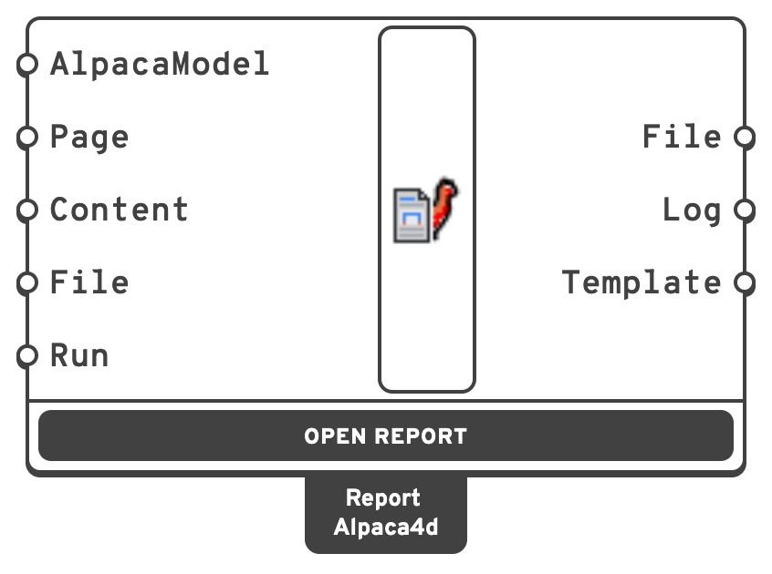

# Report

Writes a PDF report: its page from [Report Page](report-page.md), and what goes in it, in order —
the parts [Report Text](report-text.md), [Report Table](report-table.md),
[Report Result Table](report-result-table.md), [Report View](report-view.md) and
[Report Page Break](report-page-break.md) hand out, or a template written in JSON. The pictures are
drawn by [Model View](../visualisation/model-view.md) without a Model View on the canvas.

## 🔧 Grasshopper component

`Report (Alpaca4d)` — **Alpaca4d ▸ 13_Report**

<figure><figcaption></figcaption></figure>

### Inputs

| Name | Nick | Type | Default | Description |
| --- | --- | --- | --- | --- |
| AlpacaModel | `AlpacaModel` | Generic (list) | *(empty)* | The models the report is of: from [Assemble](../assemble.md), [Run Analysis](../analysis/run-analysis.md), [Natural Vibration](../analysis/natural-vibration.md), [Linear Buckling](../analysis/linear-buckling.md), [Pushover Analysis](../analysis/pushover.md) and [Footfall Analysis](../analysis/footfall.md). [Report View](report-view.md) and [Report Result Table](report-result-table.md) hold none: each is drawn or made of the model here of its topic — the model as built, the static analysis, the natural vibration, the stability, the pushover, the footfall. A template written in JSON names them so too — `model`, `static`, `vibration`, `buckling`, `pushover`, `footfall` — or by their place here, from 0. |
| Page | `Page` | Generic | *A4* | The paper, the margins and the title block, from [Report Page](report-page.md). Left empty, A4 with a plain header and footer. |
| Content | `Content` | Generic (list) | *(empty)* | What goes in the report, in order: the outputs of the report components — wire them through a **Merge** to keep their order — or a template in JSON, or the path of a `.json` file, from the Grasshopper file's folder unless it is a full one. A panel's lines are joined into one text. Flattened. Left empty, a report of each model given to **AlpacaModel**. |
| File | `File` | Text | *(beside the .gh)* | Where to write the PDF. Left empty, beside the Grasshopper file, named after it: `<file> report.pdf`. A folder, in it. The pictures go in a folder beside the PDF. |
| Run | `Run` | Boolean | `False` | True writes the report. Wire a **Toggle**, which writes it again whenever the models change, or a **Button**. Then click **Open report** to read it. |

### Outputs

| Name | Nick | Type | Description |
| --- | --- | --- | --- |
| File | `File` | Text | The PDF written. **Open report** opens it. |
| Log | `Log` | Text (list) | What could not be made, and why. It is marked in the report too, where it would have gone. |
| Template | `Template` | Text | The report as a template in JSON: to read what goes in it, or to copy and change. |

### Open report

The bar under the component, drawn as a menu's header is: click it to open the PDF in the program your
computer opens PDFs with. It is faded until there is a report to open — the one just written, or one
written before where **File** points — and the pointer resting on it shows where the PDF is.

## 📈 When to use it

**Use it when**

- You hand in calculations and want the tables and pictures of every analysis in one document.
- You change the model and want the report to follow, without taking the pictures again.
- You write the same kind of report for many models: write the template once.

It is free on models up to 50 elements, like [Model View](../visualisation/model-view.md).

## 🧩 A report from components

1. [Report Page](report-page.md): the paper and the margins, and a [Report Title Block](report-title-block.md)
   drawn on every page.
2. The content, a part after another: a [Report Text](report-text.md) for the title and for each
   heading and paragraph, a [Report Result Table](report-result-table.md) for each table Alpaca4d makes,
   a [Report Table](report-table.md) for each table of your own, a [Report View](report-view.md) for each
   picture, a [Report Page Break](report-page-break.md) where a chapter starts on a new page.
3. The models into **AlpacaModel**: the one from Assemble and the ones the analyses hand on.
4. A **Merge** with an input per part, in order, into **Content**; Report Page into **Page**; a
   **Toggle** into **Run**.
5. Set the Toggle to True to write the report, then click **Open report** to read it.

Each part hands out what a template would hold for it, in JSON: put a panel on one to read it. None
holds a model, so the same parts write the report of other models. The **Template** output of the Report holds them all, a template to keep or to change.

## 💡 How the pictures are drawn

For each figure, the component makes a Model View in memory, sets its menus as the figure says,
gives it the model and draws it in the active Rhino view. While it does, it moves that view's
camera, hides its grid and axes, switches off Grasshopper's own previews and leaves Rhino's objects
out of the picture. It puts all of them back when it is done. Each picture is cut down to what was
drawn, so the structure fills its figure.

The report is written once the Grasshopper solution is over, and the component then solves again
to hand out what it wrote. The PDF is written with Rhino's own PDF writer, on Windows and on a Mac.

## 📝 The template

```json
{
  "title": "Two-storey steel frame",
  "subtitle": "Static, natural vibration and linear buckling analysis",
  "project": "Office extension",
  "author": "A. Engineer",
  "content": [
    { "heading": "Natural vibration" },
    { "text": "The first mode sways at {vibration.frequency[1]:F2} Hz." },
    { "table": "vibration.modes" },
    { "repeat": "mode", "of": "vibration", "modes": "1-6", "columns": 2, "content": [
        { "figure": { "result": "Displacement", "view": "iso", "legend": false,
                      "caption": "Mode {mode}: f = {vibration.frequency[mode]:F2} Hz" } }
    ] }
  ]
}
```

This writes the table of natural frequencies, and under it the first six mode shapes, two to a row.

### At the top

| Key | Default | What it is |
| --- | --- | --- |
| `title`, `subtitle` | `Analysis report` | On the first page, and the title in the header of the others. |
| `project`, `author`, `date` | today for the date | Under the title. The date also goes in the footer. |
| `cover` | `true` | Whether the first page opens with the title, the subtitle and the details. A report from components puts them where its `{ "title": ... }` entry is instead. |
| `page` | `A4` | `A4`, `A3`, `A2`, `A1`, `A0`, `Letter` or `Legal`. |
| `width`, `height` | — | A paper of your own, in mm, in place of `page`. |
| `orientation` | `portrait` | `portrait` or `landscape`. |
| `margins` | `{ "top": 24, "bottom": 22, "left": 20, "right": 20 }` | In mm. The content stays inside them; the title block, or the plain header and footer, goes in them. |
| `titleBlock` | — | Drawn on every page in place of the plain header and footer: `frame`, the page's `[width, height]` as drawn, and `items` placed on it from its bottom left corner — `{ "line": [[x, y], ...] }`, `{ "fill": [[x, y], ...] }`, `{ "text": "...", "at": [x, y], "size": 3.5, "align": "right" }`, `{ "image": "logo.png", "at": [x, y], "size": [w, h] }`. What [Report Title Block](report-title-block.md) hands out. |
| `numbered` | `true` | Whether the headings are numbered as they come — 1, 1.1, 1.1.1 — before their text. What **Numbered** on [Report Page](report-page.md) sets. |
| `content` | — | What goes in the report, in order: a list of the entries below. |

### Entries

| Entry | What it makes |
| --- | --- |
| `{ "title": "...", "subtitle": "..." }` | The title and subtitle set large, with the project, the author and the date under them. |
| `{ "heading": "..." }` | A chapter heading. `{ "subheading": "..." }` for a section in it, `{ "subsubheading": "..." }` for a part of that, or `"level": 2` or `3`. Numbered as they come — 1, 1.1, 1.1.1 — unless it says `"numbered": false`. |
| `{ "text": "..." }` | A paragraph. A list of texts makes a paragraph of each. Placeholders are filled in. |
| `{ "note": "..." }` | A note in small grey type. |
| `{ "table": { "caption": "...", "header": [...], "units": [...], "rows": [[...], ...] } }` | A table of your own: a unit is written after its header in brackets, and a column of numbers is lined up on the right unless `"align"` says otherwise. |
| `{ "table": "vibration.modes" }` | A table from the list below. `"caption"` and `"note"` replace its own; `"modes"` picks the modes of a table of modes; `"of"` picks the model; `"columns"` lists what it shows, out of what [Report Result Table](report-result-table.md)'s **Columns** menu offers — everything when it is left out; `"by"` sorts `footfall.response` by one of the quantities `quantity` names below, that column first. |
| `{ "figure": { ... } }` | A picture of a model, drawn by Model View with the settings below. |
| `{ "figures": [ { ... }, { ... } ], "columns": 2 }` | Pictures side by side. |
| `{ "image": "sketch.png", "caption": "..." }` | A picture file, its path from the Grasshopper file's folder or a full one. `"width"` as a figure's. |
| `{ "repeat": "step", "of": "pushover", "steps": { "spread": 4 }, "columns": 2, "content": [ ... ] }` | Its content once for each of the steps `steps` picks of a static or pushover model: `last`, a list of steps from 0, or `{ "spread": n }` for n steps spread over the analysis, the last at its end. `{step}` is the step it is on. |
| `{ "repeat": "mode", "of": "vibration", "modes": "all", "columns": 2, "content": [ ... ] }` | Its content once for each mode of the model `of` names, `{mode}` the mode it is on. `modes` is `all`, a range `1-4`, a list `1,3,5` or `[1, 3, 5]`, or a number n for the first n. With `columns`, the pictures it makes go that many to a row. |
| `{ "group": [ ... ] }` | The entries in it, in their order: what [Report View](report-view.md) hands on for a picture with its tables. |
| `{ "pagebreak": true }` | What follows starts on a new page. |

### Figure settings

A figure takes [Model View](../visualisation/model-view.md)'s settings by the names below. Those left
out are as a new Model View has them.

| Setting | What it is |
| --- | --- |
| `model` | Which model: `model` (as it was built), `static`, `vibration`, `buckling`, `pushover`, `footfall`, or its place in the list from 0. Inside a repeat, the repeat's model. |
| `footfall` | `true` draws the footfall model coloured by its response factors. |
| `quantity` | What a footfall model is coloured by: `Response factor R` (to start with), `Steady-state R`, `Transient R`, `Steady-state acceleration` or `Transient acceleration`, the accelerations in mm/s² rms. |
| `mode` | The mode to draw, from 1. Inside a repeat over modes, the mode it is on. |
| `step` | The recorded step to draw, from 0. A static model is drawn at its last step otherwise. |
| `result` | `Displacement`, `Beam forces`, `Beam stresses`, `Shell forces`, `Shell stresses`, `Brick stresses` or `Reactions`, as Model View's **Results** menu names them. Left out, the model alone. |
| `results` | Several results drawn at once, as Report View's **Results** menu writes them: a list, each with its own `result`, `component` or `forces`, `unit`, `units` and `table`. |
| `component` | The component of the result, by its name in Model View's menu (`Magnitude`, `Uz`, `VonMises`, ...) or its place from 0. |
| `forces` | Beam forces only: the diagrams to draw, any of `N`, `Vy`, `Vz`, `T`, `My`, `Mz`. |
| `unit` | The unit to draw the result in, as Model View's **Unit** menu writes it: `mm`, `MPa`, `kN`. |
| `units` | The unit of each quantity, when a result draws more than one: `{ "Force": "kN", "Moment": "kN·m" }`. |
| `table` | `true` writes the table of what is drawn of the result after the picture: a row per support for the reactions, the largest and smallest value of each component for the rest. In `results`, on each result that wants one. |
| `deformed`, `scale` | The deformed shape, and its scale. A mode or a displacement is drawn deformed unless `deformed` is `false`. |
| `colourBy` | With no result: `Element`, `Section` or `Material`. |
| `extruded`, `edges`, `releases` | As in Model View's **Elements** menu, all on to start with. |
| `supports`, `loads`, `loadValues`, `values`, `isoSurfaces`, `hinges` | Off to start with. |
| `extremes` | Off to start with; on in what Report View hands out. `true` writes the largest and the smallest value of each result where they are, with a dot: `max 26.59`, `min -28.67`. |
| `nodeIds`, `elementIds`, `sectionNames`, `localAxes` | Off to start with. |
| `textSize`, `loadScale`, `supportScale`, `diagramScale`, `arrowScale`, `axesSize`, `releaseSize`, `hingeSize` | Model View's sliders. |
| `layer`, `axes`, `reactionStyle` | Model View's menus for shell stresses, brick stresses and reactions. |
| `elements` | Only these elements, the rest greyed: what Model View's **ElementId** takes. |
| `colours`, `range` | The gradient, as `#RRGGBB` colours from the low end to the high, and the `[min, max]` it spans. |
| `loadPattern` | Only this load pattern's loads. |
| `view` | Where from: `iso` (south-east), `southwest`, `northeast`, `northwest`, `top`, `bottom`, `front`, `back`, `left`, `right`, or a view saved in Rhino as `named:Name`. |
| `eye`, `projection`, `zoom` | A direction to look from, `[x, y, z]`; `perspective` or `parallel` (top, front and the other flat views are parallel); a zoom factor. |
| `camera` | A camera given whole — `location`, `target`, `up`, `lens`, `parallel` — as [Report View](report-view.md) takes it from the Rhino view. |
| `legend` | The colour scale under the picture: on to start with. |
| `caption` | Written under the picture. Placeholders are filled in. |
| `width` | How much of the width the picture takes, 0 to 1. |
| `aspect`, `pixels`, `trim` | The shape of the capture (height over width, `0.62`), its width in pixels (`2000`), and whether it is cut down to what was drawn (`true`). |

A setting the component does not know of is left out, and said so in **Log**: a spelling mistake
does not go unnoticed.

### Tables

| Table | Holds |
| --- | --- |
| `model.summary` | Nodes, elements by type, supports, load patterns, mass, extent and the analyses given. |
| `model.sections` | Each beam section: material, how many elements, their length, A, Iy, Iz and J. |
| `model.materials` | Each beam material: E, G, Poisson's ratio and density. |
| `model.supports` | Each support: where it is, and which of Tx, Ty, Tz, Rx, Ry, Rz it holds. |
| `static.displacements` | The largest and smallest displacement along X, Y and Z, and the largest overall, with their nodes. |
| `static.reactions` | The reactions at each support, and their sum, in the global axes. |
| `vibration.modes` | Each mode's eigenvalue, angular frequency, frequency and period. |
| `vibration.massRatios` | Each mode's participating mass along X, Y and Z, as a percentage, and the running total. |
| `buckling.factors` | Each buckling mode's load factor. |
| `footfall.response` | The nodes that respond most to footfall, worst first: their response factor R, its steady-state and transient parts, their accelerations and the pace that gives R. |

The static tables read the last step the analysis recorded.

### Placeholders

Text, captions and the title take placeholders: `{name}`, `{name[index]}`, and either with a
format after a colon, `{vibration.frequency[1]:F2}`. The index is a number, or a repeat's variable
such as `mode`. The format is a .NET one: `F2` for two decimals, `N0` for a whole number with
thousands separated.

| Placeholder | Stands for |
| --- | --- |
| `{title}`, `{subtitle}`, `{project}`, `{author}`, `{date}` | The template's own. |
| `{mode}` | Inside a repeat, the mode it is on. |
| `{frequency}`, `{period}`, `{omega}`, `{eigenvalue}`, `{factor}` | Inside a repeat, that mode's f [Hz], T [s], ω, ω², or its buckling load factor. |
| `{step}`, `{steps}` | Inside a repeat over steps, the step it is on, from 0, and how many the analysis recorded. |
| `{page}`, `{pages}` | In a title block, the page's number and how many there are. |
| `{model.nodes}`, `{model.elements}`, `{model.beams}`, `{model.shells}`, `{model.solids}` | How many the model has. |
| `{model.supports}`, `{model.loadPatterns}` | How many the model has. |
| `{model.mass}` | The model's mass, in kg. |
| `{static.maxDisplacement}`, `{static.maxNode}` | The largest displacement of the static model, in mm, and its node. |
| `{vibration.modes}` | How many modes Natural Vibration found. |
| `{vibration.frequency[i]}`, `{vibration.period[i]}`, `{vibration.omega[i]}`, `{vibration.eigenvalue[i]}` | Mode i's f [Hz], T [s], ω [rad/s] and ω² [rad²/s²]. |
| `{buckling.modes}`, `{buckling.factor[i]}` | How many buckling modes, and mode i's load factor. |
| `{footfall.maxFactor}`, `{footfall.maxNode}` | The largest footfall response factor, and its node. |
| `{footfall.maxSteadyFactor}`, `{footfall.maxTransientFactor}`, `{footfall.maxSteadyAcceleration}`, `{footfall.maxTransientAcceleration}` | The largest of each part of the footfall response, the accelerations in mm/s²; with `Node` after it, its node: `{footfall.maxSteadyFactorNode}`. |

A placeholder with no value is left as it is, and said so in **Log**.

## ⚠️ When something cannot be made

A table or a figure that cannot be made — no model of its kind among the inputs, a mode the model
does not have, a result the recorder did not keep — is written into the report as a line in
brackets where it would have gone, and listed in **Log**. The rest of the report is written. A
template that is not JSON at all writes nothing, and the component says where the mistake is: the
line and the position.
